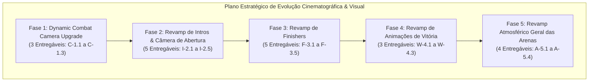

# 🗺️ Master Roadmap & Próximas Fases: Samurai Edge Demake

> **Status Atual:** **ROSTER COMPLETO (24 GUERREIROS & 24 ARENAS CONCLUÍDOS)**  
> **Prioridade Estratégica Ativa:** **REFINAMENTO CINEMATOGRÁFICO DE COMBATE (CÂMERA, INTROS, FINISHERS & VITÓRIAS) + REVAMP DAS ARENAS**  
> A expansão de conteúdo base (Ciclos 1 a 6) foi finalizada com sucesso. O foco atual é elevar o impacto visual, a intimidade marcial e a apresentação cinematográfica do jogo, dividida em **entregáveis testáveis e iterativos**.

---

## 📊 Visão Geral das Fases Ativas



---

## 🎯 1. Detalhamento dos Entregáveis Testáveis

### 🎥 Fase 1: Dynamic Combat Camera Upgrade [CONCLUÍDA ✅]
Foco: Trazer o jogador para a intimidade brutal do combate marcial (*Bushido Duel Framing*), tornando o combate próximo muito mais imersivo e dramático sem perder visão tática.

#### 📦 Entregável C-1.1: Tighter Duel Base Zoom (`1.75x`) & Curva Não-Linear de Distância [CONCLUÍDO ✅]
- **Objetivo de Valor:** Elevar a proximidade do confronto corpo a corpo, preenchendo a tela com os modelos e armas dos lutadores.
- **Especificações Técnicas:**
  - Modificar `src/isometric/camera.py`:
    - `ZOOM_CLOSE` ajustado de `1.50x` para `1.75x` (desktop) e de `1.60x` para `1.90x` (mobile).
    - `ZOOM_FAR` calibrado para `0.95x` (garantindo visão de projéteis em longa distância).
    - Curva de interpolação não-linear: distâncias entre lutadores `<= 2.8 tiles` mantêm zoom máximo; recuos abrem suavemente via função sigmóide amortecida.
- **Procedimento de Teste & Validação:**
  - Criar `tests/test_combat_camera_zoom.py` validando os níveis de zoom em distâncias de 1.5, 3.0, 6.0 e 10.0 tiles.

#### 📦 Entregável C-1.2: Margens de Segurança Vertical (*Overhead Clamping*) & Anti-Corte de HUD [CONCLUÍDO ✅]
- **Objetivo de Valor:** Evitar que golpes aéreos, saltos ou chapéus volumosos fiquem encobertos pelas barras de vida do HUD ou cortados no topo da tela.
- **Especificações Técnicas:**
  - Implementar em `src/isometric/camera.py`:
    - Compensação dinâmica de `screen_y` baseada na coordenada vertical máxima dos lutadores `max(p1.wz, p2.wz)`.
    - Garantir margem de resguardo (*safe-area margin*) de pelo menos 60px abaixo das barras de vida.
- **Procedimento de Teste & Validação:**
  - Testar Kenshi (*Ryuu Tsui Sen* a 2.6m de altura) e Daiki (*Salto com Vara*) verificando que a cabeça permanece 100% visível abaixo do HUD.

#### 📦 Entregável C-1.3: Enquadramento Direcional Reativo de Projéteis Rápidos [CONCLUÍDO ✅]
- **Objetivo de Valor:** Ajustar sutilmente a câmera para antecipar trajetórias balísticas em disparos de projéteis em alta velocidade.
- **Especificações Técnicas:**
  - Em `camera.update_combat_framing()`, detectar tiros ativos de mosquete (Teppo/Julie) e flechas velozes (Kyudo/Hamaya), expandindo o ponto focal e o campo de visão na direção balística durante o voo com decaimento exponencial suave.
- **Procedimento de Teste & Validação:**
  - Simular disparo de Teppo em arena aberta e verificar expansão suave do quadro sem solavancos bruscos. Validado em `tests/test_combat_camera_zoom.py`.

---

### 🎬 Fase 2: Revamp de Intros de Personagens & Câmera de Abertura
Foco: Criar uma experiência de abertura de duelo cinematográfica e solene para cada round, com destaque individual e animações 3D autênticas para todos os 24 guerreiros.

#### 📦 Entregável I-2.1: Sistema Core de Câmera 'Sequential Dual Spotlight'
- **Objetivo de Valor:** Estruturar a máquina de estados cinematográfica da introdução com foco sequencial P1 ➔ P2 ➔ Abertura Geral.
- **Especificações Técnicas:**
  - Reformular `src/ui/match_intro.py` e `src/ui/round_intro.py`:
    - Fase 1 (1.4s): Câmera em close-up orbital no Jogador 1 executando sua animação de intro.
    - Fase 2 (0.4s): Transição rápida (*whip glide*) focando no Jogador 2.
    - Fase 3 (1.4s): Jogador 2 executa sua postura de resposta/desafio.
    - Fase 4 (0.6s): Câmera recua em snap para o enquadramento de combate enquanto o anúncio *"IPPON SHOUBU"* surge na tela.
    - Suporte a skip imediato via `Start` / `Espaço`, transicionando sem delays para `STATE_IDLE`.
- **Procedimento de Teste & Validação:**
  - Criar `tests/test_match_intro_cinematics.py` verificando tempos, transição de fases e interrupção por skip.

#### 📦 Entregável I-2.2: Roteiros 3D de Intro — Onda 1: Veteranos Lâmina & Pólvora (6 Guerreiros)
- **Objetivo de Valor:** Implementar as animações exclusivas de introdução dos primeiros 6 veteranos.
- **Especificações Técnicas:**
  - Em `src/entities/pose_scripts.py`:
    - **Kenshi:** Puxada parcial da katana com o polegar, reflexo do aço no olho e clique no tsuba.
    - **Musashi:** Cruzamento em X das duas espadas, faíscas metálicas e postura aberta Hyoho Niten Ichi-ryu.
    - **Hanzo:** Surgimento silencioso ajoelhado sob folhagens, desembainhar reverso da ninjato.
    - **Joe & Doberman:** Yamato late em posição de ataque enquanto Joe afia a lâmina tática de costas.
    - **Saitou:** Ajuste da faixa do haori do Shinsengumi e estocada horizontal de mira do Gatotsu.
    - **Teppo:** Sopro na mecha acesa do arcabuz e engatilhamento rústico com fumaça residual.
- **Procedimento de Teste & Validação:**
  - Validar execução fluida das poses sem quebra de vértices no `Studio Inspector` (tecla `F3`).

#### 📦 Entregável I-2.3: Roteiros 3D de Intro — Onda 2: Veteranos Ocidentais & Kunoichi (6 Guerreiros)
- **Objetivo de Valor:** Implementar animações exclusivas dos 6 veteranos restantes.
- **Especificações Técnicas:**
  - Em `src/entities/pose_scripts.py`:
    - **Murasaki:** Giro da foice curta com tilintar de corrente de ferro e olhar por trás da máscara.
    - **Kasumi:** Salto acrobático aterissando com leques abertos e dispersão de folhas secas.
    - **Okuni:** Dança teatral Kumadori com abertura estalada dos leques de aço Tessen.
    - **Tomoe:** Puxada da corda do arco Yumi mirando para o céu com vento nas vestes.
    - **Anne:** Brinde com cantil de pólvora, desembaínhe do alfanje naval com corte no ar.
    - **Julie:** Vênia aristocrática com florete e floreio rodopiado da capa azul-real.
- **Procedimento de Teste & Validação:**
  - Validar no Studio Inspector a física das fitas de tecido e acessórios 3D.

#### 📦 Entregável I-2.4: Roteiros 3D de Intro — Onda 3: Expansões Ciclos 1 a 3 (6 Guerreiros)
- **Objetivo de Valor:** Animações dedicadas para Ren, Chiyo, Benkei, O-Rin, Goro e Ichi.
- **Especificações Técnicas:**
  - **Ren:** Oração marcial Shaolin palmas postas com estalo de energia Kiai.
  - **Chiyo:** Finta acrobática desembainhando as duas kodachi em pegada invertida.
  - **Benkei:** Cravada da Naginata pesada no piso com impacto de pedra e postura imóvel.
  - **O-Rin:** Acorde de abertura tenso no shamisen com o plectro bachi em riste.
  - **Goro:** Levantamento da enxada Kuwa no ombro, cusparada e ajuste da toalha Tenugui.
  - **Ichi:** Escuta atenta da lâmina bengala Shikomizue com destrave sutil do gatilho.
- **Procedimento de Teste & Validação:**
  - Validar transições perfeitas para o ciclo de respiração *Idle*.

#### 📦 Entregável I-2.5: Roteiros 3D de Intro — Onda 4: Expansões Ciclos 4 a 6 (6 Guerreiros)
- **Objetivo de Valor:** Animações para Valerius, Seimei, Daiki, Aoi, Raiden e Hendrika.
- **Especificações Técnicas:**
  - **Valerius:** Mão espalmada invocando chamas espectrais azuis no chão.
  - **Seimei:** Lançamento de talismã de papel Ofuda que se desintegra em partículas douradas.
  - **Daiki:** Rotação helicoidal do bastão Bō entre as mãos terminando em postura de guarda.
  - **Aoi:** Saudação tradicional com a lança de ponta de osso e ajuste do capuz de pele.
  - **Raiden:** Ritual Shinto completo: palmas estrondosas de sumô e agachamento Sonkyo.
  - **Hendrika:** Verificação contra a luz de frasco de ácido e ajuste do estilete cirúrgico.
- **Procedimento de Teste & Validação:**
  - Execução de partida completa com cada um dos novos combatentes verificando sincronia áudio-visual.

---

### 💀 Fase 3: Revamp de Finishers (Fatalities Singulares & Câmera Cinematográfica)
Foco: Entregar finalizações viscerais e sob medida para cada um dos 24 personagens, combinando nova câmera de alta fidelidade, desmembramento 3D anatômico e arte caligráfica.

#### 📦 Entregável F-3.1: Motor Aprimorado de Câmera de Finisher & Dinâmica de Sangue Arterial
- **Objetivo de Valor:** Aperfeiçoar o sistema de câmera de 3 fases e os efeitos de impacto fatal em `src/effects/cinematic_director.py`.
- **Especificações Técnicas:**
  - *Fase 1 (Impact Freeze - 0.25s)*: Hitstop profundo, batimento cardíaco surdo, partículas e sangue congelados no ar.
  - *Fase 2 (Dynamic Swoop & Orbit - 0.50s)*: Mergulho tridimensional em ângulo de perfil 3/4 com letterbox CinemaScope 2.39:1, evitando que um combatente oclua o outro.
  - *Fase 3 (Visceral Slow-Mo - 0.85s)*: Câmera lenta dramática (0.75x), física de desmembramento 3D real com corpos que caem e rolam no solo, repuxo arterial volumétrico e carimbo Kanji Sumi-E em relevo dourado.
- **Procedimento de Teste & Validação:**
  - Criar `tests/test_finisher_cinematics.py` verificando a integridade das 3 fases e coordenadas da câmera.

#### 📦 Entregável F-3.2: Fatalities Sob Medida — Grupo 1: Espadachins & Katanas (6 Guerreiros)
- **Objetivo de Valor:** Finalizações singulares para Kenshi, Musashi, Saitou, Ichi, Chiyo e Tomoe.
- **Especificações Técnicas:**
  - **Kenshi:** *Kenshin Split* — bisseção vertical com contraluz Kurosawa e tombo simétrico do tronco.
  - **Musashi:** *Dual Impale X-Spread* — corte cruzado em tesoura dupla separando tronco e membros.
  - **Saitou:** *Gatotsu Zero-Shiki Pierce* — estocada que transpassa o tórax e arremessa o rival contra a parede.
  - **Ichi:** *Blind Horizon Slice* — corte horizontal cego no pescoço seguido de corte tardio de sangue.
  - **Chiyo:** *Twin Kodachi Throat Scissor* — decepamento duplo em X com rodopio acrobático.
  - **Tomoe:** *Hamaya Holy Pierce* — transpassar do crânio com flecha cerimonial cravada na terra.
- **Procedimento de Teste & Validação:**
  - Validar desmembramento 3D e ângulos de corte em `tests/test_game.py`.

#### 📦 Entregável F-3.3: Fatalities Sob Medida — Grupo 2: Armas Pesadas & Lanças (5 Guerreiros)
- **Objetivo de Valor:** Finalizações para Benkei, Daiki, Goro, Raiden e Aoi.
- **Especificações Técnicas:**
  - **Benkei:** *Naginata Hoist Slam* — içamento da vítima pela lança e arremesso esmagador no solo.
  - **Daiki:** *Meteor Staff Crush* — salto monumental com impacto descendente do bastão no crânio.
  - **Goro:** *Kuwa Torso Cleave* — golpe de enxada cravado no peito arrancando o oponente do chão.
  - **Raiden:** *Tsuppari Sonic Decapitation* — bofetada sônica de palma aberta decepando a cabeça do rival.
  - **Aoi:** *Spear Heart Slide* — corrida rasteira transpassando o coração com a lança Ezo.
- **Procedimento de Teste & Validação:**
  - Validar tremores de tela (*camera shake*) e impactos pesados de solo.

#### 📦 Entregável F-3.4: Fatalities Sob Medida — Grupo 3: Ninjas & Pólvora (6 Guerreiros)
- **Objetivo de Valor:** Finalizações para Hanzo, Murasaki, Kasumi, Teppo, Julie e Anne.
- **Especificações Técnicas:**
  - **Hanzo:** *Shadow Decapitation* — teletransporte nas costas com degola precisa da ninjato.
  - **Murasaki:** *Kusarigama Choke & Sever* — estrangulamento por corrente seguido de puxada com a foice.
  - **Kasumi:** *Blasting Powder Execution* — mina cravada nas costas com detonação estilhaçante.
  - **Teppo:** *Headshot Explode* — tiro à queima-roupa de arcabuz estilhaçando a cabeça em fragmentos voxel.
  - **Julie:** *Point-Blank Pocket Flintlock* — estocada de florete no peito seguida de tiro fatal de pistola.
  - **Anne:** *Cutlass Cleave & Powder Barrel* — corte transversal de alfanje empurrando o rival em barril explosivo.
- **Procedimento de Teste & Validação:**
  - Testar fragmentação de cabeça e sangue volumétrico.

#### 📦 Entregável F-3.5: Fatalities Sob Medida — Grupo 4: Esotéricos & Marciais (7 Guerreiros)
- **Objetivo de Valor:** Finalizações para Okuni, Ren, Valerius, Seimei, Hendrika, Joe e Boss Oni.
- **Especificações Técnicas:**
  - **Okuni:** *Tessen Iron Fan Decap* — corte degolador duplo com bordas afiadas dos leques de aço.
  - **Ren:** *Hyakuretsu Body Explosion* — sequência supersônica de 100 socos implodindo o tronco do oponente.
  - **Valerius:** *Soul Reap Grave Drag* — foice espectral arrancando a alma e afundando o corpo na terra.
  - **Seimei:** *Talisman Seal Implosion* — prisão por 5 talismãs astrais com explosão elementar em pilares.
  - **Hendrika:** *Vitriol Acid Dissolution* — quebra de frasco cáustico dissolvendo o oponente em fumaça ácida.
  - **Joe:** *Wolf Throat Rip* — comando onde Yamato estraçalha a jugular enquanto Joe guarda a adaga.
- **Procedimento de Teste & Validação:**
  - Validar shaders de dissolução e partículas mágicas/químicas.

---

### 🏆 Fase 4: Revamp de Animações de Vitória
Foco: Dar a cada vitória uma conclusão digna dos clássicos do cinema samurai, com poses tridimensionais exclusivas, rituais autênticos de bainha e citações de vitória.

#### 📦 Entregável W-4.1: Framework da Câmera de Triunfo & Apresentação Hanko
- **Objetivo de Valor:** Estruturar a câmera de celebração e o layout de consagração do vencedor.
- **Especificações Técnicas:**
  - Em `src/ui/outcome_sequence.py`:
    - Órbita lenta em ângulo baixo (30° a 45°) circulando a silhueta do vencedor com iluminação dramática.
    - Banner caligráfico de vitória com carimbo Hanko pessoal do combatente e citação marcial traduzida (PT-BR / EN).
    - Diferenciação clara entre *Round Win* (celebração concisa de 2.0s) e *Match Win* (celebração completa de 3.5s com tema musical de vitória).
- **Procedimento de Teste & Validação:**
  - Criar `tests/test_victory_sequence.py` verificando tempos, letterbox e persistência do placar.

#### 📦 Entregável W-4.2: Roteiros 3D de Vitória — Veteranos (12 Guerreiros)
- **Objetivo de Valor:** Implementar as celebrações e rituais dos 12 lutadores clássicos.
- **Especificações Técnicas:**
  - **Kenshi:** Ritual cerimonial *Chiburi* (sacudida de sangue da lâmina) seguido do estalo sonoro do *Noto* (embainhar).
  - **Musashi:** Saudação cruzando as duas espadas e olhar contemplativo para o horizonte.
  - **Saitou:** Limpeza da lâmina na manga do haori do Shinsengumi e postura impassível.
  - **Hanzo:** Formação do selo de mãos ninja Kuji-kiri e desvanecimento em fumaça cinzenta.
  - **Joe:** Acariciar a cabeça do Doberman Yamato enquanto recolhe a adaga militar.
  - **Teppo:** Pouso do mosquete no chão, acendimento de cachimbo kiseru e baforada de fumaça.
  - **Murasaki:** Enrolamento lento da corrente da Kusarigama no antebraço e olhar gélido.
  - **Kasumi:** Ajoelhamento em respeito, recolhendo os leques sob o manto shinobi.
  - **Okuni:** Pose clássica de teatro Kabuki com leque aberto sobre o rosto (*Mie Pose*).
  - **Tomoe:** Dedilhar sereno na corda do arco Yumi e reverência solene à montanha.
  - **Anne:** Brinde com caneca de rum e fincada do alfanje no convés de madeira.
  - **Julie:** Vênia aristocrática impecável, retirando o chapéu de plumas e chicotada de capa.
- **Procedimento de Teste & Validação:**
  - Testar cada vitória no Modo Versus e validar rendering em 360°.

#### 📦 Entregável W-4.3: Roteiros 3D de Vitória — Expansões (12 Guerreiros)
- **Objetivo de Valor:** Implementar as celebrações dos 12 lutadores de expansão.
- **Especificações Técnicas:**
  - **Ren:** Vênia budista profunda com mãos postas (*Gassho*) e recitação de mantra.
  - **Chiyo:** Giro vertiginoso das duas kodachi embainhando ambas simultaneamente nas costas.
  - **Benkei:** Postura imóvel do gigante com a Naginata cravada, encarando o céu sem piscar.
  - **O-Rin:** Solo virtuoso de comemoração no shamisen com dispersão de pétalas de cerejeira.
  - **Goro:** Apoio da enxada sobre os ombros, sorriso confiante e enxugar de suor na toalha.
  - **Ichi:** Travamento da lâmina bengala Shikomizue com clique audível e caminhada serena.
  - **Valerius:** Riso fúnebre contido enquanto espíritos espectrais rodopiam ao seu redor.
  - **Seimei:** Abertura graciosa de leque com borboleta mística de luz pousando em seu dedo.
  - **Daiki:** Equilíbrio vertical do bastão Bō na palma da mão com sorriso tranquilo.
  - **Aoi:** Elevação da lança Ezo em direção à aurora boreal com grito de caçadora.
  - **Raiden:** Batida cerimonial das coxas e abertura monumental dos braços (*Shiko* vitorioso).
  - **Hendrika:** Anotação rápida em diário de alquimia e conferência do relógio de bolso com clique.
- **Procedimento de Teste & Validação:**
  - Validar todos os 12 roteiros no Modo Arcade após o round final.

---

### 🏯 Fase 5: Revamp Visual e Atmosférico Geral das Arenas (24 Palcos)
Foco: Elevar os 24 cenários do jogo ao ápice visual da estética voxel HD-2D, com múltiplas camadas de props, superfícies reflexivas, iluminação dinâmica e destruição reativa.

#### 📦 Entregável A-5.1: Santuários & Jardins Zen (6 Arenas)
- **Arenas:** `bamboo` (Kenshi), `mountain_shrine` (Joe), `mist_temple` (Kasumi), `shaolin_temple` (Ren), `higanbana_garden` (Chiyo), `heian_shrine` (Seimei).
- **Recursos:** Água translúcida reflexiva com carpas koi, bambus/árvores estilhaçáveis, tapetes volumétricos de flores vermelhas, incenso dinâmico e lanternas de pedra Toro com sombras longas.
- **Validação:** `tests/test_cycle6_arenas.py` e auditoria de 60 FPS com cache ativo.

#### 📦 Entregável A-5.2: Cenários Urbanos & Históricos (6 Arenas)
- **Arenas:** `kyoto` (Murasaki), `yoshiwara_alley` (O-Rin), `kabuki_stage` (Okuni), `baroque_court` (Julie), `dejima_warehouse` (Hendrika), `sacred_dohyo` (Raiden).
- **Recursos:** Telhados machiya de dois andares com chamas e fagulhas, cortinas noren e shoji rasgáveis, piso de mármore xadrez com reflexos, caixotes mercantis destrutíveis e barro batido sagrado com fardos de palha.
- **Validação:** Testes de física de colisão com props destrutíveis.

#### 📦 Entregável A-5.3: Campos de Batalha & Vilarejos Rurais (6 Arenas)
- **Arenas:** `nagashino_field` (Teppo), `forest_camp` (Musashi), `pine_forest` (Daiki), `ezo_taiga` (Aoi), `rice_paddies` (Goro), `rain_mill` (Ichi).
- **Recursos:** Paliçadas de madeira cravadas, fumaça volumétrica de pólvora, neve fofa com afundamento de pegadas, terraços de água escalonados e roda d'água monumental girando sob chuva torrencial.
- **Validação:** Testes de desaceleração em lama/água rasa e partículas climáticas.

#### 📦 Entregável A-5.4: Locais Extremos & Noturnos (6 Arenas)
- **Arenas:** `shadow_cave` (Hanzo), `iga_rooftops` (Kasumi), `pirate_deck` (Anne), `ganryu_island` (Saitou), `gojo_bridge` (Benkei), `baroque_cemetery` (Valerius).
- **Recursos:** Estalactites/estalagmites de caverna com gotas pingando, telhas de argila estilhaçáveis sob lua cheia, convés naval balançando com ondas gigantes, névoa costeira de maré, parapeitos de ponte com lanças cravadas e criptas góticas com névoa espectral.
- **Validação:** Testes de iluminação de alto contraste e abismos laterais.

---

## 🏛️ 2. Base Concluída & Roster Consolidado (24 Combatentes)

```
┌──────────────────────────────────────────────────────────────────────────────────────────────────┐
│                                     ROSTER COMPLETO (24 GUERREIROS)                              │
├──────────────────────────────────────────────────────────────────────────────────────────────────┤
│ VETERANOS (12):                                                                                  │
│ • Homens:  Kenshi | Musashi | Hanzo | Joe & Doberman | Saitou | Teppo                            │
│ • Mulheres: Murasaki | Kasumi | Okuni | Tomoe | Anne | Julie                                     │
├──────────────────────────────────────────────────────────────────────────────────────────────────┤
│ EXPANSÕES (12 — 6 Ciclos de 1 Homem + 1 Mulher):                                                 │
│ • Ciclo 1: Ren (Monge Shaolin) [M]             & Chiyo (Kunoichi 2 Kodachi) [F]                  │
│ • Ciclo 2: Benkei (Guardião Naginata) [M]       & O-Rin (Menestrel Shamisen) [F]                 │
│ • Ciclo 3: Goro (Fazendeiro da Kuwa) [M]        & Ichi (Lâmina Cega Shikomizue) [F]              │
│ • Ciclo 4: Valerius (Necromante Prussiano) [M]  & Seimei (Onmyoji dos Talismãs) [F]              │
│ • Ciclo 5: Daiki (Peregrino do Bastão) [M]      & Aoi (Caçadora Ainu de Hokkaido) [F]            │
│ • Ciclo 6: Raiden (Rikishi do Sumô) [M]         & Hendrika (Alquimista Holandesa) [F]            │
└──────────────────────────────────────────────────────────────────────────────────────────────────┘
```

### Resumo dos Marcos Concluídos:
- ✅ **Plano Mestre de Modernização (M-1 a M-5):** Performance zero-alloc, auto-FPS governor, primitivas de malha 3D esculpidas, rig articulado com torção de tronco, desmembramento 3D real (`voxel_corpse.py`), hitboxes por cápsula/arco (`hitboxes.py`), e áudio realista em camadas com foley por terreno e arma.
- ✅ **Expansão de Conteúdo (Ciclos 1 a 6):** Modelagem e programação completa dos 12 novos combatentes e 12 novas arenas, respeitando o pipeline de 6 passos.
- ✅ **Resolução Dinâmica & Retina High-DPI (D-1 a D-5):** Suporte nativo a telas Retina em Apple Silicon / iOS, renderização em alta densidade de pixels, Game Mode no macOS/iOS e escalonamento suave de janelas no desktop.
- ✅ **Modo Arcade 24 Guerreiros:** Escada completa de 12 lutas com chaves de dificuldade, IA balanceada, boss fight do Oni ancestral e persistência de placar (`arcade_save.json`).
- ✅ **Balanceamento de Esquiva (Graze Immunity):** Projéteis cinéticos diretos (balas, flechas, kunais, shurikens, ofudas e ondas de vento) atravessam sem causar dano durante esquivas ativas com i-frames, com proteção de sobreposição multi-frame contra acertos fantasmas na recuperação.

---

## 🎨 3. Diretrizes de Renderização Voxel & Modelagem 3D (Referência)

- **Arquitetura 3D Low-Poly Facetada Estilo Anime (Era PS1 / Tekken 2-3):**
  - **Sem Decalques 2D ou Adesivos Planos:** Nunca projetar imagens 2D chapadas na face dos modelos voxel.
  - **Sem Círculos Vetoriais Primitivos:** Proibido o uso de `pygame.draw.circle` em feições faciais.
  - **Geometria 100% 3D Facetada:** Elementos faciais modelados com prismas e quads (nariz saliente chanfrado com sombreamento direcional, lábios facetados em 3 planos com arco do cupido).
  - **Olhos Anime Luminosos:** Esclera marfim pura, íris vertical ampla com centro vibrante e pontos de luz especular duplos (femininos) ou foco marcial estreito com brilho único e sobrancelha baixa resoluta (masculinos).
  - **Naris Femininos Delicados vs Masculinos Estruturados:** Combatentes femininas possuem pontes delgadas (~50% de largura), aletas pequenas e ponta delicada; combatentes masculinos possuem pontes proeminentes com sombras angulares.
  - **Fitas de Cabelo Flutuantes & Ordenação em Profundidade:** Madeixas laterais e franjas ordenadas dinamicamente: mechas do lado oposto à câmera (`is_lock_behind`) desenhadas em `draw_behind` para que o crânio as oclua naturalmente em ângulos de perfil.
  - **Algoritmo do Pintor (Depth Sorting Dinâmico):** Partes do corpo ordenadas pelo vetor de profundidade `depth = rx + ry`. Quando o personagem está de costas para a câmera, braços e armas frontais são desenhados antes do torso/obi para evitar que braços flutuem sobre as costas.
  - **Ordem de Enrolamento (Winding Order) em Caixas Orientadas:** Em `draw_oriented_voxel_box`, os vértices das 6 faces devem apontar rigorosamente para fora `(p1 - p0) x (p2 - p0)` garantindo culling correto em todos os ângulos.
  - **Sincronização Obrigatória com Studio & Model Inspector:** Qualquer atualização visual em personagens deve ser testada e sincronizada no estúdio unificado (`tools/studio_inspector.py`) e manual in-game (`src/ui/game_help.py`).

---

## 🎵 4. Prompts Musicais Suno / Gemini (Histórico dos Ciclos 5 e 6)

- **Floresta dos Pinheiros (`bgm_pine_forest.mp3` — Daiki):**
  - `Traditional Japanese Bakumatsu fighting game stage soundtrack, 122 BPM, D Dorian / Yo-scale, virtuous shakuhachi bamboo flute lead echoing through a misty mountain red pine forest at dawn, driving taiko o-daiko and shime-daiko percussion, rhythmic wooden clappers (hyoshigi) and resonant oak bo-staff strikes, plucked shamisen and biwa accents, cinematic orchestral strings, seamless loopable combat track, no vocals.`
- **Taiga de Ezo (`bgm_ezo_taiga.mp3` — Aoi):**
  - `Northern Hokkaido Ezo wilderness fighting game soundtrack, 128 BPM, A Minor pentatonic with traditional Ainu folk motifs, resonant mukkuri (Ainu bamboo jaw harp) and tonkori (five-stringed zither) rhythms, deep tribal frame drums and taiko, icy wind atmosphere, intense staccato pizzicato strings and brass swells evoking a snowy taiga hunt, seamless loopable combat track, no vocals.`
- **Dohyo Sagrado (`bgm_sacred_dohyo.mp3` — Raiden):**
  - `Ancient Japanese Shinto shrine sumo tournament battle theme, 126 BPM, massive ceremonial O-daiko taiko thunder strikes, hyper-resonant hyoshigi wooden clappers and rhythmic referee kakegoe shouts, booming brass and majestic low strings, solemn Gagaku ryuteki flute and hichiriki harmonies evoking divine sumo ritual and unstoppable physical mass, driving cinematic combat progression, loopable, no vocals.`
- **Armazém de Dejima com Doca Chuvosa (`bgm_dejima_dock.mp3` — Hendrika):**
  - `19th-century Bakumatsu Nagasaki Dejima harbor soundtrack, 124 BPM, stormy rainy atmosphere with driving rain and thunder swells, clash of Dutch Baroque harpsichord and virtuoso classical violin with Japanese koto and shakuhachi, eccentric ticking clockwork rhythms, sinister low cello and bassoon arpeggios evoking clandestine alchemy experiments and slippery nighttime harbor intrigue, loopable combat battle theme, no vocals.`
