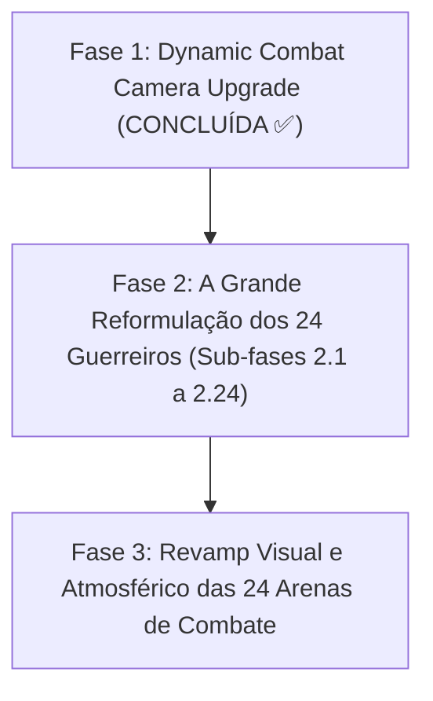

# Master Roadmap & Expansion Design: Samurai Edge Demake (Bakumatsu Edition)

Este documento representa o plano diretor canônico de expansão, balanceamento e refinamento do jogo **Samurai Edge Demake**. Todas as mecânicas, parâmetros de golpes, atributos de combate, finalizações cinematográficas, fidelidade gráfica, materiais realistas, interpolação de animações e palcos são documentados aqui para guiar o desenvolvimento com rigor e rastreabilidade.



---

## 🎯 1. Detalhamento dos Entregáveis Testáveis

### 🎥 Fase 1: Dynamic Combat Camera Upgrade [CONCLUÍDA ✅]
Foco: Trazer o jogador para a intimidade brutal do combate marcial (*Bushido Duel Framing*), tornando o combate próximo muito mais imersivo e dramático sem perder visão tática.

#### 📦 Entregável C-1.1: Tighter Duel Base Zoom (`1.75x`) & Curva Não-Linear de Distância [CONCLUÍDO ✅]
- **Objetivo de Valor:** Elevar a proximidade do confronto corpo a corpo, preenchendo a tela com os modelos e armas dos lutadores.
- **Especificações Técnicas:**
  - Modificar `src/isometric/camera.py`:
    - `ZOOM_CLOSE` ajustado de `1.50x` para `1.75x` (desktop) e de `1.60x` para `1.90x` (mobile).
    - `ZOOM_FAR` calibrado para `0.95x` (garantindo visão de projéteis em longa distância).
    - Curva de interpolação não-linear: distâncias entre lutadores `<= 2.8 tiles` mantêm zoom máximo; recuos abrem suavemente via função sigmóide amortecida.
- **Procedimento de Teste & Validação:**
  - Validado em `tests/test_combat_camera_zoom.py` nos níveis de zoom em distâncias de 1.5, 3.0, 6.0 e 10.0 tiles.

#### 📦 Entregável C-1.2: Margens de Segurança Vertical (*Overhead Clamping*) & Anti-Corte de HUD [CONCLUÍDO ✅]
- **Objetivo de Valor:** Evitar que golpes aéreos, saltos ou chapéus volumosos fiquem encobertos pelas barras de vida do HUD ou cortados no topo da tela.
- **Especificações Técnicas:**
  - Em `src/isometric/camera.py`:
    - Compensação dinâmica de `screen_y` baseada na coordenada vertical máxima dos lutadores `max(p1.wz, p2.wz)`.
    - Margem de resguardo (*safe-area margin*) de pelo menos 95px abaixo do topo da janela (preservando barras de vida).
- **Procedimento de Teste & Validação:**
  - Validado em `tests/test_combat_camera_zoom.py` com salto a 2.6m de altura sem colisão no HUD.

#### 📦 Entregável C-1.3: Enquadramento Direcional Reativo de Projéteis Rápidos [CONCLUÍDO ✅]
- **Objetivo de Valor:** Ajustar sutilmente a câmera para antecipar trajetórias balísticas em disparos de projéteis em alta velocidade.
- **Especificações Técnicas:**
  - Em `camera.update_combat_framing()`, detecção ativa de tiros de mosquete (Teppo/Julie) e flechas velozes (Kyudo/Hamaya), expandindo o ponto focal e o campo de visão na direção balística durante o voo com decaimento exponencial suave.
- **Procedimento de Teste & Validação:**
  - Validado em `tests/test_combat_camera_zoom.py`.

---

### ⚔️ Fase 2: A Grande Reformulação dos 24 Guerreiros (Movesets, Atributos, Finishers, Fidelidade HD & Transições)
Foco: Revisar, rebalancear e enriquecer cada combatente individualmente em 10 entregáveis atômicos por guerreiro: moveset completo, esquiva/defesa, finisher 3D bespoke, animações de intro/vitória, renderização supersampleada anti-aliasing/anti-tearing, texturas faciais em alta resolução, interpolação contínua de quadros (LERP Cross-fade) e biblioteca de materiais realistas.

---

#### 🥋 Sub-fase 2.1: Kenshi (O Espadachim Errante — Hiten Mitsurugi-ryu)
- **Perfil & Atributos Base:** Velocidade de corrida: 3.65 m/s | Esquiva: Shukuchi Dash veloz (0.28s) | Alcance: Médio (Katana 1.65m) | HP: 100 | Postura ágil com centro de gravidade baixo.
- **📦 Entregável 2.1.1: Golpe Primário — *Shukuchi Battoujutsu Slice***
  - *Animação:* Agachamento fulminante, puxada da bainha com clarão prateado e corte horizontal de 160°.
  - *Frames:* Startup 9f (0.15s) | Active 4f (0.06s) | Recovery 16f (0.26s).
  - *Hitbox 3D:* Raio 1.65m, largura 0.40m, altura `wz` 0.50m a 1.25m, arco frontal 160°.
  - *Whiff:* Vulnerabilidade total por 0.26s sem cancelamento de esquiva.
  - *Reação:* Corte diagonal no peito com espasmo e recuo de 0.85m; corte fatal bissecciona o tronco.
  - *SFX:* Clarão de aço sibilante, impacto de corte úmido e kiai vocal seco.
- **📦 Entregável 2.1.2: Golpe Secundário — *Ryuu Tsui Sen (Corte Descendente Aéreo)***
  - *Animação:* Salto vertical de 2.6m com rotação de tronco e queda cravando a katana com as duas mãos.
  - *Frames:* Startup 18f (0.30s salto) | Active 6f (0.10s descida) | Recovery 22f (0.36s impacto no piso).
  - *Hitbox 3D:* Raio 1.40m, vertical `wz` 0.0m a 2.4m, dispersão circular de impacto no solo.
  - *Whiff:* Pouso rígido no solo vulnerável a golpes laterais e projéteis por 0.36s.
  - *Reação:* Oponente é cravado no chão com tremor de câmera; em fatalidade, bisseção vertical craniana.
  - *SFX:* Assobio de ar cortado em altitude, estrondo de pedra rachada e kiai prolongado.
- **📦 Entregável 2.1.3: Mobilidade & Defesa — *Shukuchi Dash & Noto Walk***
  - *Propriedades:* Dash com 12 i-frames e imunidade a graze de projéteis cinéticos; caminhar embainhado recupera foco.
- **📦 Entregável 2.1.4: Finisher Bespoke — *Kenshin Split (龍槌閃)***
  - *Coreografia:* Freeze-frame no ponto de impacto ➔ Mergulho de câmera em 3/4 CinemaScope ➔ Bisseção vertical simétrica com tombo lateral do tronco e repuxo arterial Sumi-E.
- **📦 Entregável 2.1.5: Animação de Intro — *Foco no Polegar e Estalo do Tsuba***
  - *Coreografia:* Câmera em close no punho, polegar destravando a lâmina com faísca e olhar focado por sob a franja.
- **📦 Entregável 2.1.6: Animação de Vitória — *Chiburi & Noto Cerimonial***
  - *Coreografia:* Sacudida angular de sangue da lâmina, giro rápido sobre os dedos e estalo metálico ao embainhar.
- **📦 Entregável 2.1.7: Fidelidade Gráfica — *Supersampling 2x Offscreen & V-Sync Anti-Tearing***
  - *Especificações:* Canvas offscreen 2x renderizando o modelo e lâmina com reamostragem bilinear `smoothscale`, eliminando escadas de pixel e tearing em 60 FPS com double-buffering estrito.
- **📦 Entregável 2.1.8: Texturas Faciais & Olhos Anime HD***
  - *Especificações:* Íris castanho-âmbar em alta densidade com anel límbico nítido, duplo catchlight especular e lashlines resolutas visíveis em todos os ângulos da câmera.
- **📦 Entregável 2.1.9: Interpolação de Animação — *Pose LERP Cross-Fade (3 a 5 Quadros)***
  - *Especificações:* Blend contínuo de 0.08s entre Caminhada ➔ Ataque, Ataque ➔ Esquiva e Esquiva ➔ Idle, eliminando cortes secos de membros.
- **📦 Entregável 2.1.10: Biblioteca de Materiais Realistas — *Seda Chirimen Carmim & Aço Tamahagane***
  - *Especificações:* Mapeamento de textura de seda áspera japonesa Chirimen no quimono, laca negra Urushi na bainha Saya e padrão Hamon ondulado no gume da katana em `assets/textures/`.

---

#### ⚔️ Sub-fase 2.2: Musashi (O Santo da Espada — Hyoho Niten Ichi-ryu)
- **Perfil & Atributos Base:** Velocidade: 3.40 m/s | Esquiva: Passo cruzado giratório | Alcance: Curto/Médio com duas espadas (Katana + Wakizashi) | HP: 100 | Poder bruto de quebra de guarda.
- **📦 Entregável 2.2.1: Golpe Primário — *Dual Cross Cleave (二天十字斬)***
  - *Animação:* Tesoura frontal simultânea com lâmina longa descendente da direita e wakizashi ascendente da esquerda.
  - *Frames:* Startup 11f (0.18s) | Active 5f (0.08s) | Recovery 18f (0.30s).
  - *Hitbox 3D:* Raio 1.55m, abertura 180°, altura `wz` 0.40m a 1.40m.
  - *Whiff:* Abertura de guarda frontal de 0.30s.
  - *Reação:* Golpe cruzado em X com empurrão de 1.2m; em fatalidade, decepamento simultâneo de ambos os braços.
  - *SFX:* Choque harmônico duplo de aço, som de cartilagem fendida e kiai gutural de veterano.
- **📦 Entregável 2.2.2: Golpe Secundário — *Cross Shockwave (Onda de Vácuo das Lâminas)***
  - *Animação:* Cruzamento violento das espadas no ar gerando onda cortante de vento que avança 7.5m.
  - *Frames:* Startup 16f (0.26s) | Active balístico (velocidade 14 m/s) | Recovery 20f (0.33s).
  - *Hitbox 3D:* Projétil de vácuo com largura 1.2m, altura `wz` 0.8m, alcance máximo 7.5m.
  - *Whiff:* Parada estacionária durante o disparo.
  - *Reação:* Rompe ataques leves do rival e arremessa para trás.
  - *SFX:* Zunido de vácuo pressurizado e onda de vento cortante.
- **📦 Entregável 2.2.3: Mobilidade & Defesa — *Dual Blade Cross Guard & Rolling Step***
  - *Propriedades:* Deflexão ativa em cruz com micro-zoom; esquiva em rolamento lateral com graze evasion.
- **📦 Entregável 2.2.4: Finisher Bespoke — *Dual Impale X-Spread (二天一流)***
  - *Coreografia:* Estocada dupla que transpassa os ombros do oponente, seguida de abertura em leque rasgando o tronco em três partes.
- **📦 Entregável 2.2.5: Animação de Intro — *Cruzamento em X e Faíscas de Duelo***
  - *Coreografia:* Musashi bate as lâminas em X gerando fagulhas reais e assume a postura aberta de duas espadas.
- **📦 Entregável 2.2.6: Animação de Vitória — *Postura dos Dois Céus***
  - *Coreografia:* Lâmina principal erguida apontando para o céu, wakizashi horizontal protegendo o abdômen e respiração lenta.
- **📦 Entregável 2.2.7: Fidelidade Gráfica — *Supersampling 2x Offscreen & V-Sync Anti-Tearing***
  - *Especificações:* Renderização 2x sem serrilhados nas lâminas duplas e contornos do hakama azul-marinho.
- **📦 Entregável 2.2.8: Texturas Faciais & Olhos Anime HD***
  - *Especificações:* Olhar marcial veterano com cicatriz sutil na sobrancelha, íris escura intensa e barba por fazer modelada em micro-polígonos.
- **📦 Entregável 2.2.9: Interpolação de Animação — *Pose LERP Cross-Fade (3 a 5 Quadros)***
  - *Especificações:* Transição fluida entre guarda alta Hyoho Niten e corridas ou deflexões em X.
- **📦 Entregável 2.2.10: Biblioteca de Materiais Realistas — *Linho Rústico Índigo & Aço Antigo***
  - *Especificações:* Padrão de linho grosso tingido em índigo natural tradicional, empunhaduras de couro de arraia (samegawa) e ito trançado desgastado.

---

#### 🥷 Sub-fase 2.3: Hanzo (O Shinobi das Sombras — Iga Ninjutsu)
- **Perfil & Atributos Base:** Velocidade: 3.80 m/s | Esquiva: Kawarimi de folhas secas | Alcance: Curto (Ninjato reta) / Longo (Kunai) | HP: 90 | Furtividade e punição rápida.
- **📦 Entregável 2.3.1: Golpe Primário — *Ninjato Reverse Slash & Thrust***
  - *Animação:* Golpe veloz com pegada invertida da ninjato reta seguido de perfuração rápida no plexo solar.
  - *Frames:* Startup 7f (0.11s) | Active 3f (0.05s) | Recovery 12f (0.20s).
  - *Hitbox 3D:* Raio 1.30m, largura 0.35m, altura `wz` 0.60m a 1.20m.
  - *Whiff:* Baixa penalidade de recuperação (0.20s), rápida transição para corrida.
  - *Reação:* Tonteira imediata de 0.4s; em fatalidade, perfuração do coração com lâmina saindo nas costas.
  - *SFX:* Sibilo agudo de lâmina curta e baque surdo de perfuração.
- **📦 Entregável 2.3.2: Golpe Secundário — *Kunai Snipe (Disparo Letal de Precisão)***
  - *Animação:* Arremesso reto e invisível de kunai em alta velocidade (24 m/s).
  - *Frames:* Startup 8f (0.13s) | Projétil ativo até 12m | Recovery 14f (0.23s).
  - *Hitbox 3D:* Projétil pontual de alta velocidade; esquivável via dash/roll.
  - *Whiff:* Tempo desarmado até sacar nova kunai.
  - *Reação:* Em acerto no peito/cabeça, dano letal imediato; se defendido, causa leve empurrão.
  - *SFX:* Zunido fino metálico e estalo de impacto em madeira/carne.
- **📦 Entregável 2.3.3: Mobilidade & Defesa — *Kawarimi Substitution Roll***
  - *Propriedades:* Teleporte evasivo em tronco de madeira e folhas de bordo com 14 i-frames.
- **📦 Entregável 2.3.4: Finisher Bespoke — *Forehead Pin (苦無眉間)***
  - *Coreografia:* Salto por cima da vítima com lançamento à queima-roupa de kunai cravando entre os olhos com impacto craniano.
- **📦 Entregável 2.3.5: Animação de Intro — *Surgimento sob Manto de Folhas***
  - *Coreografia:* Redemoinho de folhas no solo revela Hanzo agachado em guarda pronta, desembainhando a ninjato às costas.
- **📦 Entregável 2.3.6: Animação de Vitória — *Selo Kuji-Kiri & Fumaça Negra***
  - *Coreografia:* Gesto com os dedos em selo ninja de concentração e desvanecimento total em fumaça de pólvora escura.
- **📦 Entregável 2.3.7: Fidelidade Gráfica — *Supersampling 2x Offscreen & V-Sync Anti-Tearing***
  - *Especificações:* Eliminação de pixel-staircase nas faixas e fitas flutuantes da máscara ninja durante rotações.
- **📦 Entregável 2.3.8: Texturas Faciais & Olhos Anime HD***
  - *Especificações:* Olhar gélido e penetrante de assassino entre a máscara e o capuz, com brilho metálico frio na íris.
- **📦 Entregável 2.3.9: Interpolação de Animação — *Pose LERP Cross-Fade (3 a 5 Quadros)***
  - *Especificações:* Transição suave entre salto mortal, rolamento Kawarimi e agachamento neutro.
- **📦 Entregável 2.3.10: Biblioteca de Materiais Realistas — *Tecido Negro Shinobi Shozoku & Lâmina Fosca***
  - *Especificações:* Trama de algodão denso anti-reflexo no traje ninja e aço escurecido fosco sem brilho para lâminas furtivas.

---

#### 🐕 Sub-fase 2.4: Joe & Yamato (O Shinobi Tático & O Doberman Cibernético)
- **Perfil & Atributos Base:** Velocidade: 3.50 m/s (Yamato: 5.20 m/s) | Esquiva: Rolamento militar com cobertura | Alcance: Curto (Tanto tático) / Projétil (Yamato) | HP: 100 | Dupla coordenada.
- **📦 Entregável 2.4.1: Golpe Primário — *Combat Tanto Slash & Tactical Kick***
  - *Animação:* Corte tático diagonal com faca de combate militar e chute frontal no joelho do adversário.
  - *Frames:* Startup 8f (0.13s) | Active 4f (0.06s) | Recovery 14f (0.23s).
  - *Hitbox 3D:* Raio 1.25m, altura `wz` 0.40m a 1.10m.
  - *Whiff:* Vulnerabilidade de 0.23s.
  - *Reação:* Desestabilização do oponente no joelho; em fatalidade, degola carotídea tática.
  - *SFX:* Lâmina serrilhada cortando ar, impacto de bota pesada e rosnado do cão.
- **📦 Entregável 2.4.2: Golpe Secundário — *Yamato Pounce & Pin (Ataque Coordenado do Cão)***
  - *Animação:* Apito ultrassônico; Yamato salta em velocidade extrema no torso do rival imobilizando-o no solo.
  - *Frames:* Startup 10f (0.16s) | Corrida do cão ativa por até 8.0m | Recovery do Joe: 8f.
  - *Hitbox 3D:* Projétil vivo de presa com colisão baixa `wz` 0.2m a 0.8m.
  - *Whiff:* Se errar, Yamato derrapa e se recompõe em 0.45s.
  - *Reação:* Rival é derrubado no chão exposto por 1.2s para golpe de finalização.
  - *SFX:* Latido agressivo de ataque, impacto de garras e mordida abafada.
- **📦 Entregável 2.4.3: Mobilidade & Defesa — *Tactical Evasion Roll***
  - *Propriedades:* Rolamento de combate profissional com i-frames completos e graze evasion de balas.
- **📦 Entregável 2.4.4: Finisher Bespoke — *Windmill Shuriken Decap (風車斬首)***
  - *Coreografia:* Yamato imobiliza o peito do rival enquanto Joe lança a gigantesca Fuma Shuriken decapitando a vítima em câmera lenta.
- **📦 Entregável 2.4.5: Animação de Intro — *Afiação da Lâmina Tática & Latido de Yamato***
  - *Coreografia:* Joe de costas passando a pedra na lâmina de titânio; Yamato late vigorosamente ao detectar o perigo e assume a dianteira.
- **📦 Entregável 2.4.6: Animação de Vitória — *Recompensa a Yamato & Guarda Alta***
  - *Coreografia:* Joe ajoelha, afaga a cabeça de Yamato que balança a cauda, e recolhe a adaga no coldre tático com clique audível.
- **📦 Entregável 2.4.7: Fidelidade Gráfica — *Supersampling 2x Offscreen & V-Sync Anti-Tearing***
  - *Especificações:* Antialiasing preciso na pelagem negra e acessórios táticos de Yamato e na mochila de assalto de Joe.
- **📦 Entregável 2.4.8: Texturas Faciais & Olhos Anime HD***
  - *Especificações:* Olhos resolutos de soldado com bandana camuflada e textura vívida dos olhos caninos alertas de Yamato.
- **📦 Entregável 2.4.9: Interpolação de Animação — *Pose LERP Cross-Fade (3 a 5 Quadros)***
  - *Especificações:* Transições perfeitas entre comando de apito, corrida tática e postura de faca pronta.
- **📦 Entregável 2.4.10: Biblioteca de Materiais Realistas — *Cordura Tática, Kevlar & Aço Cirúrgico***
  - *Especificações:* Tecido sintético militar de nylon balístico Cordura, colete de kevlar e titânio acetinado na faca de combate.

---

#### 🐺 Sub-fase 2.5: Saitou (O Capitão do Shinsengumi — Lobos de Mibu)
- **Perfil & Atributos Base:** Velocidade: 3.45 m/s | Esquiva: Deslocamento lateral com o haori | Alcance: Longo linear (Gatotsu) | HP: 105 | Especialista em estocadas de alta penetração.
- **📦 Entregável 2.5.1: Golpe Primário — *Mibu Wolf Katana Slash***
  - *Animação:* Golpe diagonal rápido de cima para baixo executado com a mão esquerda com pegada rígida.
  - *Frames:* Startup 10f (0.16s) | Active 4f (0.06s) | Recovery 15f (0.25s).
  - *Hitbox 3D:* Raio 1.60m, arco 140°, altura `wz` 0.50m a 1.30m.
  - *Whiff:* Tempo de recuperação de 0.25s sem possibilidade de cancel.
  - *Reação:* Corte diagonal profundo; em fatalidade, decepamento do braço da espada do oponente.
  - *SFX:* Som metálico pesado de katana de aço forjado e kiai curto e austero.
- **📦 Entregável 2.5.2: Golpe Secundário — *Gatotsu Zero-Shiki (Estocada Brutal à Queima-Roupa)***
  - *Animação:* Posicionamento horizontal da espada na altura do queixo e investida em disparo perfurante linear (3.5m).
  - *Frames:* Startup 12f (0.20s carga) | Active 6f (0.10s carga) | Recovery 24f (0.40s).
  - *Hitbox 3D:* Cilindro perfurante linear de 3.5m de comprimento por 0.45m de raio.
  - *Whiff:* Estocada profunda em falso deixa o dorso de Saitou exposto por 0.40s.
  - *Reação:* Transpassa armaduras, ignora defesas convencionais e arremessa o oponente 2.5m para trás.
  - *SFX:* Rompimento sônico de ar em linha reta e baque de osso perfurado.
- **📦 Entregável 2.5.3: Mobilidade & Defesa — *Haori Sidestep & Parry***
  - *Propriedades:* Esquiva lateral com farfalhar do haori azul e parry focado com contra-ataque imediato de Gatotsu.
- **📦 Entregável 2.5.4: Finisher Bespoke — *Heart Impale Lunge (牙突心貫)***
  - *Coreografia:* Gatotsu pleno no peito erguendo o corpo do rival no ar, transpassando o tronco antes de arremessá-lo ao solo.
- **📦 Entregável 2.5.5: Animação de Intro — *Ajuste da Faixa do Shinsengumi & Mirada Gatotsu***
  - *Coreografia:* Saitou puxa a faixa branca da testa, ergue a ponta da lâmina na linha dos olhos e fixa o olhar frio no rival.
- **📦 Entregável 2.5.6: Animação de Vitória — *Limpeza com Papel Kaishi & Bainha Fria***
  - *Coreografia:* Retira folha de papel kaishi da manga, limpa o sangue da lâmina em movimento preciso, solta o papel ao vento e embainha.
- **📦 Entregável 2.5.7: Fidelidade Gráfica — *Supersampling 2x Offscreen & V-Sync Anti-Tearing***
  - *Especificações:* Suavização nos dentes de serra brancos da barra do haori do Shinsengumi durante estocadas supersônicas.
- **📦 Entregável 2.5.8: Texturas Faciais & Olhos Anime HD***
  - *Especificações:* Olhar lupino implacável, sem pupilas dilatadas, olhos semicerrados de duelista mortal com precisão anatômica.
- **📦 Entregável 2.5.9: Interpolação de Animação — *Pose LERP Cross-Fade (3 a 5 Quadros)***
  - *Especificações:* Blend de transição instantâneo entre investida do Gatotsu e recolhimento de postura de guarda lateral.
- **📦 Entregável 2.5.10: Biblioteca de Materiais Realistas — *Tecido Asagi-iro & Laca Preta de Saya***
  - *Especificações:* Trama de algodão azul-turquesa clássico Asagi-iro do Shinsengumi, com detalhes de zigue-zague branco nítidos e bainha com laca fosca.

---

#### 💥 Sub-fase 2.6: Teppo (O Soldado Ashigaru — Pólvora Tanegashima)
- **Perfil & Atributos Base:** Velocidade: 3.20 m/s | Esquiva: Mergulho rústico de trincheira | Alcance: Global balístico (Arcabuz) / Curto (Coronhada) | HP: 95 | Gerenciamento de pólvora e munição.
- **📦 Entregável 2.6.1: Golpe Primário — *Tanegashima Matchlock Shot (Tiro de Fuzil Feudal)***
  - *Animação:* Encosto da coronha na bochecha, sopro na mecha e disparo de bala de chumbo supersônica (26 m/s).
  - *Frames:* Startup 14f (0.23s) | Active instantâneo balístico | Recovery 32f (0.53s recarga rústica).
  - *Hitbox 3D:* Projétil supersônico balístico de alta velocidade com 1-Hit Kill; esquivável via dash no timing exato.
  - *Whiff:* Tempo longo de recarga (0.53s) onde Teppo é extremamente vulnerável.
  - *Reação:* Se acertar em cheio, estilhaçamento fatal do crânio/tronco com nuvem de fumaça cinzenta.
  - *SFX:* Detonação ensurdecedora de pólvora negra, chiado de mecha e zumbido supersônico do chumbo.
- **📦 Entregável 2.6.2: Golpe Secundário — *Rifle Butt Smash (Coronhada Pesada de Madeira)***
  - *Animação:* Giro de emergência desferindo golpe com a grossa coronha de carvalho no queixo do adversário.
  - *Frames:* Startup 8f (0.13s) | Active 4f (0.06s) | Recovery 16f (0.26s).
  - *Hitbox 3D:* Raio 1.10m, arco 120°, altura `wz` 0.80m a 1.50m.
  - *Whiff:* Desequilíbrio com o peso da arma por 0.26s.
  - *Reação:* Atordoa o oponente (Hitstun longo de 0.65s) e o arremessa 1.8m para trás, criando espaço para recarregar.
  - *SFX:* Golpe maciço de madeira maciça em mandíbula com estalo de osso.
- **📦 Entregável 2.6.3: Mobilidade & Defesa — *Trench Ashigaru Dive***
  - *Propriedades:* Mergulho corporal de trincheira no solo com i-frames completos contra cortes e graze de flechas.
- **📦 Entregável 2.6.4: Finisher Bespoke — *Headshot Explode (一発必中)***
  - *Coreografia:* Disparo à queima-roupa com o cano pressionado no queixo do rival, estilhaçando o crânio em fragmentos tridimensionais sob nuvem de fogo.
- **📦 Entregável 2.6.5: Animação de Intro — *Sopro na Mecha Acesa & Fumaça Residual***
  - *Coreografia:* Teppo sopra a mecha de corda embebida em salitre, que brilha em brasa viva, ajusta o cão do fuzil e aponta para frente.
- **📦 Entregável 2.6.6: Animação de Vitória — *Cachimbo Kiseru & Fuzil no Ombro***
  - *Coreografia:* Apoia o fuzil ainda fumegante no ombro esquerdo, acende um pequeno cachimbo kiseru com a mecha e solta baforada relaxada.
- **📦 Entregável 2.6.7: Fidelidade Gráfica — *Supersampling 2x Offscreen & V-Sync Anti-Tearing***
  - *Especificações:* Antialiasing suave no longo cano octogonal de ferro do arcabuz e no chapéu cônico Jingasa de ferro.
- **📦 Entregável 2.6.8: Texturas Faciais & Olhos Anime HD***
  - *Especificações:* Olho direito focado na alça de mira com pupila contraída e marcas de queimadura de fuligem de pólvora na bochecha.
- **📦 Entregável 2.6.9: Interpolação de Animação — *Pose LERP Cross-Fade (3 a 5 Quadros)***
  - *Especificações:* Suavização nos quadros de recarga com vareta de ferro (ramrod) conectando com corrida de fuga.
- **📦 Entregável 2.6.10: Biblioteca de Materiais Realistas — *Carvalho Envelhecido & Ferro Fundido Rústico***
  - *Especificações:* Madeira de carvalho escuro envernizado na coronha, ferro fundido rústico com pátina no cano e corda de cânhamo na mecha.

---

#### ⛓️ Sub-fase 2.7: Murasaki (A Kunoichi da Foice com Corrente — Kusarigama-jutsu)
- **Perfil & Atributos Base:** Velocidade: 3.75 m/s | Esquiva: Giro acrobático com salto mortal | Alcance: Médio/Longo flexível (Corrente 3.8m) | HP: 90 | Controle de média distância e tração.
- **📦 Entregável 2.7.1: Golpe Primário — *Kusarigama Scythe Cleave***
  - *Animação:* Corte horizontal da foice curta de aço combinado com giro curto da corrente.
  - *Frames:* Startup 9f (0.15s) | Active 4f (0.06s) | Recovery 15f (0.25s).
  - *Hitbox 3D:* Raio 1.50m, arco 150°, altura `wz` 0.50m a 1.20m.
  - *Whiff:* Vulnerabilidade de 0.25s enquanto recolhe a foice.
  - *Reação:* Corte horizontal no abdômen com sangramento contínuo; em fatalidade, evisceração em corte duplo.
  - *SFX:* Sibilo cortante afiado da foice kama e tinir de elos metálicos.
- **📦 Entregável 2.7.2: Golpe Secundário — *Iron Weight Whip & Chain Drag (Arremesso do Peso de Ferro)***
  - *Animação:* Lançamento do peso de ferro no alcance de 3.8m que prende o rival e o puxa violentamente para perto.
  - *Frames:* Startup 14f (0.23s rotação) | Active 8f (0.13s arremesso) | Recovery 20f (0.33s recolhimento).
  - *Hitbox 3D:* Projétil de tração linear de 3.8m de alcance; se acertar, engata tração imediata.
  - *Whiff:* Corrente estendida no chão deixa Murasaki imóvel por 0.33s.
  - *Reação:* Oponente é puxado em desequilíbrio até a distância de corte corpo a corpo da foice.
  - *SFX:* Zumbido giratório helicoidal do peso de ferro e impacto sonoro de impacto contundente.
- **📦 Entregável 2.7.3: Mobilidade & Defesa — *Acrobatic Backflip & Chain Whirl***
  - *Propriedades:* Salto mortal para trás com 13 i-frames e barreira giratória de corrente que reflete projéteis leves.
- **📦 Entregável 2.7.4: Finisher Bespoke — *Kamaitachi Chain Slice (三弦微塵)***
  - *Coreografia:* Enlaça o pescoço da vítima com a corrente de ferro, puxa com força estrangulando o rival e decepa a cabeça com corte ascendente da foice.
- **📦 Entregável 2.7.5: Animação de Intro — *Giro Suave do Peso de Ferro & Olhar Oculto***
  - *Coreografia:* Murasaki gira o peso de ferro em órbita perfeita com apenas um dedo, parando-o de supetão na palma com olhar misterioso.
- **📦 Entregável 2.7.6: Animação de Vitória — *Recolhimento Espiral da Corrente***
  - *Coreografia:* Com um puxão seco, a corrente enrola-se perfeitamente em torno de seu antebraço coberto de laca, com a foice em repouso pronto.
- **📦 Entregável 2.7.7: Fidelidade Gráfica — *Supersampling 2x Offscreen & V-Sync Anti-Tearing***
  - *Especificações:* Antialiasing dinâmico nos elos tridimensionais da corrente e na longa fita roxa do rabo de cavalo.
- **📦 Entregável 2.7.8: Texturas Faciais & Olhos Anime HD***
  - *Especificações:* Olhos ametista profundos e misteriosos com traço gatinho fino e sombreamento suave de cílios femininos.
- **📦 Entregável 2.7.9: Interpolação de Animação — *Pose LERP Cross-Fade (3 a 5 Quadros)***
  - *Especificações:* Interpolação fluida entre o recolhimento em espiral da corrente e passos de esquiva rápida.
- **📦 Entregável 2.7.10: Biblioteca de Materiais Realistas — *Seda Púrpura de Quioto & Ferro Escuro***
  - *Especificações:* Textura de seda roxa escura com padrões florais de ameixeira (*ume*), elos de ferro forjado e aço carbono na foice.

---

#### 💣 Sub-fase 2.8: Kasumi (A Kunoichi dos Leques & Pólvora — Iga)
- **Perfil & Atributos Base:** Velocidade: 3.70 m/s | Esquiva: Desaparecimento em névoa de pólvora | Alcance: Curto (Leques afiados) / Médio parabólico (Bombas Horoku) | HP: 95 | Controle de terreno e armadilhas.
- **📦 Entregável 2.8.1: Golpe Primário — *Steel Fan Slices (Cortes Duplos de Tessen)***
  - *Animação:* Giro gracioso desferindo dois cortes rasgantes em rápida sucessão com as lâminas embutidas nos leques.
  - *Frames:* Startup 8f (0.13s) | Active 4f (0.06s) | Recovery 13f (0.21s).
  - *Hitbox 3D:* Raio 1.35m, arco 160°, altura `wz` 0.60m a 1.25m.
  - *Whiff:* Janela de vulnerabilidade de 0.21s.
  - *Reação:* Dois cortes paralelos no peito; em fatalidade, degola cruzada em tesoura de leques.
  - *SFX:* Abertura ríspida de leque de aço e cortes de navalha.
- **📦 Entregável 2.8.2: Golpe Secundário — *Horoku-biya Bomb Lob (Arremesso de Bomba de Cerâmica)***
  - *Animação:* Lançamento em arco parabólico tridimensional de uma esfera cerâmica recheada de pólvora e estilhaços.
  - *Frames:* Startup 12f (0.20s) | Trajetória balística parabólica em arco 3D | Recovery 18f (0.30s).
  - *Hitbox 3D:* Esfera explosiva de área no impacto com raio de fragmentação de 1.8m e dano em área com estilhaços.
  - *Whiff:* Tempo de arremesso deixa flanco aberto.
  - *Reação:* Explosão arremessa o oponente para o ar com tremor de câmera; imune a suicídio com 50% blast armor próprio.
  - *SFX:* Pavio sibilando no ar e estrondo explosivo de cerâmica estilhaçada.
- **📦 Entregável 2.8.3: Mobilidade & Defesa — *Smoke Concealment Roll***
  - *Propriedades:* Rolamento tático com dispersão de fumaça cinzenta, 14 i-frames e graze total contra flechas e balas.
- **📦 Entregável 2.8.4: Finisher Bespoke — *Blasting Powder Cataclysm (毒霧融骸)***
  - *Coreografia:* Kasumi crava uma bomba no obi do adversário com corte de leque, salta para trás em cambalhota e detona o rival em pedaços sob fogo.
- **📦 Entregável 2.8.5: Animação de Intro — *Aterrisagem Acrobática & Abertura de Leques***
  - *Coreografia:* Salta do topo da tela aterrisando sem ruído agachada, abrindo ambos os leques com estalo sincronizado.
- **📦 Entregável 2.8.6: Animação de Vitória — *Rosto Oculto & Risada Sinistra***
  - *Coreografia:* Fecha um dos leques e posiciona o outro ocultando a metade inferior do rosto, deixando transparecer apenas o olhar vitorioso.
- **📦 Entregável 2.8.7: Fidelidade Gráfica — *Supersampling 2x Offscreen & V-Sync Anti-Tearing***
  - *Especificações:* Amostragem 2x sem serrilhado nas dobras de papel e varetas de aço dos leques tessen.
- **📦 Entregável 2.8.8: Texturas Faciais & Olhos Anime HD***
  - *Especificações:* Olhos cor de avelã luminosos com delineado anime alado e esclera marfim pura em alta resolução.
- **📦 Entregável 2.8.9: Interpolação de Animação — *Pose LERP Cross-Fade (3 a 5 Quadros)***
  - *Especificações:* Conexão fluida entre o arremesso parabólico da bomba cerâmica e a recuperação em esquiva de fumaça.
- **📦 Entregável 2.8.10: Biblioteca de Materiais Realistas — *Cerâmica Vitrificada & Papel Washi Reforçado***
  - *Especificações:* Textura de terracota esmaltada com verniz brilhante nas bombas Horoku e papel japonês Washi impermeável nos leques.

---

#### 🎭 Sub-fase 2.9: Okuni (A Donzela Dançarina do Kabuki — Tessen-jutsu)
- **Perfil & Atributos Base:** Velocidade: 3.60 m/s | Esquiva: Finta teatral Kawarimi | Alcance: Curto/Médio com veneno | HP: 95 | Estilo rítmico, veneno Dokukiri e atordoamento.
- **📦 Entregável 2.9.1: Golpe Primário — *Kabuki Iron Fan Flurry***
  - *Animação:* Dança circular teatral desferindo três estocadas com as pontas de aço dos leques Tessen.
  - *Frames:* Startup 9f (0.15s) | Active 5f (0.08s) | Recovery 16f (0.26s).
  - *Hitbox 3D:* Raio 1.45m, abertura rítmica, altura `wz` 0.50m a 1.30m.
  - *Whiff:* Ritmo quebrado deixa Okuni aberta por 0.26s.
  - *Reação:* Três cortes estocados; em fatalidade, decapitação cirúrgica com a ponta de aço do leque.
  - *SFX:* Estalos de madeira laqueada, badalar de guizos discretos e canto breve de kabuki.
- **📦 Entregável 2.9.2: Golpe Secundário — *Dokukiri Poison Mist (Névoa Tóxica de Sopro)***
  - *Animação:* Sopro teatral espalhando uma nuvem roxa de pó tóxico em cone frontal de 3.2m de alcance.
  - *Frames:* Startup 13f (0.21s inspiração) | Active 18f (nuvem persistente por 1.5s) | Recovery 16f (0.26s).
  - *Hitbox 3D:* Cone de partículas venenosas com raio 3.2m e abertura 60°.
  - *Whiff:* Vulnerável se o oponente esquivar pelas costas.
  - *Reação:* Causa tosse violenta e paralisia no oponente (Whiff Stun) por 0.8s, permitindo punição fatal.
  - *SFX:* Som de sopro sibilante e chiado cáustico de pó venenoso.
- **📦 Entregável 2.9.3: Mobilidade & Defesa — *Theatrical Kawarimi Feint***
  - *Propriedades:* Passo de dança com ilusão ótica de quimono vazio, 12 i-frames e reposicionamento lateral ágil.
- **📦 Entregável 2.9.4: Finisher Bespoke — *Tessen Decapitation (鉄扇斬首)***
  - *Coreografia:* Okuni executa um giro teatral elegante, posiciona as bordas cortantes de ambos os leques no pescoço e decepa a cabeça em movimento de tesoura.
- **📦 Entregável 2.9.5: Animação de Intro — *Dança Kumadori & Estalo de Tessen***
  - *Coreografia:* Okuni executa passos rítmicos tradicionais, bate os pés com força no tablado e abre os leques com estalo monumental.
- **📦 Entregável 2.9.6: Animação de Vitória — *Mie Pose Tradicional do Kabuki***
  - *Coreografia:* Posição clássica estática do Kabuki (*Mie*), com a cabeça inclinada, olhos cruzados em expressão dramática e leque estendido.
- **📦 Entregável 2.9.7: Fidelidade Gráfica — *Supersampling 2x Offscreen & V-Sync Anti-Tearing***
  - *Especificações:* Renderização 2x nítida das maquiagens faciais Kumadori sem sangramento de pixels em rotação de câmera.
- **📦 Entregável 2.9.8: Texturas Faciais & Olhos Anime HD***
  - *Especificações:* Pintura branca Oshiroi com traços vermelhos e pretos Kumadori perfeitamente definidos e lábios de carmim brilhante.
- **📦 Entregável 2.9.9: Interpolação de Animação — *Pose LERP Cross-Fade (3 a 5 Quadros)***
  - *Especificações:* Transições rítmicas de dança conectando passadas laterais de Kabuki com ataques de leque.
- **📦 Entregável 2.9.10: Biblioteca de Materiais Realistas — *Brocado de Seda Dourado & Folha de Ouro***
  - *Especificações:* Tecido pesado de brocado de seda de Quioto com fios de ouro reluzentes e laca vermelha cinnabar nas hastes dos leques.

---

#### 🏹 Sub-fase 2.10: Tomoe (A Mestra Arqueira Onna-musha — Kyudo)
- **Perfil & Atributos Base:** Velocidade: 3.55 m/s | Esquiva: Recuo ágil com arco erguido | Alcance: Longo/Global com arco Yumi (16m) | HP: 95 | Mestra de disparos e flechas rituais.
- **📦 Entregável 2.10.1: Golpe Primário — *Kyudo Quick Snipe (Disparo Yumi Imediato)***
  - *Animação:* Puxada rápida da corda até a têmpora e liberação imediata de flecha mortal em alta velocidade (32 m/s).
  - *Frames:* Startup 12f (0.20s) | Active balístico veloz | Recovery 22f (0.36s nova flecha da aljava).
  - *Hitbox 3D:* Projétil de perfuração de alta precisão com 1-Hit Kill; esquivável via rolamento com timing.
  - *Whiff:* Vulnerável por 0.36s enquanto puxa nova flecha da aljava traseira.
  - *Reação:* Perfuração instantânea no peito arremessando o oponente para trás; se acertar a cabeça, fincamento na parede.
  - *SFX:* Estalo tenso da corda de cânhamo de 2 metros e assobio perfurante da pena de águia.
- **📦 Entregável 2.10.2: Golpe Secundário — *Hamaya Sacred Arrow (Flecha Exorcista de Madeira Sagrada)***
  - *Animação:* Puxada completa cerimonial invocando energia sagrada que faz a flecha quebrar armaduras e defesas.
  - *Frames:* Startup 18f (0.30s carga) | Active balístico supersônico (34 m/s) | Recovery 26f (0.43s).
  - *Hitbox 3D:* Flecha mística de carvalho sagrado envolta em partículas douradas; quebra qualquer defesa comum.
  - *Whiff:* Tempo longo de mira e carga deixa Tomoe estacionária.
  - *Reação:* Purificação mística perfurante que ignora parries e transpassa o tronco.
  - *SFX:* Ressonância mística de sino budista e impacto de estilhaço purificador.
- **📦 Entregável 2.10.3: Mobilidade & Defesa — *Retreating Arrow Hop***
  - *Propriedades:* Salto recuado evasivo com 13 i-frames mantendo a mira do arco engatilhada.
- **📦 Entregável 2.10.4: Finisher Bespoke — *Pinned to Earth (地縫強弓)***
  - *Coreografia:* Tomoe dispara flecha sagrada que atravessa a garganta do rival e crava profundamente no solo, imobilizando o cadáver ereto na terra.
- **📦 Entregável 2.10.5: Animação de Intro — *Puxada da Corda Mirando o Céu***
  - *Coreografia:* Tomoe aponta o arco Yumi para o céu, puxa a corda sentindo a brisa e a solta com reverberação sonora impressionante.
- **📦 Entregável 2.10.6: Animação de Vitória — *Oração Solene & Arco na Vertical***
  - *Coreografia:* Tomoe repousa a base do arco de bambu no chão, faz reverência solene de cabeça e agradece aos deuses da guerra.
- **📦 Entregável 2.10.7: Fidelidade Gráfica — *Supersampling 2x Offscreen & V-Sync Anti-Tearing***
  - *Especificações:* Curvatura assimétrica do arco Yumi de 2.2m sem serrilhados diagonais em nenhuma orientação.
- **📦 Entregável 2.10.8: Texturas Faciais & Olhos Anime HD***
  - *Especificações:* Olhar nobre e focado com íris azul-escura brilhante e sobrancelhas delgadas arqueadas de nobre guerreira.
- **📦 Entregável 2.10.9: Interpolação de Animação — *Pose LERP Cross-Fade (3 a 5 Quadros)***
  - *Especificações:* Interpolação suave dos braços tensionando e soltando a corda do arco conectando com corrida.
- **📦 Entregável 2.10.10: Biblioteca de Materiais Realistas — *Bambu Laminado, Madeira de Amoreira & Penas de Falcão***
  - *Especificações:* Fibras naturais de bambu curvado com verniz fosco, corda de linho encerado e empenas de pena de falcão nas flechas.

---

#### 🏴‍☠️ Sub-fase 2.11: Anne (A Corsária dos Sete Mares — Alfanje & Pólvora)
- **Perfil & Atributos Base:** Velocidade: 3.50 m/s | Esquiva: Rolamento acrobático de convés | Alcance: Médio amplo (Sabre naval 180°) | HP: 105 | Ataques pesados e explosivos de pólvora.
- **📦 Entregável 2.11.1: Golpe Primário — *Cutlass Cleave 180° (Corte Transversal de Corsário)***
  - *Animação:* Golpe circular monumental com sabre curvo naval com arco de varredura ampla de 180°.
  - *Frames:* Startup 10f (0.16s) | Active 5f (0.08s) | Recovery 17f (0.28s).
  - *Hitbox 3D:* Raio 1.65m, arco 180°, altura `wz` 0.40m a 1.20m.
  - *Whiff:* Penalidade de 0.28s para recuperar o equilíbrio da espada pesada.
  - *Reação:* Oponente é cortado transversalmente com repuxo violento de sangue e empurrão de 1.4m.
  - *SFX:* Assobio rústico de aço pesado forjado e corte de carne profunda.
- **📦 Entregável 2.11.2: Golpe Secundário — *Gunpowder Pouch Dash & Detonation***
  - *Animação:* Corrida impetuosa lançando bolsa de pólvora negra aos pés do rival seguida de detonação por faísca do sabre.
  - *Frames:* Startup 12f (0.20s corrida) | Active explosivo (raio 2.0m) | Recovery 22f (0.36s).
  - *Hitbox 3D:* Investida frontal de 2.8m que explode em círculo de raio 2.0m.
  - *Whiff:* Queda de rendimento caso o oponente esquive lateralmente.
  - *Reação:* Onda de choque arremessa o oponente longe em chamas.
  - *SFX:* Grito pirata audacioso, arranhão de faísca e estrondo de pólvora em madeira.
- **📦 Entregável 2.11.3: Mobilidade & Defesa — *Deck Swashbuckle Roll***
  - *Propriedades:* Rolamento agressivo com i-frames completos passando por baixo de golpes altos e projéteis.
- **📦 Entregável 2.11.4: Finisher Bespoke — *Pirate Cleave (荒波両断)***
  - *Coreografia:* Corte monumental de baixo para cima com o alfanje naval partindo o oponente em dois da cintura ao ombro oposto.
- **📦 Entregável 2.11.5: Animação de Intro — *Brinde com Cantil de Rum & Golpe no Vento***
  - *Coreografia:* Anne dá um gole no cantil de peltre, cospe o rum na lâmina do sabre e desfere um corte rápido no ar sorrindo desafiadoramente.
- **📦 Entregável 2.11.6: Animação de Vitória — *Alfanje Cravado no Solo & Risada***
  - *Coreografia:* Crava o sabre com força na terra/madeira, apoia a bota na empunhadura e solta uma gargalhada de corsária triunfante.
- **📦 Entregável 2.11.7: Fidelidade Gráfica — *Supersampling 2x Offscreen & V-Sync Anti-Tearing***
  - *Especificações:* Antialiasing 2x na lâmina curvada pesada do cutlass e nas fivelas e cintos de couro cruzados.
- **📦 Entregável 2.11.8: Texturas Faciais & Olhos Anime HD***
  - *Especificações:* Olhar felino esmeralda destemido com sardas delicadas nas bochechas e mechas ruivas soltas ao vento.
- **📦 Entregável 2.11.9: Interpolação de Animação — *Pose LERP Cross-Fade (3 a 5 Quadros)***
  - *Especificações:* Transição suave entre rolamento de esquiva de convés e corte com momentum do sabre.
- **📦 Entregável 2.11.10: Biblioteca de Materiais Realistas — *Couro Marinho Envelhecido & Latão Naval***
  - *Especificações:* Couro castanho envelhecido com marcas de sal marinho nas botas e colete, e guarda de cesto de latão polido no cutlass.

---

#### ⚜️ Sub-fase 2.12: Julie (A Mosqueteira Real — Florete & Pederneira)
- **Perfil & Atributos Base:** Velocidade: 3.65 m/s | Esquiva: Floreio com a capa azul e salto recuado | Alcance: Longo linear (Florete) / Pederneira de bolso | HP: 95 | Estilo esgrima clássica aristocrática.
- **📦 Entregável 2.12.1: Golpe Primário — *Fleche Thrust (Estocada de Flecha Aristocrática)***
  - *Animação:* Arranque explosivo para frente estocando com o braço estendido e corpo totalmente alinhado.
  - *Frames:* Startup 8f (0.13s) | Active 3f (0.05s) | Recovery 14f (0.23s).
  - *Hitbox 3D:* Linha estreita perfurante de 1.85m de comprimento por 0.25m de largura, altura `wz` 0.85m a 1.25m.
  - *Whiff:* Estocada em falso deixa o flanco lateral vulnerável por 0.23s.
  - *Reação:* Perfuração precisa na garganta ou coração com estocada rápida; em fatalidade, perfura o crânio pelo olho.
  - *SFX:* Sibilo agudo fino de aço flexível e estalo de punção cirúrgica.
- **📦 Entregável 2.12.2: Golpe Secundário — *Cape Flourish & Point-blank Flintlock (Disparo à Queima-Roupa)***
  - *Animação:* Giro da capa real azul cegando o rival por fração de segundo e disparo surpresa de pistola de bolso de pederneira.
  - *Frames:* Startup 10f (0.16s floreio) | Active instantâneo | Recovery 22f (0.36s).
  - *Hitbox 3D:* Disparo frontal curto de 3.5m com dispersão cônica e alta potência letal.
  - *Whiff:* Tempo desprotegida após o recuo do tiro.
  - *Reação:* Desorienta o rival no floreio e o fuzila à queima-roupa com ejeção de sangue.
  - *SFX:* Chicotada de tecido aveludado pesado seguida de tiro seco de pistola de duelo.
- **📦 Entregável 2.12.3: Mobilidade & Defesa — *Cape Swirl Backhop***
  - *Propriedades:* Salto gracioso para trás enrolando o corpo na capa com 13 i-frames e evasão de projéteis.
- **📦 Entregável 2.12.4: Finisher Bespoke — *Rapier Flurry Pointblank (零距離乱撃)***
  - *Coreografia:* Sequência relâmpago de 4 estocadas de florete que perfuram o tronco, finalizada com disparo da pederneira no centro do peito.
- **📦 Entregável 2.12.5: Animação de Intro — *Vênia Aristocrática & Floreio da Capa***
  - *Coreografia:* Julie retira o chapéu cavalier emplumado, curva-se em nobre reverência, recoloca o chapéu e empunha o florete com floreio de capa.
- **📦 Entregável 2.12.6: Animação de Vitória — *Bainha Graciosa & Ajuste de Luva***
  - *Coreografia:* Embainha o florete fino sem sequer olhar para a bainha com clique impecável, ajeita a luva de couro e sopra a fumaça da pistola.
- **📦 Entregável 2.12.7: Fidelidade Gráfica — *Supersampling 2x Offscreen & V-Sync Anti-Tearing***
  - *Especificações:* Antialiasing nítido no florete fino de esgrima e na aba dobrada do chapéu cavalier com pluma.
- **📦 Entregável 2.12.8: Texturas Faciais & Olhos Anime HD***
  - *Especificações:* Olhos azul-safira aristocráticos de alta resolução, lábios delicadamente rosados e expressão de superioridade refinada.
- **📦 Entregável 2.12.9: Interpolação de Animação — *Pose LERP Cross-Fade (3 a 5 Quadros)***
  - *Especificações:* Interpolação suave de esgrima clássica francesa entre estocada profunda, recuperação e guarda com floreio de capa.
- **📦 Entregável 2.12.10: Biblioteca de Materiais Realistas — *Veludo Real Francês, Aço Toledo & Renda***
  - *Especificações:* Textura de veludo azul-real na capa com forro de cetim dourado, lâmina de aço Toledo polido espelhado e babados de renda branca no punho.

---

#### 📿 Sub-fase 2.13: Ren (O Monge Shaolin / Sohei — Punho de Ferro)
- **Perfil & Atributos Base:** Velocidade: 3.60 m/s | Esquiva: Passo de Chi ágil | Alcance: Curto/Médio de punho | HP: 110 | Golpes contundentes e ondas de choque internas.
- **📦 Entregável 2.13.1: Golpe Primário — *Iron Palm Strike (Palma de Ferro Budista)***
  - *Animação:* Passo firme avançando com palma aberta estalando energia no esterno do oponente.
  - *Frames:* Startup 9f (0.15s) | Active 4f (0.06s) | Recovery 14f (0.23s).
  - *Hitbox 3D:* Raio 1.35m, altura `wz` 0.60m a 1.20m, impacto concentrado frontal.
  - *Whiff:* Vulnerabilidade de 0.23s.
  - *Reação:* Impacto interno quebra a guarda do oponente; em fatalidade, afunda o esterno implodindo as costelas.
  - *SFX:* Estalo seco de palma kiai ressoando como sino de bronze.
- **📦 Entregável 2.13.2: Golpe Secundário — *Kiai Sonic Shockwave (Rugido de Energia)***
  - *Animação:* Concentração rápida de energia espiritual e liberação em cone circular de choque sonoro.
  - *Frames:* Startup 12f (0.20s) | Active 6f (0.10s) | Recovery 18f (0.30s).
  - *Hitbox 3D:* Expansão esférica de raio 2.2m em torno de Ren.
  - *Whiff:* Parada estacionária por 0.30s.
  - *Reação:* Dissipa projéteis leves e arremessa oponentes próximos ao chão.
  - *SFX:* Grito espiritual tonitruante e vibração sônica de baixa frequência.
- **📦 Entregável 2.13.3: Mobilidade & Defesa — *Chi Step & Iron Body Stance***
  - *Propriedades:* Deslocamento ágil com 12 i-frames e armadura contra 1 golpe fraco durante o avanço.
- **📦 Entregável 2.13.4: Finisher Bespoke — *Hyakuretsu Ken (百烈拳)***
  - *Coreografia:* Sequência furiosa de 100 socos em alta velocidade culminando em golpe de palma que desintegra o tronco do rival.
- **📦 Entregável 2.13.5: Animação de Intro — *Palmas Postas em Oração & Estalo de Kiai***
  - *Coreografia:* Ren curva-se em respeito com as mãos postas, abre a base com estalo dos pés na terra e assume guarda Shaolin.
- **📦 Entregável 2.13.6: Animação de Vitória — *Reverência Solene Gassho***
  - *Coreografia:* Junta as palmas em oração profunda, fecha os olhos e recita um mantra em honra à vida ceifada.
- **📦 Entregável 2.13.7: Fidelidade Gráfica — *Supersampling 2x Offscreen & V-Sync Anti-Tearing***
  - *Especificações:* Antialiasing suave no manto monástico alaranjado e nas contas de oração budistas (Juzu).
- **📦 Entregável 2.13.8: Texturas Faciais & Olhos Anime HD***
  - *Especificações:* Cabeça raspada com 9 pontos rituais de queima de incenso (Jiedie) nítidos e olhos castanho-dourados serenos.
- **📦 Entregável 2.13.9: Interpolação de Animação — *Pose LERP Cross-Fade (3 a 5 Quadros)***
  - *Especificações:* Transição suave entre oração de palmas postas e investidas de impacto marcial.
- **📦 Entregável 2.13.10: Biblioteca de Materiais Realistas — *Linho Monástico Açafrão & Madeira de Sândalo***
  - *Especificações:* Tecido de algodão cru tingido em açafrão, contas de sândalo polido e faixas de linho nos tornozelos.

---

#### 🗡️ Sub-fase 2.14: Chiyo (A Assassina das Sombras — Kodachi Dupla)
- **Perfil & Atributos Base:** Velocidade: 3.85 m/s | Esquiva: Passo fantasma deslizante | Alcance: Curto com lâminas gêmeas (0.95m) | HP: 85 | Hiper-agilidade e combos rápidos.
- **📦 Entregável 2.14.1: Golpe Primário — *Twin Kodachi Cross Slice***
  - *Animação:* Cruzamento rápido de corte em X em pegada invertida das duas kodachi curtas.
  - *Frames:* Startup 7f (0.11s) | Active 3f (0.05s) | Recovery 11f (0.18s).
  - *Hitbox 3D:* Raio 1.20m, arco 140°, altura `wz` 0.50m a 1.20m.
  - *Whiff:* Menor penalidade do jogo (0.18s), permite fuga rápida.
  - *Reação:* Dois cortes rápidos no pescoço; em fatalidade, decapitação em tesoura invertida.
  - *SFX:* Sibilos duplos relâmpago de navalha e kiai agudo de kunoichi.
- **📦 Entregável 2.14.2: Golpe Secundário — *Twin Blade Acrobat Lunge***
  - *Animação:* Salto rasteiro avançando 3.2m com as duas lâminas estendidas em pinça.
  - *Frames:* Startup 10f (0.16s) | Active 5f (0.08s) | Recovery 17f (0.28s).
  - *Hitbox 3D:* Cilindro de avanço rápido rente ao solo com 3.2m de alcance.
  - *Whiff:* Se passar do alvo, deixa as costas expostas por 0.28s.
  - *Reação:* Transpassa o adversário pelas costelas e o gira no ar.
  - *SFX:* Rasgo sônico rente à terra e impacto duplo nos flancos.
- **📦 Entregável 2.14.3: Mobilidade & Defesa — *Shadow Step Slip***
  - *Propriedades:* Deslizamento fantasmagórico com 14 i-frames e graze immunity total a flechas e tiros.
- **📦 Entregável 2.14.4: Finisher Bespoke — *Triple Scissor Cleave (双刃十字)***
  - *Coreografia:* Chiyo salta nas costas do oponente, enlaça a garganta com as duas kodachi em cruz e arranca a cabeça com giro aéreo.
- **📦 Entregável 2.14.5: Animação de Intro — *Finta Veloz & Pegada Invertida***
  - *Coreografia:* Chiyo saca ambas as kodachi das costas num relance, gira as lâminas entre os dedos e assume guarda baixa felina.
- **📦 Entregável 2.14.6: Animação de Vitória — *Giro Sincronizado & Bainha nas Costas***
  - *Coreografia:* Gira as lâminas em espiral sobre os pulsos e as embainha simultaneamente nas costas com estalo rítmico duplo.
- **📦 Entregável 2.14.7: Fidelidade Gráfica — *Supersampling 2x Offscreen & V-Sync Anti-Tearing***
  - *Especificações:* Antialiasing 2x nas lâminas duplas e na máscara leve de kunoichi sem tremores em movimento veloz.
- **📦 Entregável 2.14.8: Texturas Faciais & Olhos Anime HD***
  - *Especificações:* Olhos carmim vívidos com delineador duplo alado e franja assimétrica sem serrilhado.
- **📦 Entregável 2.14.9: Interpolação de Animação — *Pose LERP Cross-Fade (3 a 5 Quadros)***
  - *Especificações:* Transição acrobática sem quebras entre deslizamento no solo e tesoura aérea de lâminas.
- **📦 Entregável 2.14.10: Biblioteca de Materiais Realistas — *Seda Escura de Iga & Aço Espelhado Dobrado***
  - *Especificações:* Tecido elástico fosco de seda negra e carmesim com bainhas duplas de laca com acabamento acetinado.

---

#### 🛡️ Sub-fase 2.15: Benkei (O Monge Guardião — Naginata Pesada)
- **Perfil & Atributos Base:** Velocidade: 3.10 m/s | Esquiva: Empurrão de guarda adamantina | Alcance: Longo pesado (Naginata 2.6m) | HP: 120 | Resiste a knockbacks e quebra guardas.
- **📦 Entregável 2.15.1: Golpe Primário — *Heavy Naginata Cleave***
  - *Animação:* Golpe circular devastador com a pesada haste de carvalho e lâmina curvada de aço.
  - *Frames:* Startup 13f (0.21s) | Active 6f (0.10s) | Recovery 22f (0.36s).
  - *Hitbox 3D:* Raio 2.40m, arco 170°, altura `wz` 0.40m a 1.60m.
  - *Whiff:* Recuperação pesada de 0.36s devido à inércia da lança.
  - *Reação:* Arremessa o adversário violentamente no ar com desmembramento em hit fatal.
  - *SFX:* Zunido cavernoso da haste pesada e impacto esmagador de osso.
- **📦 Entregável 2.15.2: Golpe Secundário — *Naginata Hoist & Ground Slam***
  - *Animação:* Estocada que empala o rival pela cintura, içando-o acima da cabeça e esmagando-o contra o solo.
  - *Frames:* Startup 15f (0.25s) | Active 6f (0.10s) | Recovery 26f (0.43s).
  - *Hitbox 3D:* Estocada frontal de 2.6m de alcance.
  - *Whiff:* Fincada na terra deixa Benkei aberto por 0.43s.
  - *Reação:* Esmagamento total do oponente no chão com tremor de câmera e quebra de costelas.
  - *SFX:* Baque sismico monumental na terra e grito gutural de leão.
- **📦 Entregável 2.15.3: Mobilidade & Defesa — *Adamantine Guard Push***
  - *Propriedades:* Defesa sólida que não recua com ataques e empurra o oponente com o cabo da lança.
- **📦 Entregável 2.15.4: Finisher Bespoke — *Naginata Hoist Slam (金剛叩落)***
  - *Coreografia:* Içamento monumental do corpo da vítima no topo da lança seguido de impacto brutal que esmaga o tronco no solo de pedra.
- **📦 Entregável 2.15.5: Animação de Intro — *Cravada de Pedra no Solo***
  - *Coreografia:* Benkei crava a base da pesada naginata no chão de pedra rachando o piso, cruza os braços maciços e encara o rival.
- **📦 Entregável 2.15.6: Animação de Vitória — *Postura Imóvel do Guardião***
  - *Coreografia:* Permanece imóvel como estátua ancestral de templo, com a lança erguida ao céu e respiração de montanha.
- **📦 Entregável 2.15.7: Fidelidade Gráfica — *Supersampling 2x Offscreen & V-Sync Anti-Tearing***
  - *Especificações:* Antialiasing 2x nas ombreiras de placas de ferro (ō-sode) e na longa haste da naginata.
- **📦 Entregável 2.15.8: Texturas Faciais & Olhos Anime HD***
  - *Especificações:* Feições rudes e imponentes de guerreiro lendário com sobrancelhas grossas e queixo firme sombreado.
- **📦 Entregável 2.15.9: Interpolação de Animação — *Pose LERP Cross-Fade (3 a 5 Quadros)***
  - *Especificações:* Conexão contínua da massa inercial da naginata entre golpe circular e guarda imóvel.
- **📦 Entregável 2.15.10: Biblioteca de Materiais Realistas — *Placas de Ferro Escurecido & Carvalho Maciço***
  - *Especificações:* Placas de ferro laqueado preto amarradas com cordões de seda vermelha (odoshi) e haste de carvalho negro reforçada com anéis de bronze.

---

#### 🎶 Sub-fase 2.16: O-Rin (A Menestrel Cega — Shamisen & Lâminas de Vácuo)
- **Perfil & Atributos Base:** Velocidade: 3.50 m/s | Esquiva: Deslize cego guiado pelo som | Alcance: Projétil sônico (Ondas cortantes) | HP: 90 | Lâminas de vácuo Kamaitachi.
- **📦 Entregável 2.16.1: Golpe Primário — *Kamaitachi Vacuum Slices***
  - *Animação:* Palhetada enérgica com o plectro bachi gerando lâminas de ar invisíveis que viajam 5.5m.
  - *Frames:* Startup 10f (0.16s) | Active balístico sônico | Recovery 16f (0.26s).
  - *Hitbox 3D:* Onda cortante de vácuo com raio 1.2m e alcance de 5.5m.
  - *Whiff:* Parada de dedilhado deixa flancos abertos.
  - *Reação:* Três cortes de ar no corpo que laceram as vestes; em fatalidade, retalhamento em fatias.
  - *SFX:* Acorde rasgado e tenso de shamisen tradicional e sibilos de corte de vácuo.
- **📦 Entregável 2.16.2: Golpe Secundário — *Spiral Resonance Sonic Burst***
  - *Animação:* Acorde contínuo ressonante que cria turbilhão de ondas concêntricas ao redor de O-Rin.
  - *Frames:* Startup 14f (0.23s) | Active 8f (0.13s) | Recovery 20f (0.33s).
  - *Hitbox 3D:* Círculo acústico de 3.0m de raio que reflete flechas e desestabiliza oponentes.
  - *Whiff:* Pausa estática pós-acorde de 0.33s.
  - *Reação:* Dissipa projéteis e atordoa oponentes próximos com vibração acústica.
  - *SFX:* Reverberação grave e hipnótica de corda de seda e choque de ar.
- **📦 Entregável 2.16.3: Mobilidade & Defesa — *Blind Maiden Slide***
  - *Propriedades:* Deslize suave guiado pelo eco sonoro com 13 i-frames e imunidade a tiros diretos.
- **📦 Entregável 2.16.4: Finisher Bespoke — *Kamaitachi Mince (三弦微塵)***
  - *Coreografia:* Acorde triunfal em ápice sônico faz o corpo da vítima ser fatiado por dezenas de lâminas invisíveis de vácuo simultâneas.
- **📦 Entregável 2.16.5: Animação de Intro — *Acorde Tenso & Bachi em Riste***
  - *Coreografia:* O-Rin inclina a cabeça escutando os passos do adversário, dedilha um acorde tenso no shamisen e ergue o plectro bachi.
- **📦 Entregável 2.16.6: Animação de Vitória — *Afinação Serena & Pétalas de Cerejeira***
  - *Coreografia:* Ajusta suavemente as cravelhas do instrumento, toca uma melodia fúnebre delicada enquanto pétalas caem ao seu redor.
- **📦 Entregável 2.16.7: Fidelidade Gráfica — *Supersampling 2x Offscreen & V-Sync Anti-Tearing***
  - *Especificações:* Antialiasing 2x nas três finas cordas de seda do shamisen e na aba do chapéu de palha de peregrina.
- **📦 Entregável 2.16.8: Texturas Faciais & Olhos Anime HD***
  - *Especificações:* Olhos leitosos vendados com expressão serena de escuta e mechas suaves que emolduram a face.
- **📦 Entregável 2.16.9: Interpolação de Animação — *Pose LERP Cross-Fade (3 a 5 Quadros)***
  - *Especificações:* Transição suave entre palhetada com o bachi e deslizamento lateral evasivo.
- **📦 Entregável 2.16.10: Biblioteca de Materiais Realistas — *Madeira Karin Vermelha, Pele de Gato & Marfim***
  - *Especificações:* Madeira de lei vermelha Karin na caixa de ressonância do shamisen, tampo de couro autêntico e plectro bachi de marfim esculpido.

---

#### 🌾 Sub-fase 2.17: Goro (O Fazendeiro Rebelde — Enxada Kuwa & Terremoto)
- **Perfil & Atributos Base:** Velocidade: 3.35 m/s | Esquiva: Rolamento pesado de lavrador | Alcance: Médio pesado (Enxada 1.8m) | HP: 115 | Golpes de impacto e fissuras de terra.
- **📦 Entregável 2.17.1: Golpe Primário — *Kuwa Skull Cleave***
  - *Animação:* Pancada descendente com a lâmina afiada da enxada Kuwa caindo com todo o peso do corpo.
  - *Frames:* Startup 12f (0.20s) | Active 5f (0.08s) | Recovery 19f (0.31s).
  - *Hitbox 3D:* Raio 1.70m, arco vertical descendente, altura `wz` 0.0m a 1.70m.
  - *Whiff:* Enxada finca no solo exigindo puxão de recuperação de 0.31s.
  - *Reação:* Esmaga defesas fracas e divide o crânio; em fatalidade, transpassa o tórax verticalmente.
  - *SFX:* Golpe de ferro forjado pesado e ruído de terra/osso esmagado.
- **📦 Entregável 2.17.2: Golpe Secundário — *Earth Stomp Fissure***
  - *Animação:* Pisotão sísmico violento no solo criando uma fissura que levanta pedras e arremessa o rival no chão.
  - *Frames:* Startup 14f (0.23s elevação da perna) | Active 6f (onda de choque terrestre 4m) | Recovery 22f (0.36s).
  - *Hitbox 3D:* Linha de choque pelo solo de 4.0m de comprimento e 1.2m de largura.
  - *Whiff:* Perna estendida deixa Goro desequilibrado por 0.36s.
  - *Reação:* Derruba o oponente no piso em posição vulnerável por 0.9s.
  - *SFX:* Estrondo sísmico de terra rachada e pedras colidindo.
- **📦 Entregável 2.17.3: Mobilidade & Defesa — *Peasant Mud Roll***
  - *Propriedades:* Rolamento na lama com i-frames completos e evasão de tiros de arcabuz.
- **📦 Entregável 2.17.4: Finisher Bespoke — *Kuwa Skull Cleave (鍬頭砕断)***
  - *Coreografia:* Cravada colossal da enxada no peito da vítima, seguida de puxão arrancando o oponente do chão e lançando-o morto na terra.
- **📦 Entregável 2.17.5: Animação de Intro — *Enxada no Ombro, Cusparada & Tenugui***
  - *Coreografia:* Goro apoia a enxada no ombro, cospe de lado, aperta a faixa tenugui na cabeça e assume postura desafiadora.
- **📦 Entregável 2.17.6: Animação de Vitória — *Apoio na Enxada & Enxugamento de Suor***
  - *Coreografia:* Apoia ambas as mãos na enxada, enxuga o suor da testa com a toalha e solta um suspiro de trabalho cumprido.
- **📦 Entregável 2.17.7: Fidelidade Gráfica — *Supersampling 2x Offscreen & V-Sync Anti-Tearing***
  - *Especificações:* Antialiasing 2x nas vestes de camponês remendadas e no cabo rústico de madeira da enxada.
- **📦 Entregável 2.17.8: Texturas Faciais & Olhos Anime HD***
  - *Especificações:* Rosto bronzeado pelo sol com rugas de determinação, sorriso teimoso e olhos castanhos vivos.
- **📦 Entregável 2.17.9: Interpolação de Animação — *Pose LERP Cross-Fade (3 a 5 Quadros)***
  - *Especificações:* Blend de transição suave entre o recuo de enxada fincada no solo e passadas firmes de terra.
- **📦 Entregável 2.17.10: Biblioteca de Materiais Realistas — *Cânhamo Rústico Remendado & Ferro Rústico Oxidado***
  - *Especificações:* Tecido áspero de cânhamo cru com remendos visíveis, ferro batido à mão com oxidação natural e madeira áspera de freixo.

---

#### 🦯 Sub-fase 2.18: Ichi (A Espadachim Cega — Lâmina Bengala Shikomizue)
- **Perfil & Atributos Base:** Velocidade: 3.70 m/s | Esquiva: Desvio sutil ao toque da bengala | Alcance: Médio linear (Shikomizue 1.5m) | HP: 95 | Contra-ataques e saques relâmpago.
- **📦 Entregável 2.18.1: Golpe Primário — *Blind Shikomizue Quick-Draw***
  - *Animação:* Saque cego invisível de lâmina reta oculta na bengala com corte horizontal na garganta.
  - *Frames:* Startup 7f (0.11s) | Active 3f (0.05s) | Recovery 13f (0.21s).
  - *Hitbox 3D:* Raio 1.50m, linha horizontal frontal estrita, altura `wz` 0.90m a 1.25m.
  - *Whiff:* Brecha de 0.21s para retorno da lâmina à madeira.
  - *Reação:* Corte horizontal limpo com sangramento tardio; em fatalidade, decapitação sutil da carótida.
  - *SFX:* Destrave metálico suave de mola e corte instantâneo no ar.
- **📦 Entregável 2.18.2: Golpe Secundário — *Listen Stance Counter-Thrust (Estocada de Escuta Atenta)***
  - *Animação:* Postura imóvel escutando o ar; ao menor golpe inimigo, rebate e desfere estocada no coração.
  - *Frames:* Janela de parry ativa de 12f (0.20s) ➔ Contra-ataque de 4f.
  - *Hitbox 3D:* Contra-ataque de perfuração de 1.7m com prioridade máxima.
  - *Whiff:* Se o rival não atacar, Ichi fica desprotegida por 0.35s.
  - *Reação:* Desvia o golpe inimigo com o estojo de madeira e perfura o plexo fatalmente.
  - *SFX:* Toque de madeira oca na lâmina inimiga e estocada penetrante.
- **📦 Entregável 2.18.3: Mobilidade & Defesa — *Cane Tap Slip***
  - *Propriedades:* Batida rítmica da bengala no chão revelando a posição do inimigo com 13 i-frames de esquiva.
- **📦 Entregável 2.18.4: Finisher Bespoke — *Blind Carotid Slice (盲刃頚断)***
  - *Coreografia:* Corte invisível na carótida; Ichi trava a lâmina de volta na madeira com um clique e somente então o sangue jorra e o rival tomba.
- **📦 Entregável 2.18.5: Animação de Intro — *Escuta com a Ponta da Bengala & Destrave***
  - *Coreografia:* Toca o chão com a bengala de madeira, inclina o ouvido sentindo o ar e destrava a lâmina oculta em 2 centímetros.
- **📦 Entregável 2.18.6: Animação de Vitória — *Trava da Lâmina & Caminhada Serena***
  - *Coreografia:* Empurra a lâmina até ouvir o clique de travamento completo e caminha lentamente tateando a terra em paz.
- **📦 Entregável 2.18.7: Fidelidade Gráfica — *Supersampling 2x Offscreen & V-Sync Anti-Tearing***
  - *Especificações:* Resolução 2x cristalina na bengala cilíndrica de madeira de cerejeira e no quimono em movimento.
- **📦 Entregável 2.18.8: Texturas Faciais & Olhos Anime HD***
  - *Especificações:* Olhos suavemente cerrados com cílios expressivos e aura de calma imperturbável.
- **📦 Entregável 2.18.9: Interpolação de Animação — *Pose LERP Cross-Fade (3 a 5 Quadros)***
  - *Especificações:* Suavização nos quadros de saque e retração da lâmina oculta conectando com passos firmes.
- **📦 Entregável 2.18.10: Biblioteca de Materiais Realistas — *Madeira de Cerejeira Polida & Aço Navalha***
  - *Especificações:* Madeira de cerejeira polida com cera de abelha natural e lâmina de aço carbono finamente retificada.

---

#### 🕯️ Sub-fase 2.19: Valerius (O Necromante / Exorcista Prussiano — Chamas Espectrais)
- **Perfil & Atributos Base:** Velocidade: 3.40 m/s | Esquiva: Dissipação em névoa espectral | Alcance: Médio (Espada ritual) / Longo (Invocações) | HP: 100 | Controle de mortos e chamas azuis.
- **📦 Entregável 2.19.1: Golpe Primário — *Cursed Rapier Slash***
  - *Animação:* Golpe circular com espada de corte oculta em cajado com rastro de chamas azuis espectrais.
  - *Frames:* Startup 9f (0.15s) | Active 4f (0.06s) | Recovery 15f (0.25s).
  - *Hitbox 3D:* Raio 1.55m, arco 150°, altura `wz` 0.50m a 1.30m.
  - *Whiff:* Recuperação de 0.25s com chamas desvanecendo.
  - *Reação:* Corte amaldiçoado com queimação espectral contínua de vida; em fatalidade, consome a carne até os ossos.
  - *SFX:* Chiado místico de chamas fantasmagóricas e riso fúnebre.
- **📦 Entregável 2.19.2: Golpe Secundário — *Spectral Flame Undead Summon***
  - *Animação:* Mão espalmada invocando chamas azuis do chão que erguem um esqueleto servo armado de foice.
  - *Frames:* Startup 16f (0.26s conjuração) | Servo ativo por até 5.0s | Recovery 22f (0.36s).
  - *Hitbox 3D:* Invocação de servo autônomo com hitbox própria que avança contra o rival.
  - *Whiff:* Conjuração longa deixa Valerius vulnerável a projéteis rápidos.
  - *Reação:* O servo ataca as pernas do oponente derrubando-o.
  - *SFX:* Lamento de almas penadas e som de ossos se encaixando.
- **📦 Entregável 2.19.3: Mobilidade & Defesa — *Mist Dissipation***
  - *Propriedades:* Desintegração temporária em névoa azul com 14 i-frames e imunidade a dano físico.
- **📦 Entregável 2.19.4: Finisher Bespoke — *Soul Reap (首刈骸生)***
  - *Coreografia:* Ceifada com a lâmina espectral arrancando a alma visível do rival, enquanto o corpo decompõe-se instantaneamente em esqueleto e é arrastado para a terra.
- **📦 Entregável 2.19.5: Animação de Intro — *Palma Aberta Invocando Chamas Espectrais***
  - *Coreografia:* Ergue a mão enluvada de negro, chamas azuis irrompem do chão ao seu redor e seu olhar gélido fixa-se na presa.
- **📦 Entregável 2.19.6: Animação de Vitória — *Servo Esqueleto Recolhe o Cajado***
  - *Coreografia:* Um esqueleto emerge da terra, entrega o cajado cerimonial a Valerius que sorri satisfeito e desaparece no nevoeiro.
- **📦 Entregável 2.19.7: Fidelidade Gráfica — *Supersampling 2x Offscreen & V-Sync Anti-Tearing***
  - *Especificações:* Antialiasing suave na fumaça translúcida espectral e nos ossos 3D do servo esqueleto.
- **📦 Entregável 2.19.8: Texturas Faciais & Olhos Anime HD***
  - *Especificações:* Tez pálida cadavérica, olhos cinzento-prateados incandescentes e mechas de cabelo platinado.
- **📦 Entregável 2.19.9: Interpolação de Animação — *Pose LERP Cross-Fade (3 a 5 Quadros)***
  - *Especificações:* Transição suave entre gestos de conjuração de almas e postura aristocrática com cajado.
- **📦 Entregável 2.19.10: Biblioteca de Materiais Realistas — *Lã Negra Prussiana, Prata Envelhecida & Fogo Azul***
  - *Especificações:* Tecido pesado de lã preta de sobretudo militar gótico, prata de lei envelhecida nos anéis e crânio do cajado.

---

#### ☯️ Sub-fase 2.20: Seimei (O Mestre Onmyoji — Talismãs dos 5 Elementos)
- **Perfil & Atributos Base:** Velocidade: 3.55 m/s | Esquiva: Desvanecimento Shikigami | Alcance: Projétil místico (Talismãs Ofuda) | HP: 90 | Magia Onmyodo e 5 elementos.
- **📦 Entregável 2.20.1: Golpe Primário — *Five-Element Ofuda Burst***
  - *Animação:* Lançamento em leque de 3 talismãs de papel Ofuda que voam em trajetória curva perseguindo o oponente.
  - *Frames:* Startup 10f (0.16s) | Active balístico místico (velocidade 18 m/s) | Recovery 17f (0.28s).
  - *Hitbox 3D:* 3 projéteis de papel energizado com alcance de 8.0m.
  - *Whiff:* Janela de vulnerabilidade de 0.28s.
  - *Reação:* Detonação mágica de selamento; em fatalidade, desintegração em chamas azuis/douradas.
  - *SFX:* Tremular rápido de papel sagrado e estalo de queima mágica.
- **📦 Entregável 2.20.2: Golpe Secundário — *Sacred Talisman Ward (Barreira de Proteção Onmyodo)***
  - *Animação:* Traçado circular no ar invocando barreira pentagonal de caracteres sânscritos no solo.
  - *Frames:* Startup 14f (0.23s) | Duração da barreira: 2.5s | Recovery 18f (0.30s).
  - *Hitbox 3D:* Cúpula mágica de raio 2.0m que destrói qualquer projétil inimigo.
  - *Whiff:* Parada estacionária durante o traçado.
  - *Reação:* Reflete tiros e causa choque mágico em oponentes que tentem cruzar.
  - *SFX:* Canto ritual harmônico e vibração de sino sagrado Kagura.
- **📦 Entregável 2.20.3: Mobilidade & Defesa — *Shikigami Vanish***
  - *Propriedades:* Desintegração em pássaros de papel branco com 14 i-frames e teletransporte curto.
- **📦 Entregável 2.20.4: Finisher Bespoke — *Ofuda Purification Pillar (青炎灰燼)***
  - *Coreografia:* 5 talismãs cravam no peito da vítima formando um pentagrama, que irrompe em coluna gigante de fogo purificador transformando o corpo em cinzas.
- **📦 Entregável 2.20.5: Animação de Intro — *Lançamento de Talismã em Partículas de Luz***
  - *Coreografia:* Seimei segura um talismã entre dois dedos, sopra suavemente fazendo-o explodir em partículas douradas e abre seu leque cerimonial.
- **📦 Entregável 2.20.6: Animação de Vitória — *Traçado do Pentagrama Doman-Semman***
  - *Coreografia:* Traça o pentagrama Doman-Semman luminoso no ar com a ponta dos dedos, que brilha e se dissipa no éter enquanto Seimei sorri com serenidade.
- **📦 Entregável 2.20.7: Fidelidade Gráfica — *Supersampling 2x Offscreen & V-Sync Anti-Tearing***
  - *Especificações:* Antialiasing 2x nas bordas dos caracteres sânscritos dos talismãs e no chapéu cerimonial Eboshi.
- **📦 Entregável 2.20.8: Texturas Faciais & Olhos Anime HD***
  - *Especificações:* Olhos de raposa místicos dourados com maquiagem cerimonial vermelha nos cantos dos olhos.
- **📦 Entregável 2.20.9: Interpolação de Animação — *Pose LERP Cross-Fade (3 a 5 Quadros)***
  - *Especificações:* Blend contínuo entre gestos manuais com mudras e deslizamento de vestes talares Kariginu.
- **📦 Entregável 2.20.10: Biblioteca de Materiais Realistas — *Seda Nobre Heian Branca & Papel Sagrado Washi***
  - *Especificações:* Seda branca pura com motivos hexagonais de carapaça de tartaruga (kikkou) e papel Washi fibroso com escrita de tinta nanquim vermelha.

---

#### 🎋 Sub-fase 2.21: Daiki (O Peregrino Yamabushi — Bastão Bō & Salto com Vara)
- **Perfil & Atributos Base:** Velocidade: 3.60 m/s | Esquiva: Salto com apoio de bastão | Alcance: Longo circular (Bastão de 1.80m) | HP: 105 | Ataques helicoidais e acrobacias aéreas.
- **📦 Entregável 2.21.1: Golpe Primário — *Six-Shaku Bo Staff Sweep***
  - *Animação:* Rotação helicoidal do bastão Bō de carvalho vermelho com golpe de varredura baixa de 180° e estocada alta.
  - *Frames:* Startup 10f (0.16s) | Active 5f (0.08s) | Recovery 16f (0.26s).
  - *Hitbox 3D:* Raio 2.10m, arco 180°, altura `wz` 0.30m a 1.50m.
  - *Whiff:* Recuperação de 0.26s ajustando a pegada das duas mãos.
  - *Reação:* Rasteira pesada que desequilibra o rival; em fatalidade, estilhaçamento craniano de têmpora.
  - *SFX:* Zunido de madeira de carvalho girando em alta velocidade e impacto surdo de bastão.
- **📦 Entregável 2.21.2: Golpe Secundário — *Pole Vault Drop-Kick (Salto com Vara Acrobático)***
  - *Animação:* Finca o bastão no solo, salta a 2.5m de altura e desfere uma voadora dupla descendente no queixo do rival.
  - *Frames:* Startup 15f (0.25s impulso) | Active 6f (descida) | Recovery 22f (0.36s aterrissagem).
  - *Hitbox 3D:* Projeção aérea com altura `wz` até 2.5m e alcance frontal de 3.2m.
  - *Whiff:* Aterrissagem dura se errar o alvo.
  - *Reação:* Quebra guardas e arremessa o adversário de costas no piso com concussão.
  - *SFX:* Flexão elástica do carvalho e impacto duplo de solado de palha.
- **📦 Entregável 2.21.3: Mobilidade & Defesa — *Staff Vault Hop***
  - *Propriedades:* Salto acrobático por cima do adversário com 13 i-frames e imunidade a rasteiras e projéteis baixos.
- **📦 Entregável 2.21.4: Finisher Bespoke — *Throat Temple Crush (六尺砕頭)***
  - *Coreografia:* Daiki engata o bastão sob o queixo do adversário, gira o corpo no ar e quebra a coluna cervical com alavanca mortal de madeira.
- **📦 Entregável 2.21.5: Animação de Intro — *Giro Helicoidal do Bastão Bō***
  - *Coreografia:* Daiki gira o bastão como hélice entre os dedos de ambas as mãos em velocidade estonteante, cravando-o no solo em guarda Zen.
- **📦 Entregável 2.21.6: Animação de Vitória — *Equilíbrio Zen na Palma da Mão***
  - *Coreografia:* Equilibra a ponta do bastão perfeitamente na palma da mão estendida, fecha os olhos em meditação e faz reverência tranquila.
- **📦 Entregável 2.21.7: Fidelidade Gráfica — *Supersampling 2x Offscreen & V-Sync Anti-Tearing***
  - *Especificações:* Antialiasing 2x no bastão longo de 1.8m girando em 360° sem flicker nas extremidades.
- **📦 Entregável 2.21.8: Texturas Faciais & Olhos Anime HD***
  - *Especificações:* Rosto jovem resoluto com olhar castanho determinado e pequenas marcas de orvalho da montanha.
- **📦 Entregável 2.21.9: Interpolação de Animação — *Pose LERP Cross-Fade (3 a 5 Quadros)***
  - *Especificações:* Conexão fluida entre salto com vara, pouso no solo e transição para o giro de combate.
- **📦 Entregável 2.21.10: Biblioteca de Materiais Realistas — *Carvalho Vermelho Maciço & Corda de Cânhamo***
  - *Especificações:* Textura de carvalho vermelho denso envernizado com cera natural e pompons monásticos Yuigesa de lã branca no peito.

---

#### ❄️ Sub-fase 2.22: Aoi (A Caçadora Ainu de Hokkaido — Lança de Osso & Armadilhas)
- **Perfil & Atributos Base:** Velocidade: 3.65 m/s | Esquiva: Deslize ágil de caçadora no gelo | Alcance: Longo linear (Lança de caça 2.2m) | HP: 100 | Lança de presa e armadilhas de urso.
- **📦 Entregável 2.22.1: Golpe Primário — *Bone-Tipped Spear Lunge***
  - *Animação:* Estocada fulminante com ponta afiada de osso de urso e recuperada rápida em guarda de caça.
  - *Frames:* Startup 9f (0.15s) | Active 4f (0.06s) | Recovery 15f (0.25s).
  - *Hitbox 3D:* Linha frontal estreita de 2.20m de alcance, altura `wz` 0.70m a 1.20m.
  - *Whiff:* Estocada em falso deixa o flanco direito aberto por 0.25s.
  - *Reação:* Perfuração no tórax com recuo de 1.1m; em fatalidade, transpassa o coração saindo pelas costas.
  - *SFX:* Silvo de ar frio e estalo cortante de ponta de osso esculpida.
- **📦 Entregável 2.22.2: Golpe Secundário — *Hunting Bear Trap Placement (Armadilha de Caça com Dentes de Aço)***
  - *Animação:* Agachamento rápido posicionando armadilha de dentes de aço camuflada no chão.
  - *Frames:* Startup 12f (0.20s colocação) | Armadilha ativa na arena até ser pisada | Recovery 16f (0.26s).
  - *Hitbox 3D:* Ponto no solo de 0.8m de raio; detonação mecânica imediata ao pisar.
  - *Whiff:* Tempo de posicionamento no solo deixa Aoi vulnerável.
  - *Reação:* Prende a perna do rival no solo com sangramento intenso e imobilização completa por 1.4s.
  - *SFX:* Estalo estrondoso de mandíbula de ferro se fechando e grito de dor da vítima.
- **📦 Entregável 2.22.3: Mobilidade & Defesa — *Tundra Hunt Slide***
  - *Propriedades:* Deslize baixo sobre a neve/terra com 13 i-frames passando por baixo de tiros e flechas.
- **📦 Entregável 2.22.4: Finisher Bespoke — *Trap & Execute (獣罠処刑)***
  - *Coreografia:* A armadilha de urso prende a vítima no chão; Aoi desliza em velocidade extrema cravando a lança de osso na garganta da presa imobilizada.
- **📦 Entregável 2.22.5: Animação de Intro — *Saudação Ainu & Ajuste do Capuz de Pele***
  - *Coreografia:* Aoi toca a ponta da lança no peito em saudação tradicional Ainu, ajusta o capuz de pele de lobo e assume postura de caçada.
- **📦 Entregável 2.22.6: Animação de Vitória — *Elevação da Lança & Chamado da Taiga***
  - *Coreografia:* Ergue a lança com as duas mãos em direção ao céu do norte, solta o brado solene das caçadoras Ezo e contempla o horizonte.
- **📦 Entregável 2.22.7: Fidelidade Gráfica — *Supersampling 2x Offscreen & V-Sync Anti-Tearing***
  - *Especificações:* Antialiasing 2x na borda do capuz de pelos e nos intrincados padrões bordados do traje tradicional Ainu.
- **📦 Entregável 2.22.8: Texturas Faciais & Olhos Anime HD***
  - *Especificações:* Olhos azul-ártico luminosos com tatuagem labial cerimonial Ainu nítida e bochechas coradas pelo frio.
- **📦 Entregável 2.22.9: Interpolação de Animação — *Pose LERP Cross-Fade (3 a 5 Quadros)***
  - *Especificações:* Conexão contínua entre agachamento para colocação da armadilha e estocada veloz de lança.
- **📦 Entregável 2.22.10: Biblioteca de Materiais Realistas — *Pele de Lobo Ártico, Osso Fóssil & Tecido Bordado Attush***
  - *Especificações:* Pelagem de lobo cinzento com relevo, osso polido na ponta da lança e tecido tradicional de fibra de casca de árvore Attush com bordados geométricos.

---

#### 🤼 Sub-fase 2.23: Raiden (O Grande Campeão Yokozuna — Empurrões Harite & Carga Tachiai)
- **Perfil & Atributos Base:** Velocidade: 3.00 m/s | Esquiva: Pivô de Shiko maciço | Alcance: Curto/Médio de sumô corporal | HP: 130 | Massa física inabalável, armadura e desestabilização.
- **📦 Entregável 2.23.1: Golpe Primário — *Tsuppari Slap Barrage***
  - *Animação:* Sequência rápida e monumental de bofetadas de palma aberta alternadas mirando o queixo do rival.
  - *Frames:* Startup 10f (0.16s) | Active 5f (0.08s) | Recovery 18f (0.30s).
  - *Hitbox 3D:* Raio 1.40m, abertura frontal de impacto, altura `wz` 0.80m a 1.50m.
  - *Whiff:* Inércia corporal exige 0.30s para recomposição de base.
  - *Reação:* Atordoa e quebra totalmente a defesa do adversário empurrando-o 1.5m; em fatalidade, decapita por impacto de palma.
  - *SFX:* Bofetadas estrondosas de carne densa colidindo e kakegoe de sumô ressoante.
- **📦 Entregável 2.23.2: Golpe Secundário — *Tachiai Forward Charge (Impacto Inicial de Sumô)***
  - *Animação:* Carga impetuosa com os punhos cerrados na terra explodindo em cabeçada/encontrão de peito maciço.
  - *Frames:* Startup 14f (0.23s arranque) | Active de investida de 3.0m com super-armor | Recovery 24f (0.40s).
  - *Hitbox 3D:* Caixa frontal de 3.0m de comprimento por 1.2m de largura; resiste a 1 corte durante o avanço.
  - *Whiff:* Carga em falso deixa a nuca desprotegida por 0.40s.
  - *Reação:* Lança o rival pelos ares em trajetória parabólica com concussão grave ao cair no solo.
  - *SFX:* Estrondo de colisão corporal de 150kg e impacto sísmico no solo do dohyo.
- **📦 Entregável 2.23.3: Mobilidade & Defesa — *Sumo Shiko Pivot & Mawashi Block***
  - *Propriedades:* Giro de base pesada com 11 i-frames que deflete golpes corporais e absorve impactos sem recuo.
- **📦 Entregável 2.23.4: Finisher Bespoke — *Tsuppari Sonic Decapitation (雷電掌断)***
  - *Coreografia:* Raiden carrega a palma direita com rotação de cintura e desfere uma bofetada sônica que arranca a cabeça do rival do tronco num estrondo estrondoso.
- **📦 Entregável 2.23.5: Animação de Intro — *Ritual Shinto de Sumô & Sonkyo***
  - *Coreografia:* Raiden bate as palmas duas vezes com som de trovão, agacha-se na postura sagrada Sonkyo e fixa os olhos incandescentes no adversário.
- **📦 Entregável 2.23.6: Animação de Vitória — *Shiko Cerimonial & Punhos no Mawashi***
  - *Coreografia:* Ergue a perna direita a 90° e despenca o pé no solo com estrondo telúrico, apoia os punhos fechados na cintura e solta um rugido de vitória.
- **📦 Entregável 2.23.7: Fidelidade Gráfica — *Supersampling 2x Offscreen & V-Sync Anti-Tearing***
  - *Especificações:* Antialiasing 2x nas faixas sagradas Shimenawa e na grande silhueta corporal do lutador de sumô.
- **📦 Entregável 2.23.8: Texturas Faciais & Olhos Anime HD***
  - *Especificações:* Olhos resolutos e ferozes com sobrancelhas grossas, topete Oicho tradicional perfeitamente esculpido e dentes cerrados.
- **📦 Entregável 2.23.9: Interpolação de Animação — *Pose LERP Cross-Fade (3 a 5 Quadros)***
  - *Especificações:* Transição suave da enorme massa corporal entre investida de carga e batida de palmas.
- **📦 Entregável 2.23.10: Biblioteca de Materiais Realistas — *Seda Densa do Mawashi & Corda Shinto Shimenawa***
  - *Especificações:* Tecido denso de seda grossa do cinturão Mawashi azul-marinho e corda de palha de arroz Shinto trançada com ziguezagues de papel branco Shide.

---

#### ⚗️ Sub-fase 2.24: Hendrika (A Alquimista de Dejima — Estilete & Frascos Químicos)
- **Perfil & Atributos Base:** Velocidade: 3.55 m/s | Esquiva: Deslize veloz com manto de couro | Alcance: Curto cirúrgico (Estilete 1.1m) / Médio em poça (Ácido) | HP: 95 | Dano residual, corrosão e controle químico.
- **📦 Entregável 2.24.1: Golpe Primário — *Surgical Stiletto Arterial Thrust***
  - *Animação:* Estocada cirúrgica de precisão anatômica com estilete triangular nos vasos principais do pescoço.
  - *Frames:* Startup 8f (0.13s) | Active 3f (0.05s) | Recovery 13f (0.21s).
  - *Hitbox 3D:* Linha curta precisa de 1.15m de alcance, altura `wz` 0.90m a 1.30m.
  - *Whiff:* Recuperação de 0.21s.
  - *Reação:* Perfuração de artéria com esguicho imediato e sangramento persistente; em fatalidade, perfura o canal auditivo.
  - *SFX:* Perfuração fina metálica e sussurro frio em holandês.
- **📦 Entregável 2.24.2: Golpe Secundário — *Alchemic Vitriol Flask Toss (Frasco de Ácido Sulfúrico)***
  - *Animação:* Lançamento em arco de um frasco de vidro de ácido que estilhaça no chão gerando poça química corrosiva.
  - *Frames:* Startup 11f (0.18s arremesso) | Active poça persistente por 3.0s | Recovery 16f (0.26s).
  - *Hitbox 3D:* Poça circular cáustica no chão com raio 1.6m; queima qualquer um que pisar nela.
  - *Whiff:* Tempo de arremesso deixa flanco desprotegido.
  - *Reação:* Causa dano cáustico corrosivo contínuo e desacelera o movimento do rival em 40%.
  - *SFX:* Vidro quebrando em estilhaços e chiado violento de ácido reagindo com fumaça esverdeada.
- **📦 Entregável 2.24.3: Mobilidade & Defesa — *Dejima Chemist Slide***
  - *Propriedades:* Deslize com o manto de couro isolante com 13 i-frames e imunidade a dano de poças ácidas.
- **📦 Entregável 2.24.4: Finisher Bespoke — *Alchemic Acid Dissolve (強酸溶解)***
  - *Coreografia:* Hendrika quebra um frasco concentrado de vitríolo diretamente no rosto do oponente, que é dissolvido em fumaça ácida borbulhante caindo em esqueleto liquefeito.
- **📦 Entregável 2.24.5: Animação de Intro — *Inspeção de Frasco Contra a Luz & Teste de Lâmina***
  - *Coreografia:* Hendrika ergue um frasco âmbar examinando o reagente contra a luz, goteja uma gota no estilete que chia com fumaça e sorri friamente.
- **📦 Entregável 2.24.6: Animação de Vitória — *Registro em Caderno de Campo & Relógio de Bolso***
  - *Coreografia:* Abre um caderno de anotações com capa de couro, escreve rapidamente com pena os resultados do experimento e fecha o relógio de bolso com clique seco.
- **📦 Entregável 2.24.7: Fidelidade Gráfica — *Supersampling 2x Offscreen & V-Sync Anti-Tearing***
  - *Especificações:* Antialiasing 2x no estilete triangular delgado e na transparência dos frascos de vidro alquímicos.
- **📦 Entregável 2.24.8: Texturas Faciais & Olhos Anime HD***
  - *Especificações:* Olhos cinzento-aço analíticos com óculos de proteção de relojoeiro na testa e expressão meticulosa.
- **📦 Entregável 2.24.9: Interpolação de Animação — *Pose LERP Cross-Fade (3 a 5 Quadros)***
  - *Especificações:* Suavização nos movimentos de retirada e arremesso de frascos conectando com passos laterais.
- **📦 Entregável 2.24.10: Biblioteca de Materiais Realistas — *Vidro Âmbar de Laboratório, Couro Encerado & Latão Holandês***
  - *Especificações:* Vidro translúcido em frascos borossilicato, couro impermeabilizado com cera no avental de alquimia e latão de instrumentos de precisão.

---

### 🏯 Fase 3: Revamp Visual e Atmosférico Geral das Arenas (24 Palcos)
Foco: Elevar os 24 cenários do jogo ao ápice visual da estética voxel HD-2D, com múltiplas camadas de props, superfícies reflexivas, iluminação dinâmica e destruição reativa.

#### 📦 Entregável A-3.1: Santuários & Jardins Zen (6 Arenas)
- **Arenas:** `bamboo` (Kenshi), `mountain_shrine` (Joe), `mist_temple` (Kasumi), `shaolin_temple` (Ren), `higanbana_garden` (Chiyo), `heian_shrine` (Seimei).
- **Recursos:** Água translúcida reflexiva com carpas koi, bambus/árvores estilhaçáveis, tapetes volumétricos de flores vermelhas, incenso dinâmico e lanternas de pedra Toro com sombras longas.
- **Validação:** `tests/test_cycle6_arenas.py` e auditoria de 60 FPS com cache ativo.

#### 📦 Entregável A-3.2: Cenários Urbanos & Históricos (6 Arenas)
- **Arenas:** `kyoto` (Murasaki), `yoshiwara_alley` (O-Rin), `kabuki_stage` (Okuni), `baroque_court` (Julie), `dejima_warehouse` (Hendrika), `sacred_dohyo` (Raiden).
- **Recursos:** Telhados machiya de dois andares com chamas e fagulhas, cortinas noren e shoji rasgáveis, piso de mármore xadrez com reflexos, caixotes mercantis destrutíveis e barro batido sagrado com fardos de palha.
- **Validação:** Testes de física de colisão com props destrutíveis.

#### 📦 Entregável A-3.3: Campos de Batalha & Vilarejos Rurais (6 Arenas)
- **Arenas:** `nagashino_field` (Teppo), `forest_camp` (Musashi), `pine_forest` (Daiki), `ezo_taiga` (Aoi), `rice_paddies` (Goro), `rain_mill` (Ichi).
- **Recursos:** Paliçadas de madeira cravadas, fumaça volumétrica de pólvora, neve fofa com afundamento de pegadas, terraços de água escalonados e roda d'água monumental girando sob chuva torrencial.
- **Validação:** Testes de desaceleração em lama/água rasa e partículas climáticas.

#### 📦 Entregável A-3.4: Locais Extremos & Noturnos (6 Arenas)
- **Arenas:** `shadow_cave` (Hanzo), `iga_rooftops` (Kasumi), `pirate_deck` (Anne), `ganryu_island` (Saitou), `gojo_bridge` (Benkei), `baroque_cemetery` (Valerius).
- **Recursos:** Estalactites/estalagmites de caverna com gotas pingando, telhas de argila estilhaçáveis sob lua cheia, convés naval balançando com ondas gigantes, névoa costeira de maré, parapeitos de ponte com lanças cravadas e criptas góticas com névoa espectral.
- **Validação:** Testes de iluminação de alto contraste e abismos laterais.

---

## 🏛️ 2. Base Concluída & Roster Consolidado (24 Combatentes)

```
┌──────────────────────────────────────────────────────────────────────────────────────────────────┐
│                                     ROSTER COMPLETO (24 GUERREIROS)                              │
├──────────────────────────────────────────────────────────────────────────────────────────────────┤
│ VETERANOS (12):                                                                                  │
│ • Homens:  Kenshi | Musashi | Hanzo | Joe & Doberman | Saitou | Teppo                            │
│ • Mulheres: Murasaki | Kasumi | Okuni | Tomoe | Anne | Julie                                     │
├──────────────────────────────────────────────────────────────────────────────────────────────────┤
│ EXPANSÕES (12 — 6 Ciclos de 1 Homem + 1 Mulher):                                                 │
│ • Ciclo 1: Ren (Monge Shaolin) [M]             & Chiyo (Kunoichi 2 Kodachi) [F]                  │
│ • Ciclo 2: Benkei (Guardião Naginata) [M]       & O-Rin (Menestrel Shamisen) [F]                 │
│ • Ciclo 3: Goro (Fazendeiro da Kuwa) [M]        & Ichi (Lâmina Cega Shikomizue) [F]              │
│ • Ciclo 4: Valerius (Necromante Prussiano) [M]  & Seimei (Onmyoji dos Talismãs) [F]              │
│ • Ciclo 5: Daiki (Peregrino do Bastão) [M]      & Aoi (Caçadora Ainu de Hokkaido) [F]            │
│ • Ciclo 6: Raiden (Rikishi do Sumô) [M]         & Hendrika (Alquimista Holandesa) [F]            │
└──────────────────────────────────────────────────────────────────────────────────────────────────┘
```

### Resumo dos Marcos Concluídos:
- ✅ **Plano Mestre de Modernização (M-1 a M-5):** Performance zero-alloc, auto-FPS governor, primitivas de malha 3D esculpidas, rig articulado com torção de tronco, desmembramento 3D real (`voxel_corpse.py`), hitboxes por cápsula/arco (`hitboxes.py`), e áudio realista em camadas com foley por terreno e arma.
- ✅ **Expansão de Conteúdo (Ciclos 1 a 6):** Modelagem e programação completa dos 12 novos combatentes e 12 novas arenas, respeitando o pipeline de 6 passos.
- ✅ **Resolução Dinâmica & Retina High-DPI (D-1 a D-5):** Suporte nativo a telas Retina em Apple Silicon / iOS, renderização em alta densidade de pixels, Game Mode no macOS/iOS e escalonamento suave de janelas no desktop.
- ✅ **Modo Arcade 24 Guerreiros:** Escada completa de 12 lutas com chaves de dificuldade, IA balanceada, boss fight do Oni ancestral e persistência de placar (`arcade_save.json`).
- ✅ **Balanceamento de Esquiva (Graze Immunity):** Projéteis cinéticos diretos (balas, flechas, kunais, shurikens, ofudas e ondas de vento) atravessam sem causar dano durante esquivas ativas com i-frames, com proteção de sobreposição multi-frame contra acertos fantasmas na recuperação.
- ✅ **Fase 1: Dynamic Combat Camera Upgrade:** Zoom dinâmico próximo (`1.75x`), overhead clamping contra corte de HUD e enquadramento direcional de projéteis velozes.
