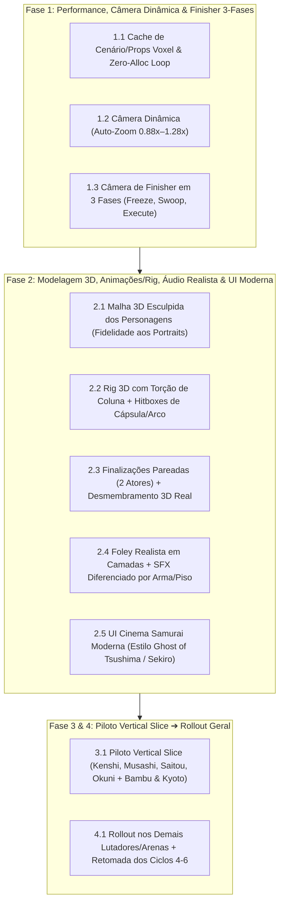
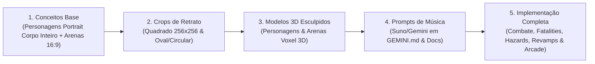
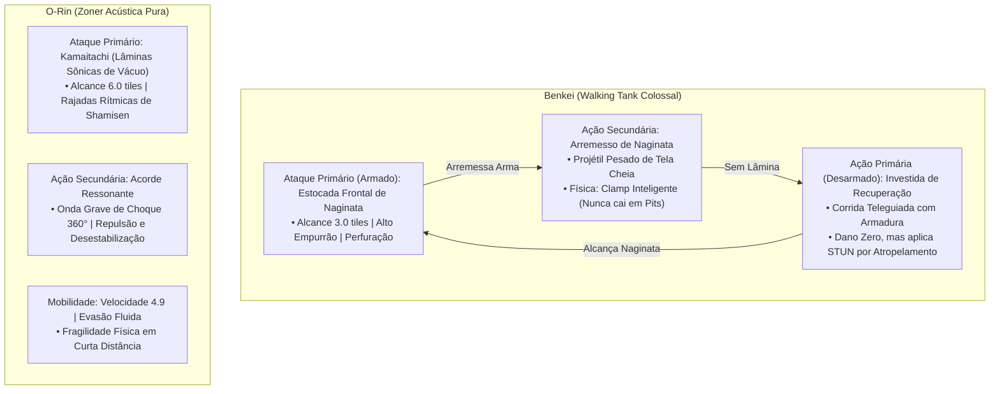
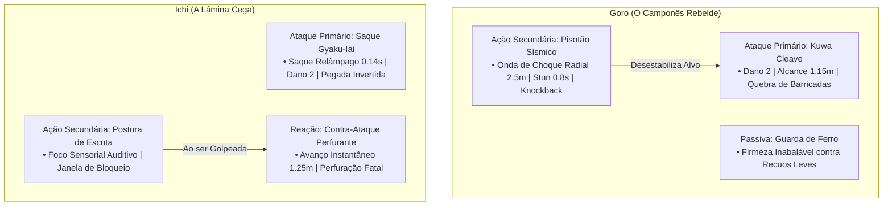
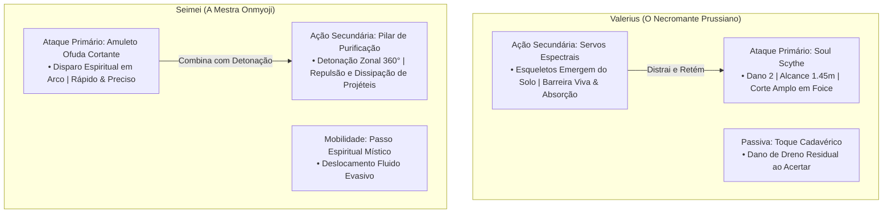
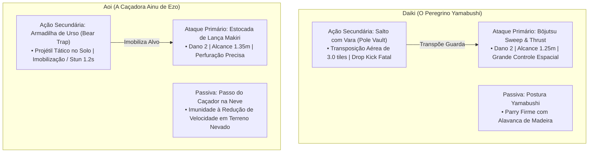
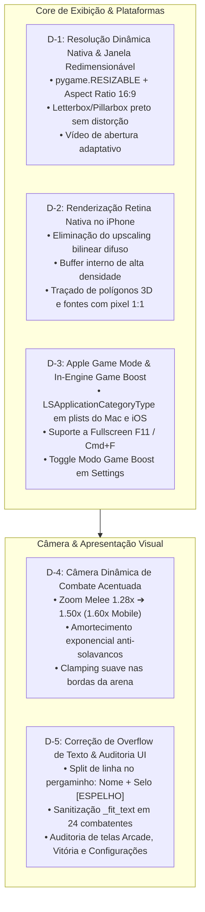
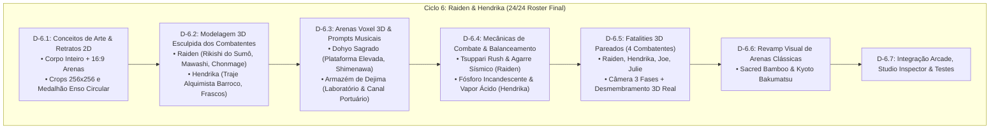

# 🗺️ Master Roadmap & Plano de Expansão: Samurai Edge Demake (Roster 12 ➔ 24)

> **Prioridade Estratégica Atual:** **PRIORIDADE MÁXIMA — PLANO MESTRE DE MODERNIZAÇÃO, PERFORMANCE & FIDELIDADE VISUAL**  
> Os itens do Plano Mestre abaixo têm precedência absoluta sobre a continuidade da expansão do roster (Ciclos 4 a 6). A engine, o sistema de câmeras, os modelos dos personagens, as colisões, as arenas voxel, os efeitos sonoros e os menus serão modernizados primeiro na base existente e nos lutadores do piloto antes de prosseguir com novos combatentes.

---

## ⚡ 0. PLANO MESTRE DE MODERNIZAÇÃO & PERFORMANCE (PRIORIDADE MÁXIMA)

Este plano consolida as melhorias prioritárias acordadas para elevar a fidelidade técnica e estética de *Samurai Edge Demake*, mantendo 100% da base em **Python / Pygame** (sem perda de lógica de combate, IA, testes ou Modo Arcade).



> [!IMPORTANT]
> **Diretriz Anti-Aberração Visual em Câmeras 3D:**  
> Personagens, feições faciais, fitas de tecido/cabelo e pedaços de corpos desmembrados passam a usar **projeção pura de vértices 3D no espaço de mundo** (`camera.apply(wx, wy, wz)`), eliminando completamente recortes de superfície 2D com `pygame.transform.rotate` ou distorções escaladas na rotação/zoom da câmera.

---

### 0.1 Os 9 Pilares de Melhoria + 3 Recursos de Alto Impacto

#### 1. Performance & Otimização Low-End PC / Mobile
* **Problema:** `arena_generator.py` redesenha 484 tiles e dezenas de props estáticos (`draw_voxel_box` + `draw_face_texture` com chamadas de linhas em CPU) todo frame; `_draw_pit` e `cinematic_director.py` alocam superfícies `SRCALPHA` de tela cheia a cada frame.
* **Solução:**
  * **Cache de Terreno e Props Estáticos (`src/world/arena_cache.py` [NOVO])**: Pré-renderizar a camada de solo e props estáticos (rochas, árvores, fachadas, lanternas) em uma superfície cacheada quando `azimuth == 0`. O loop principal faz blit direto do cache, ativando desenho voxel 3D ao vivo apenas quando houver rotação de câmera (`azimuth != 0`), destruição de prop ou perigo dinâmico.
  * **Zero Per-Frame Allocations**: Pré-alocar e reutilizar buffers de vinheta, filtros monocromáticos, sombras e partículas.
  * **Governador Automático de FPS (`src/effects/quality.py`)**: Monitorar a média de tempo de quadro. Se exceder 17.5ms (<57 FPS em PCs modestos ou mobile), reduzir automaticamente densidade de fumaça/fog e linhas de textura distantes.

#### 2. Modelagem dos Personagens & Fidelidade aos Portraits
* **Problema:** Os personagens atuais usam caixas retangulares empilhadas (`cbox`/`obox`) com contornos pretos rígidos em cada junta, e a função `face()` é vazia (`return`), deixando rostos sem expressão nem semelhança com os portraits 2D.
* **Solução:**
  * **Primitivas de Malha 3D Esculpidas (`src/isometric/mesh_primitives.py` [NOVO], `src/entities/model_kit.py`)**:
    * Troncos cônicos com ombros largos afinando na cintura; membros com frustums octogonais/tapered; cabeças esculpidas com maxilar e queixo definidos.
    * **Rostos 2.5D com Fidelidade ao Retrato**: Olhos, sobrancelhas, maquiagem teatral Kumadori (Okuni), cicatrizes (Kenshi), delineados (O-Rin) e bandanas projetados como polígonos 3D precisos na face frontal.
  * **Fitas Contínuas de Tecido e Cabelo 3D (`src/isometric/cloth.py`)**: Hakamas, quimonos, capas e rabos de cavalo construídos em faixas contínuas de quads conectados (`draw_ribbon_mesh_3d`), com contornos apenas na silhueta externa (sem linhas internas de tijolo).
  * **Shaders de Materiais**: Brilho anisotrópico em seda/cetim, especularidade metálica na lâmina/armadura e sombreamento de dobras vincadas no hakama.

#### 3. Arenas Voxel: Materiais, Detalhes & Texturas
* **Abordagem:** Preservar a identidade voxel consagrada das arenas, mas elevar o detalhamento e acabamento:
  * **Props em Múltiplas Camadas Voxel**: Rochas com formações em degraus, musgo e seixos; árvores com copas em camadas cônicas orgânicas e raízes expostas; telhados com beirais curvos tradicionais e lanternas suspensas.
  * **Acabamento de Solo**: Transições de espuma nas margens d'água, chanfros nas calçadas de pedra de Kyoto e poças com reflexos especulares das tochas/chamas.

#### 4. Áudio & Efeitos Sonoros Realistas (Foley em Camadas)
* **Problema:** Os arquivos `.wav` atuais são ruídos sintetizados procedurais estáticos idênticos para todas as armas.
* **Solução:**
  * **Biblioteca de Foley Realista (`assets/sounds/sfx/`, `tools/build_realistic_sfx.py`)**:
    * Substituição de bleeps por amostras acústicas de aço temperado de verdade, lâminas pesadas cortando o ar, impacto seco de madeira, ressonância profunda de taiko/gongo, pólvora de canhão/arcabuz encorpada e sons viscerais de corte.
  * **Diferenciação por Arma e Terreno (`src/audio/sound_events.py`, `src/audio/sound_manager.py`)**:
    * Eventos separados para katanas rápidas, naginatas pesadas, florete agudo, bastão de madeira, corrente e shamisen.
    * Passos diferenciados em tempo real de acordo com o piso (grama, madeira de ponte, cascalho, água rasa, lama).
  * **Micro-Variação em Tempo Real**: Variação aleatória de pitch (±6%) e volume (±8%) em cada golpe para eliminar repetição robótica.

#### 5. Animações dos Personagens, Colisões & Finalizações Pareadas
* **Problema:** Rig rígido sem movimento de coluna/pelve; hitboxes circulares simples não casam com estocadas longas ou cortes em arco; finalizações desconectadas (vítima fica a 1 metro da espada).
* **Solução:**
  * **Rig com Articulação de Tronco & Easing Marcial (`src/isometric/voxel_rig.py`)**:
    * Movimento de pelve (peso na passada), inclinação do torso ao correr e **torção de cintura/ombro** durante os golpes.
    * Curvas de animação em 3 fases (*Antecipação ➔ Impacto Rápido ➔ Recuperação fluida*).
  * **Hitboxes por Cápsula e Setor de Arco (`src/combat/hitboxes.py` [NOVO], `src/combat/collision.py`)**:
    * Cápsulas orientadas para estocadas (Gatotsu do Saitou, Julie, Benkei) e arcos angulares para cortes curvos (Kenshi, Musashi, Anne).
    * Tecla de depuração `F3` para inspecionar hitboxes/hurtboxes e frame data no treino.
  * **Coreografia de Finalização Pareada (2 Atores) (`src/effects/cinematic_director.py`)**:
    * Ao acertar o golpe fatal, agressor e vítima são suavemente magnetizados na posição relativa perfeita de contato (`ideal_distance` e ângulo livre de paredes).
    * A vítima reage fisicamente ao ponto de corte (ajoelhar, transpassar no peito, tombar de costas).
  * **Física de Desmembramento 3D Real (`src/entities/voxel_corpse.py`)**:
    * Substituição completa da rotação de imagem 2D por sub-modelos 3D físicos independentes (cabeça, torso, membros, arma cravada) que caem, quicam e rolam com física 3D tridimensional pura.

#### 6. Animações e Física Reativa das Arenas
* **Solução:**
  * **Vento e Deslocamento de Ar em Combate**: Golpes próximos, dashes rápidos e explosões empurram o vento local, fazendo bambus, grama de duna, cortinas noren, faixas e folhagens dobrarem e soltarem pétalas/folhas.
  * **Água e Lama Interativas**: Passos e deslizamentos na água geram ondas circulares isométricas concêntricas e respingos.
  * **Destruição Voxel Direcional**: Biombos shoji, cercas de bambu e fardos de feno estilhaçam em blocos voxel que voam na direção do golpe e repousam no chão.
  * **Deslizamento Suave em Obstáculos**: Eliminar travamentos secos ao esbarrar em paredes/rochas, aplicando vetor tangente de deslizamento.

#### 7. Câmera Dinâmica de Gameplay (Auto-Zoom Suave & Enquadramento)
* **Solução (`src/isometric/camera.py`, `main.py`):**
  * Rotação mantida estritamente fixa (0°) durante o combate normal.
  * **Auto-Zoom Inteligente por Distância (`0.88x` a `1.28x`)**:
    * Combate próximo corpo-a-corpo (`distância <= 3.0 tiles`): zoom suave até `1.28x` para destacar detalhes das lâminas e roupas.
    * Combate em média distância (`3.0 a 8.0 tiles`): zoom padrão `1.00x` a `1.15x`.
    * Combate em longa distância com projéteis (`distância >= 9.0 tiles`): zoom abre até `0.88x` para enquadrar ambos os lutadores e projéteis.
  * **Micro-Zooms de Ação & Clamping**: Pequeno pulso de zoom em Parries bem-sucedidos; amortecimento por mola (*spring-damper*); trava de borda para não mostrar área vazia fora da arena.

#### 8. Câmera de Finisher em 3 Fases (Freeze, Swoop, Execute)
* **Solução (`src/effects/cinematic_director.py`):**
  * **Fase 1 — Impact Freeze (0.25s)**: No momento exato do impacto fatal, o jogo congela no tempo (lutadores, partículas e sangue parados no ar) com hitstop pesado e batimento cardíaco surdo.
  * **Fase 2 — Swoop & Órbita com Tempo Congelado (0.55s)**: Com o mundo congelado, a câmera mergulha suavemente em direção ao ponto de contato, aplica barras pretas CinemaScope `2.39:1`, fecha o zoom em `1.75x` e **rotaciona o azimute para o melhor ângulo de perfil 3/4** em relação à linha agressor-vítima (evitando que um cubra o outro).
  * **Fase 3 — Execução da Finalização**: A câmera trava no ângulo cinematográfico ideal, o tempo volta a correr em câmera lenta dramática (`0.80x`), a animação da coreografia pareada se completa, o corte desmembra a vítima em 3D e o kanji Sumi-E é carimbado.

#### 9. Menus, HUD & Mensagens de Combate Profissionais (Cinema Samurai)
* **Solução (`src/ui/`, `src/effects/particles.py`):**
  * **Adeus aos Textos Neon Flutuantes (`FloatingBanner`)**: Substituição de mensagens flutuantes arcade por **faixas horizontais de pincelada Sumi-E discretas com acentos dourados e caligrafia refinada**, surgindo de forma elegante e dissipando como névoa de tinta.
  * **Prompt de Choque de Lâminas (Clash QTE)**: O botão vermelho arcade é substituído por um **selo ritual de espadas cruzadas com círculo de tensão e caligrafia Kanji de impacto**.
  * **HUD de Vida e Rounds Moderno**: Barras de vida em paralelogramos laqueados escuros com friso dourado, dreno suave de dano fantasma e pips de round elegantes.
  * **Telas de Título, Opções, Pausa e Resultados Unificadas**: Aplicação do estilo pergaminho de alta fidelidade + madeira laqueada com iluminação de lanterna suave em todas as telas restantes.

---

### 0.2 Cronograma de Execução do Plano Mestre

| Fase | Entregáveis | Foco Principal | Status |
| :---: | :--- | :--- | :---: |
| **M-1** | **Performance & Câmeras** | • Cache de solo e props de arena (`arena_cache.py`)<br>• Zero per-frame allocations & Auto-FPS Governor<br>• Câmera dinâmica de combate (Zoom 0.88x–1.28x)<br>• Câmera de Finisher em 3 Fases (Freeze ➔ Swoop ➔ Execute) | ✅ **CONCLUÍDO** |
| **M-2** | **Modelagem 3D, Rig & Colisões** | • Primitivas 3D esculpidas & rostos 2.5D dos portraits (`mesh_primitives.py`)<br>• Fitas contínuas de tecido/cabelo (sem efeito tijolo)<br>• Rig com torção de tronco & hitboxes de cápsula/arco (`hitboxes.py`)<br>• Desmembramento 3D real (`voxel_corpse.py`) & finalizações pareadas | ✅ **CONCLUÍDO** |
| **M-3** | **Foley Realista & UI Moderna** | • Gerador e biblioteca de SFX realistas em camadas por arma e piso<br>• Micro-variação de pitch/volume em tempo real<br>• Callouts de combate em pincelada Sumi-E<br>• Redesign do Clash QTE e unificação dos menus e HUD | ✅ **CONCLUÍDO** |
| **M-4** | **Piloto Vertical Slice** | • Aplicação do novo padrão em 4 lutadores: **Kenshi**, **Musashi**, **Saitou**, **Okuni**<br>• Aplicação do novo padrão em 2 arenas: **Sacred Bamboo** e **Kyoto Bakumatsu**<br>• Validação de 60 FPS estável, jogabilidade e prévias visuais | ✅ **CONCLUÍDO** |
| **M-5** | **Rollout nos Demais Lutadores & Arenas** | • Atualização dos 14+ lutadores restantes no padrão esculpido<br>• Atualização das 16+ arenas restantes com props detalhados e física reativa<br>• Validação da suíte de 21 testes automatizados | ✅ **CONCLUÍDO** |

---

## 👥 1. O Roster Completo dos 24 Guerreiros

Com o ajuste de nomes (**Valerius** no lugar de Faust, **Raiden** masculino, **Hendrika** feminina) e a adição da 6ª guerreira feminina (**Aoi**, a caçadora Ainu de Hokkaido), o jogo totaliza **24 combatentes** divididos em perfeita simetria de gênero (12 Mulheres e 12 Homens).

```
┌──────────────────────────────────────────────────────────────────────────────────────────────────┐
│                                     ROSTER FINAL (24 GUERREIROS)                                │
├──────────────────────────────────────────────────────────────────────────────────────────────────┤
│ VETERANOS (12):                                                                                  │
│ • Homens:  Kenshi | Musashi | Hanzo | Joe & Doberman | Saitou | Teppo                            │
│ • Mulheres: Murasaki | Kasumi | Okuni | Tomoe | Anne | Julie                                     │
├──────────────────────────────────────────────────────────────────────────────────────────────────┤
│ NOVOS COMBATENTES (12 — 6 Ciclos de 1 Homem + 1 Mulher):                                         │
│ • Ciclo 1: Ren (Monge Shaolin) [M]             & Chiyo (Kunoichi 2 Kodachi) [F]                  │
│ • Ciclo 2: Benkei (Guardião Naginata) [M]       & O-Rin (Menestrel Shamisen) [F]                 │
│ • Ciclo 3: Goro (Fazendeiro da Kuwa) [M]        & Ichi (Lâmina Cega Shikomizue) [F]              │
│ • Ciclo 4: Valerius (Necromante Prussiano) [M]  & Seimei (Onmyoji dos Talismãs) [F]              │
│ • Ciclo 5: Daiki (Peregrino do Bastão) [M]      & Aoi (Caçadora Ainu de Hokkaido) [F]            │
│ • Ciclo 6: Raiden (Rikishi do Sumô) [M]         & Hendrika (Alquimista Holandesa) [F]            │
└──────────────────────────────────────────────────────────────────────────────────────────────────┘
```

---

## 🔄 2. A Estrutura do Novo Roadmap Iterativo

Com a implementação do **Plano Mestre de Modernização & Performance**, o fluxo de desenvolvimento para os ciclos restantes (Ciclos 4, 5 e 6) passa a herdar diretamente as novas malhas 3D esculpidas, o rig com torção de tronco, o áudio realista em camadas e as finalizações 3D pareadas:



### Protocolo Obrigatório de Cada Ciclo (Ordem Estrita):
1. **Conceito em Formato Portrait (Corpo Inteiro) & Arena 16:9**: Geração da arte conceitual vertical de corpo inteiro dos dois novos personagens (`assets/concepts/<id>_full_concept.jpg`) e da arte conceitual panorâmica 16:9 das duas novas arenas (`assets/concepts/<arena>_concept.jpg`).
2. **Crop Quadrado e Oval para Personagens**: Derivação do retrato de busto quadrado `256x256` (`assets/portraits/<id>_bust.png`) e do medalhão oval/circular emoldurado (`assets/portraits/<id>_circle.png`).
3. **Modelos 3D Esculpidos (Personagens e Arenas)**: Modelagem 3D facetada low-poly dos personagens (`head_<id>.py` e `body_<id>.py`) e das arenas/props (`decor.py` e `arenas.py`) fielmente ancorada nos conceitos gerados.
4. **Prompts de Música Suno / Gemini**: Registro dos prompts de geração musical das novas arenas em `GEMINI.md` e `docs/GEMINI_MUSIC_PROMPTS.md`.
5. **Implementação, Fatalities, Revamps & Testes**: Classes de combate dos lutadores, fatalities 3D pareados, hazards das novas arenas, revamp visual das 2 arenas clássicas do ciclo, sincronização com Model/Arena/Studio Inspector, Game Help, Modo Arcade e bateria de testes automatizados.


---

## 💀 3. Catálogo Oficial de Fatalities Ataque a Ataque (24 Guerreiros)

Cada fatality é acionado de forma **contextual de acordo com o ataque que desferiu o golpe letal**, executado através da nova **câmera de 3 fases** e com **desmembramento e física em 3D real**.

### 3.1 Os 12 Lutadores Veteranos

| # | Guerreiro | Ataque Letal | Fatality Específico Elaborado | Opção Clássica |
| :-: | :--- | :--- | :--- | :--- |
| **1** | **Kenshi** | **Primário** (*Iai Flash*) | **DIAGONAL_KENSHIN_SPLIT**: Peito partido em ângulo de 45° com atraso dramático e jato arterial vertical após embainhar a lâmina. | Colapso dramático Kurosawa com espada embainhada. |
| | | **Secundário** (*Ryuu Tsui Sen*) | **VERTICAL_BISECTION**: O corte aéreo descendente divide a vítima verticalmente ao meio do crânio à virilha. | Queda de joelhos com impacto esmagador no solo. |
| **2** | **Musashi** | **Primário** (*Combo de Cortes*) | **DUAL_IMPALE_X_SPREAD**: Musashi empala o peito do rival com a katana, em seguida com a wakizashi, e abre as duas lâminas em 'X' partindo o peito do rival. | Queda pesada de joelhos com as lâminas cravadas. |
| | | **Secundário** (*Parry / Reflexão*) | **REFLECTED_TORSO_CLEAVE**: O golpe/projétil refletido desfere um corte diagonal com separação do torso do rival. | Vítima cambaleia e tomba de costas. |
| **3** | **Hanzo** | **Ranged** (*Arremesso Kunai*) | **FOREHEAD_PIN**: A kunai crava na testa entre os olhos; o impacto arremessa a cabeça e o corpo da vítima estatelada de costas. | Queda simples com kunai cravada (*STAB_FALL*). |
| | | **Melee** (*Tanto sem Kunai*) | **HEART_THROAT_STAB**: Estocada dupla fulminante no coração e corte transversal na garganta, a vítima cai de joelhos sufocando. | Queda clássica para frente. |
| **4** | **Joe** | **Secundário** (*Bote Yamato*) | **YAMATO_MAUL_DECAP**: O Doberman Yamato salta derrubando o rival de costas no solo imobilizando-o, e Joe arremessa uma shuriken pesada que decapita o rival caído. | Mordida letal com queda (*MAULED*). |
| | | **Primário** (*Shuriken Fatal*) | **SHURIKEN_PIN**: Estrelas de metal cravadas no peito e garganta arremessando o rival para trás. | Colapso de costas. |
| **5** | **Saitou** | **Primário** (*Gatotsu Investida*) | **HEART_IMPALE_LUNGE**: Katana perfura o tórax saindo pelas costas; o ímpeto arrasta a vítima por 1m e a projeta no solo com jorro arterial. | Perfuração simples (*SAITOU_IMPALE*). |
| | | **Secundário** (*Zeroshiki*) | **TORSO_BLAST_THRUST**: Estocada explosiva de tronco à queima-roupa perfura o abdômen e arremessa a vítima de costas pelo ar. | Queda seca de costas. |
| **6** | **Teppo** | **Primário Tiro** (*Tanegashima*) | **HEADSHOT_EXPLODE**: Crânio e peito desintegrados por impacto balístico com densa nuvem de fumaça e faíscas. | Queda por bala no peito (*BLUNT_FALL*). |
| | | **Primário Melee** (*Coronhada*) | **JAW_CRUSH_FALL**: Coronha pesada de carvalho quebra a mandíbula; a vítima gira 180° no ar e desaba de bruços. | Queda atordoado no solo. |
| | | **Secundário** (*Mina Pólvora*) | **POWDER_CHAR**: Detonação incendeia a vítima, que dá 2 passos e cai carbonizada em cinzas. | Queda chamuscada. |
| **7** | **Murasaki** | **Primário** (*Kama Strike*) | **CLEAN_DECAP**: Foice curva contorna o pescoço e decepa a cabeça em arco alto em movimento fluído contínuo. | Decapitação padrão (*MURASAKI_DECAP*). |
| | | **Secundário** (*Chain Pull*) | **CHAIN_PULL_BISECTION**: A corrente laça o pescoço puxando com violência, e Murasaki fatia a cintura ao passar direto em bissecção horizontal. | Puxão simples com queda. |
| **8** | **Kasumi** | **Primário** (*Bomba Cerâmica*) | **SHRAPNEL_DISINTEGRATION**: A explosão faz o corpo se desfazer em dezenas de fragmentos voxel incandescentes arremessados com fumaça e faíscas. | Queda chamuscada (*KASUMI_EXPLODE*). |
| | | **Secundário** (*Mina Remota*) | **MINE_BLAST_INCINERATION**: A mina detona aos pés; onda de choque e fogo consome o rival. | Queda por explosão de solo. |
| **9** | **Okuni** | **Primário** (*Leques Tessen*) | **TESSEN_DECAP**: Leques de ferro afiados fecham em tesoura navalha no pescoço, decapitando com chuva de pétalas de cerejeira. | Queda cortada pelos leques. |
| | | **Veneno** (*Dokukiri 10s*) | **DOKUKIRI_MELT**: Vômito de sangue púrpura com dissolução completa do corpo em névoa espectral e vestes vazias no chão. | Colapso no solo (*OKUNI_MELT*). |
| **10** | **Tomoe** | **Primário** (*Flecha Yumi*) | **PINNED_TO_EARTH**: Flecha pesada crava no peito, projeta a vítima para trás e a prega ao solo ou bambu mais próximo com haste vibrando. | Queda com flecha fincada (*ARROW_PIN*). |
| | | **Secundário** (*Hamaya Sagrada*) | **HAMAYA_HOLY_PIERCE**: Flecha de luz dourada atravessa o tórax deixando partículas de kami e a vítima desaba de joelhos purificada. | Queda estatelada no solo. |
| **11** | **Anne** | **Primário** (*Alfanje 180°*) | **WAIST_BISECTION**: O corte em meia-lua divide o rival na cintura; o tronco superior desliza lateralmente caindo no chão. | Colapso deitada de lado (*PIRATE_CLEAVE*). |
| | | **Secundário** (*Tiro de Canhão*) | **CANNONBALL_OBLITERATION**: Bola de ferro maciço esmaga o rival de cima a baixo em cratera de pó e estilhaços. | Queda por impacto de canhão. |
| **12** | **Julie** | **Primário** (*Flèche Thrust*) | **HUNDRED_STAB_BARRAGE**: Após a primeira estocada, Julie desfere entre 20 e 40 estocadas a uma velocidade alucinante; a vítima jorra sangue e cai de bruços em poça carmesim. | Queda elegante de duelo. |
| | | **Secundário** (*Flintlock*) | **FLINTLOCK_CHEST_BLAST**: Tiro de pederneira abre rombo fumegante no centro do peito arremessando o rival para trás. | Queda clássica por tiro. |

---

### 3.2 Os 12 Novos Combatentes

| # | Guerreiro | Ataque Letal | Fatality Específico Elaborado | Opção Clássica |
| :-: | :--- | :--- | :--- | :--- |
| **13** | **Ren** | **Primário** (*Combo 3 Dragões*) | **HYAKURETSU_BODY_EXPLOSION**: Sucessão de dezenas de socos em velocidade supersônica (estilo Hokuto no Ken), breve pausa dramática e explosão completa do corpo do rival. | Queda desmaiado por golpe de palma atordoante. |
| | | **Secundário** (*Kiai da Montanha*) | **WALL_SMASH_FATAL**: Onda esférica de choque arremessa o rival contra obstáculos/armadilhas estilhaçando o corpo no impacto. | Empurrão defensivo sem fatality. |
| **14** | **Chiyo** | **Primário** (*Cortes Cruzados 2 Kodachi*) | **TRIPLE_SCISSOR_CLEAVE**: As duas lâminas curtas Kodachi cortam simultaneamente na cintura e no pescoço em velocidade relâmpago, separando cabeça e tronco em três partes. | Desabamento de joelhos. |
| | | **Secundário** (*Dança Mai*) | **MAI_X_CLEAVE**: Surge do vórtice de pós-imagens com corte giratório duplo fatiando o peito em 'X' profundo. | Queda com lâminas embainhadas. |
| **15** | **Benkei** | **Primário** (*Estocada Frontal Colossal*) | **ARMORED_HEART_IMPALE**: A lâmina pesada de Naginata perfura o tórax de ponta a ponta com o ímpeto da armadura de placas; Benkei ergue o rival pelo cabo e o projeta estatelado no chão com jorro arterial massivo. | Queda pesada por perfuração de ponta. |
| | | **Secundário** (*Arremesso da Naginata*) | **SKEWERED_LANCE_FLAG**: A Naginata transpassa o tórax em arremesso supersônico e crava no solo, erguendo o corpo em ângulo oblíquo como troféu de guerra. | Queda perfurada à distância. |
| **16** | **O-Rin** | **Primário** (*Lâminas Kamaitachi*) | **SONIC_SLICER**: Ondas de vácuo sônicas fatiam a vítima em 3 segmentos horizontais que deslizam em cascata após 1 segundo de silêncio. | Queda lenta ouvindo a última nota musical. |
| | | **Secundário** (*Acorde Ressonante*) | **RESONANCE_BURST**: Onda grave de choque à queima-roupa estoura os tímpanos e crânio da vítima com sangramento arterial facial e colapso seco. | Colapso por choque sonoro. |
| **17** | **Goro** | **Primário** (*Descida da Kuwa*) | **KUWA_SKULL_CLEAVE**: A enxada racha o crânio e crava na caixa torácica; Goro apoia a bota no peito para arrancar a lâmina com estalo ósseo. | Queda atordoado pelo peso do ferro. |
| | | **Secundário** (*Pisotão Sísmico*) | **EARTH_STOMP_CRUSH**: O tremor quebra os joelhos do rival e Goro esmaga o crânio no solo com pisada colossal de bota. | Desestabilização sem fatality. |
| **18** | **Ichi** | **Primário** (*Gyaku-Iai Cego*) | **BLIND_CAROTID_SLICE**: Corte imperceptível na carótida; Ichi embainha a lâmina na bengala com um clique oco de madeira e só então o sangue jorra em leque com colapso do rival. | Desabamento silencioso para a frente. |
| | | **Secundário** (*Postura Escuta*) | **BLIND_SPINE_PIERCE**: Esquiva do golpe do rival e estocada cega nas costas atravessando a espinha dorsal e o coração. | Contra-ataque simples. |
| **19** | **Valerius** | **Primário** (*Foice Fúnebre*) | **SOUL_REAP**: Ataque de foice contra a cabeça do rival, separando-a do corpo e a prendendo na ponta da foice. Valerius a recolhe na mão e reanima o cadáver decapitado, transformando-o em um esqueleto servo erguido no campo. | Decapitação e transformação em esqueleto. |
| | | **Secundário** (*Summons Mortos*) | **DRAGGED_TO_GRAVE**: Os esqueletos agarram o rival e mãos emergem do solo puxando o corpo para dentro da terra funerária. | Queda puxada pelos mortos. |
| **20** | **Seimei** | **Primário** (*Ofuda Cortante*) | **SEAL_STASIS_COLLAPSE**: Ao acertar o amuleto contra o alvo, este é consumido em chamas verdes espirituais até que só sobrem cinzas fumegantes no solo. | Incineração em chamas verdes às cinzas. |
| | | **Secundário** (*Detonação Selos*) | **OFUDA_PURIFICATION_PILLAR**: Pilar de fogo sagrado azul/branco incinera o rival, desintegrando o corpo em cinzas prateadas e borboletas de luz. | Queima espiritual simples. |
| **21** | **Daiki** | **Primário** (*Estocada Bastão*) | **THROAT_TEMPLE_CRUSH**: Estocada quebra a laringe com estalo seco e giro na têmpora projeta a vítima no solo sem ar. | Queda por contusão de madeira. |
| | | **Secundário** (*Salto com Vara*) | **METEOR_STAFF_CRUSH**: Desce do ar cravando o bastão e os dois pés no peito do rival, estilhaçando a caixa torácica contra o solo rachado. | Rasteira sem fatality. |
| **22** | **Aoi** | **Primário** (*Lança Makiri*) | **SPEAR_HEART_SLIDE**: Aoi crava a lança no coração, finca a lança no chão e a vítima desliza lentamente por ela ficando de joelhos transpassada enquanto o sangue forma poça no solo. | Queda com lança cravada no peito. |
| | | **Secundário** (*Armadilha Urso*) | **TRAP_AND_EXECUTE**: A mandíbula de ferro mastiga e decepa a perna da vítima que cai no chão, seguida por estocada vertical da lança na garganta. | Imobilização simples. |
| **23** | **Raiden** | **Primário** (*Palmas Tsuppari*) | **TSUPPARI_TEMPLE_CRUSH**: Bofetada dupla nas duas têmporas simultâneas estala o crânio; a vítima gira no ar e desaba no chão com sangue facial. | Nocaute limpo por esmagamento muscular. |
| | | **Secundário** (*Carga Haridate*) | **EARTH_SHATTER_SLAM**: Raiden agarra o rival no ar, ergue-o sobre a cabeça e o esmaga de costas no solo rachado partindo a coluna. | Queda por arremesso. |
| **24** | **Hendrika** | **Primário Ranged** (*Fósforo*) | **PHOSPHORUS_INCINERATION**: O fogo químico branco queima a vítima, que dá 2 passos cambaleantes em desespero e cai de joelhos carbonizada em cinzas. | Morte em chamas químicas. |
| | | **Primário Melee** (*Estilete*) | **SURGICAL_INCISION**: Corte cirúrgico na carótida, Hendrika limpa a lâmina de aço com lenço de linho branco e o rival cai em poça de sangue. | Colapso por corte arterial. |
| | | **Secundário** (*Vapor Ácido*) | **ACID_DISSOLUTION**: Asfixia e dissolução cáustica da pele e vestes com fumaça esverdeada. | Queda asfixiada no chão. |

---

## 🌸 4. Cronograma de Revamp Visual das 12 Arenas Clássicas

*(Beneficiadas diretamente pelo novo sistema de Cache Voxel de Alto Desempenho e Física Reativa)*

| Ciclo | Arena 1 para Revamp | Melhorias Visuais & Partículas | Arena 2 para Revamp | Melhorias Visuais & Partículas |
| :---: | :--- | :--- | :--- | :--- |
| **Ciclo 1** | **Nagashino Field** (`nagashino_field` - Teppo) | • Fumaça volumétrica contínua subindo dos canhões.<br>• Brasas incandescentes flutuando no vento.<br>• Lama com reflexos úmidos e marcas de passos com respingos.<br>• Banners de clã tremulando ao vento com física. | **Shadow Cave** (`shadow_cave`) | • Gotas de água caindo do teto da caverna com ondulações no solo.<br>• Tochas procedurais projetando luz dinâmica e sombras longas nos pilares de pedra.<br>• Poeira de esporos brilhantes suspensa no ar. |
| **Ciclo 2** | **Forest Camp** (`forest_camp`) | • Fogueiras centrais com estalos de faíscas dinâmicas.<br>• Folhas secas outonais sopradas pela passagem dos lutadores.<br>• Luz da lua filtrada pela copa das árvores (*God rays* isométricos). | **Baroque Court** (`baroque_court`) | • Chafariz de mármore com partículas de spray de água espumante.<br>• Pétalas de rosas brancas e vermelhas flutuando nos canteiros.<br>• Azulejos de mármore xadrez com reflexos especulares das lâminas. |
| **Ciclo 3** | **Ganryū Island** (`ganryu_island`) | • Névoa costeira volumétrica baixa sobre a areia.<br>• Espuma dinâmica de maré batendo contra as pedras da praia.<br>• Grama de duna balançando de acordo com a direção do vento. | **Iga Rooftops** (`iga_rooftops`) | • Névoa noturna densa nos becos entre os telhados.<br>• Telhas que soltam fragmentos de argila ao receberem impactos.<br>• Lua cheia de alto contraste projetando silhuetas nítidas. |
| **Ciclo 4** | **Mist Temple** (`mist_temple`) | • Camadas duplas de neblina animada com densidade variável.<br>• Pétalas de lótus flutuando no tanque koi com peixes animados.<br>• Lanternas de pedra acesas com chama trêmula. | **Kabuki Stage** (`kabuki_stage`) | • Cortinas de teatro que ondulam com o deslocamento de ar dos golpes.<br>• Chuva de confetes dourados (*Hana-fubuki*) no centro do palco.<br>• Iluminação de lanternas de papel projetando tons rubros quentes. |
| **Ciclo 5** | **Storm Pirate Deck** (`pirate_deck`) | • Chuva pesada em diagonal com respingos nas tábuas do convés.<br>• Ondas espumantes colidindo nas laterais do casco do navio.<br>• Relâmpagos dinâmicos que iluminam a tela com flashes estroboscópicos. | **Mountain Shrine** (`mountain_shrine`) | • Folhas douradas de ginkgo caindo suavemente sobre os degraus de pedra.<br>• Fumaça de incenso subindo dos caldeirões rituais.<br>• Vibração visual no ar ao bater no sino de bronze sagrado. |
| **Ciclo 6** | **Sacred Bamboo** (`bamboo` - Kenshi) | • Partículas de serragem verde e folhas ao fatiar bambus.<br>• Reflexo do céu e dos bambus no lago Zen com distorção senoidal.<br>• Vagalumes noturnos interagindo com a lâmina. | **Kyoto: Burning Bakumatsu** (`kyoto` - Murasaki) | • Fagulhas crepitantes caindo dos telhados das machiyas em chamas.<br>• Ondas de distorção de calor térmico no ar.<br>• Rastro de poeira e poças de sangue refletindo as chamas nas pedras. |

---

## 🏯 5. Novas Arenas dos Combatentes

### 5.1 Ciclo 1 — ✅ Implementadas
Ambas estão registradas em `ARENA_SPECS` (`src/world/arenas.py`), mapeadas em `ARENA_BY_FIGHTER` (`src/roster.py`) e são as arenas da **Edição Demo** (`DEMO_ARENAS` em `src/edition.py`, com `shaolin_temple` como fallback).

| | **Pátio dos Sinos Shaolin** | **Jardim dos Lírios Carmim** |
| :--- | :--- | :--- |
| **ID / Constante** | `shaolin_temple` / `ARENA_SHAOLIN` | `higanbana_garden` / `ARENA_HIGANBANA` |
| **Subtítulo** | *O Templo das Mil Contas* | *O Bosque do Adeus Noturno* |
| **Lutador** | **Ren** (Monge Shaolin) | **Chiyo** (Kunoichi) |
| **Perigo** | Nenhum | Moderado (Névoa Espessa, Água Rasa) |
| **Layout** | Borda de pedra escura ➔ terraço ➔ lajes polidas ➔ círculo central de cascalho (raio 4.5). | Tapete de lírios-aranha ➔ lago escuro em elipse (água rasa, velocidade ×0.5) ➔ passarela de pedra N–S ➔ plataforma circular com canteiro de lírios no centro. |
| **Props** | 2 sinos de bronze, 4 incensários, 4 lanternas de pedra, 4 pinheiros, 2 estátuas Jizo. | 2 torii (norte/sul), 8 bambus sombrios, 4 lanternas de pedra, 5 bancos de névoa, 2 estátuas Jizo. |
| **Iluminação** | Ambiente dourado quente (força 0.88, vinheta 0.15); lanternas âmbar com cintilação leve. | Ambiente roxo noturno (força 0.38, vinheta 0.45); lanternas carmesim com cintilação forte. |
| **Atmosfera & Partículas** | Fumaça de incenso, raios de sol, poeira; 42 partículas à deriva (`drift_petals=0.65`), ginkgo dourado. | Névoa, banco de neblina, vagalumes; 55 partículas à deriva (`drift_petals=0.95`), pétalas carmesim. |
| **Tática** | Bater no sino reverbera ondas sonoras; o piso limpo favorece esquivas rápidas. | Névoa e pétalas camuflam aproximações; a água rasa atrasa a corrida. |
| **BGM** | *Courtyard of the Sacred Bronze Bells* — 118 BPM, Ré Dórico (`bgm_shaolin_temple`) | *Dance of the Crimson Spider Lilies* — 136 BPM, Fá# menor In-sen (`bgm_higanbana_garden`) |

### 5.2 Ciclo 2 — ✅ Implementadas
Ambas estão registradas em `ARENA_SPECS` (`src/world/arenas.py`), mapeadas em `ARENA_BY_FIGHTER` (`src/roster.py`) e com trilhas sonoras integradas (`bgm_gojo_bridge.mp3` e `bgm_yoshiwara_alley.mp3`).

| | **Ponte Gojo** | **Beco Yoshiwara** |
| :--- | :--- | :--- |
| **ID / Constante** | `gojo_bridge` / `ARENA_GOJO_BRIDGE` | `yoshiwara_alley` / `ARENA_YOSHIWARA` |
| **Subtítulo** | *A Travessia das Mil Lâminas* | *O Labirinto das Sombras Rubras* |
| **Lutador** | **Benkei** (Guardião Naginata) | **O-Rin** (Menestrel Shamisen) |
| **Perigo** | **ALTO (Queda Letal no Rio Kamo / Pits)** | **MODERADO (Obstáculos Destrutíveis / Biombos)** |
| **Layout** | Ponte horizontal central de tábuas de carvalho rústico (faixa central entre o Rio Kamo). Vãos abertos nas muretas onde empurrões/golpes fortes causam queda fatal na correnteza. | Beco estreito longitudinal pavimentado em paralelepípedos úmidos pós-chuva com poças reflexivas. Fachadas de machiyas de dois andares delimitando paredes de madeira. |
| **Props** | Muretas baixas de carvalho com vãos abertos, katanas e lanças troféu cravadas nos postes da ponte, lanternas de bronze com tochas, estátuas Jizo nas cabeceiras da ponte. | Biombos de papel shoji destrutíveis com colisão, lanternas chōchin vermelhas suspensas em beirais, cortinas noren ondulantes e barris de madeira. |
| **Iluminação** | Noite fria de luar prateado (lua cheia de alto contraste, força 0.42, vinheta 0.35); tochas quentes de bronze projetando chamas com cintilação. | Noite chuvosa em chiaroscuro; iluminação rubra e âmbar intensa das lanternas vermelhas projetando sombras longas nas machiyas molhadas (força 0.50, vinheta 0.40). |
| **Atmosfera & Partículas** | Névoa densa do rio subindo pelas frestas das tábuas, folhas secas sopradas pelo vento fluvial, poeira de madeira e respingos d'água; 48 partículas à deriva. | Gotejamento de chuva dos telhados, vapor subindo das pedras molhadas, faíscas e estilhaços de papel/madeira ao quebrar biombos; 52 partículas à deriva. |
| **Tática** | Controle cirúrgico de espaçamento; empurrar o oponente em direção aos vãos abertos da mureta; arremesso de naginata contra postes sem risco de queda no rio. | Confinamento do beco favorece ricochetes e rajadas de Kamaitachi; destruir biombos para abrir espaço de esquiva ou prensar o oponente contra as paredes. |
| **BGM** | *The Guardian of Gojo Bridge* — 108 BPM, Si Frígio (`bgm_gojo_bridge.mp3`) | *Echoes of the Crimson Pleasure Quarter* — 140 BPM, Sol# menor In-sen (`bgm_yoshiwara_alley.mp3`) |

### 5.3 Especificações de Combate e Balanceamento dos Guerreiros (Ciclo 2)



### 5.4 Ciclo 3 — Arrozais Terraciados & Moinho na Chuva

Trilhas sonoras e prompts especializados registrados em [`GEMINI_MUSIC_PROMPTS.md`](GEMINI_MUSIC_PROMPTS.md).

| | **Arrozais Terraciados** | **Moinho na Chuva** |
| :--- | :--- | :--- |
| **ID / Constante** | `rice_paddies` / `ARENA_RICE_PADDIES` | `rain_mill` / `ARENA_RAIN_MILL` |
| **Subtítulo** | *A Fúria dos Campos Alagados* | *O Pranto das Águas do Moinho* |
| **Lutador** | **Goro** (Fazendeiro da Kuwa) | **Ichi** (Lâmina Cega Shikomizue) |
| **Perigo** | **MODERADO (Lamaçais com Redução de Velocidade / Obstáculos Destrutíveis)** | **ALTO (Correnteza do Rio / Queda no Moinho)** |
| **Layout** | Encosta montanhosa esculpida em terraços escalonados de arrozais alagados ao pôr do sol crepuscular. Espelhos d'água reflexivos, caminhos de terra batida e lamaçais, degraus de contenção de pedra rústica. | Moinho de água abandonado com grande roda de madeira giratória à beira de um riacho caudaloso sob chuva contínua. Pontes de madeira estreitas e margens de cascalho escorregadio. |
| **Props** | Espantalhos rústicos de palha, feixes de feno secando destrutíveis, ferramentas agrícolas fincadas, cestos de bambu e lanternas de pedra campestres. | Roda d'água de madeira animada com respingos, sacas de grãos, pilares de sustentação de carvalho, lanternas de bronze sob beirais e pedras de rio musgosas. |
| **Iluminação** | Pôr do sol dourado e alaranjado dramático com névoa baixa no solo (força 0.65, vinheta 0.30); tons terrosos quentes e reflexos crepusculares na água. | Noite cinzenta de tempestade contínua; iluminação fria azulada e dessaturada (força 0.40, vinheta 0.45), com flashes ocasionais e névoa d'água. |
| **Atmosfera & Partículas** | Fagulhas de terra/poeira, folhas de arroz secas sopradas pelo vento, névoa rasteira alaranjada; 45 partículas à deriva. | Chuva contínua em ângulo diagonal, respingos ao bater no solo e nas tábuas, névoa d'água da roda do moinho; 60 partículas à deriva. |
| **Tática** | Os espelhos d'água e lamaçais afetam levemente a tração; Goro aproveita o terreno para prensar oponentes com o Pisotão Sísmico e quebrar fardos de feno. | A chuva constante e a correnteza exigem controle estrito de borda; a roda d'água e os pilares de madeira servem para interceptar investidas lineares. |
| **BGM** | *Wrath of the Terraced Earth* — 116 BPM, Ré Menor Min'yo (`bgm_rice_paddies.mp3`) | *The Blind Blade in the Weeping Mill* — 124 BPM, Lá Menor Miyako-bushi (`bgm_rain_mill.mp3`) |

### 5.5 Especificações de Combate e Balanceamento dos Guerreiros (Ciclo 3)



### 5.6 Ciclo 4 — Cemitério Barroco & Santuário Heian — ✅ Implementadas

Ambas estão registradas em `ARENA_SPECS` (`src/world/arenas.py`), mapeadas em `ARENA_BY_FIGHTER` (`src/roster.py`) e com trilhas sonoras integradas (`bgm_baroque_cemetery.mp3` e `bgm_heian_shrine.mp3`).

| | **Cemitério Barroco** | **Santuário Heian** |
| :--- | :--- | :--- |
| **ID / Constante** | `baroque_cemetery` / `ARENA_BAROQUE_CEMETERY` | `heian_shrine` / `ARENA_HEIAN_SHRINE` |
| **Subtítulo** | *O Repouso das Almas Errantes* | *O Portal dos Espíritos Celestiais* |
| **Lutador** | **Valerius** (Necromante Prussiano) | **Seimei** (Onmyoji dos Talismãs) |
| **Perigo** | **ALTO (Mãos Espectrais do Solo / Névoa Fúnebre)** | **MODERADO (Selos de Barreira Espiritual / Chamas)** |
| **Layout** | Pátio fúnebre gótico europeu cercado por mausoléus de pedra escura, cruzes de ferro forjado e lápides desgastadas sob luar azulado crepuscular. | Pátio sagrado imperial da era Heian com passarelas de laca vermelha, lanternas de pedra antigas, espelhos rituais e árvores sakura espectrais. |
| **Props** | Mausoléus monumentais, cruzes góticas, sepulturas abertas, gárgulas de pedra e criptas entrelaçadas por raízes retorcidas. | Portais Torii carmesim, altares de purificação com espelhos de bronze, sinos kagura sagrados e árvores antigas com cordas shimenawa. |
| **Iluminação** | Noite gótica escura fria (força 0.35, vinheta 0.45); névoa espectral luminescente emanando das sepulturas abertas. | Noite mística azul-índigo com tons dourados e fogo fátuo esverdeado (força 0.55, vinheta 0.35). |
| **Atmosfera & Partículas** | Fumaça rasteira de sepultura, folhas mortas secas, brasas azuis espectrais; 50 partículas à deriva. | Pétalas de sakura luminescentes, faíscas espirituais azuis/verdes de talismãs; 55 partículas à deriva. |
| **Tática** | Valerius manipula o terreno mantendo distância média e erguendo servos esqueletos para interceptar avanços. | Seimei projeta amuletos Ofuda zonais que restringem trajetórias e detonam pilares espirituais defensivos. |
| **BGM** | *Requiem for the Forgotten Souls* — 112 BPM, Dó Menor (`bgm_baroque_cemetery.mp3`) | *Celestial Ward of the Onmyoji* — 130 BPM, Mi Menor Pentatônico (`bgm_heian_shrine.mp3`) |

### 5.7 Especificações de Combate dos Guerreiros (Ciclo 4)



### 5.8 Ciclo 5 — Floresta dos Pinheiros & Taiga de Ezo — ✅ Implementadas

Ambas estão registradas em `ARENA_SPECS` (`src/world/arenas.py`), mapeadas em `ARENA_BY_FIGHTER` (`src/roster.py`) e com trilhas sonoras integradas (`bgm_pine_forest.mp3` e `bgm_ezo_taiga.mp3`).

| | **Floresta dos Pinheiros** | **Taiga de Ezo** |
| :--- | :--- | :--- |
| **ID / Constante** | `pine_forest` / `ARENA_PINE_FOREST` | `ezo_taiga` / `ARENA_EZO_TAIGA` |
| **Subtítulo** | *A Clareira dos Pinheiros Sagrados* | *A Vastidão Gelada de Hokkaido* |
| **Lutador** | **Daiki** (Yamabushi do Bastão Bō) | **Aoi** (Caçadora Ainu de Hokkaido) |
| **Perigo** | **MODERADO (Troncos Tombados / Galhos Destrutíveis)** | **ALTO (Neve Profunda com Lentidão / Armadilhas Ocultas)** |
| **Layout** | Clareira montanhosa em solo de terra batida e agulhas de pinheiro secas, cercada por coníferas seculares e rochas cobertas de musgo alpino. | Planície congelada no norte selvagem de Ezo; solo coberto de neve fofa acumulada, bancos de gelo escorregadio e abetos nevados sob ventania cortante. |
| **Props** | Pinheiros japoneses (*Matsu*) com folhagens em camadas cônicas, toras caídas destrutíveis, lanternas de pedra rústicas e altares yamabushi. | Totens de madeira esculpidos Ainu (*Inau*), abetos congelados, rochas nevadas, peles de urso estendidas e fogueiras de acampamento. |
| **Iluminação** | Alvorecer enevoado dourado com raios de sol oblíquos atravessando a copa dos pinheiros (força 0.70, vinheta 0.25). | Dia frio cinzento de nevasca polar; luz difusa fria branca/azulada com forte vinheta e neblina de gelo (força 0.45, vinheta 0.40). |
| **Atmosfera & Partículas** | Agulhas de pinheiro e poeira dourada à deriva no vento montanhoso; 45 partículas. | Flocos de neve densos soprados em ângulo pela ventania gelada e respingos brancos de neve nos passos; 65 partículas. |
| **Tática** | Daiki aproveita o terreno desimpedido para o Salto com Vara (*Pole Vault*), flanqueando oponentes por cima de obstáculos. | Aoi atrai oponentes para bancos de neve profunda ou camufla a Armadilha de Urso (*Bear Trap*), punindo com a lança Makiri. |
| **BGM** | *The Sacred Pine Forest* — 122 BPM, Ré Dórico (`bgm_pine_forest.mp3`) | *Wilderness of the Ezo Hunter* — 128 BPM, Lá Menor Ainu (`bgm_ezo_taiga.mp3`) |

### 5.9 Especificações de Combate dos Guerreiros (Ciclo 5)



---

## 📅 6. Resumo Executivo Global dos 6 Ciclos

> **Nota de Sequenciamento:** A execução das fases **M-1 a M-5 do Plano Mestre de Modernização** precede e abastece os ciclos **4, 5 e 6**, garantindo que os novos lutadores já sejam criados sob a nova malha esculpida e com áudio realista.

| Ciclo | Nova Dupla (1M + 1F) | Novas Arenas da Dupla | Revamp de 2 Arenas Atuais | Fatalities Implementados no Ciclo | Status |
| :---: | :--- | :--- | :--- | :--- | :---: |
| **MASTER** | **Piloto: Kenshi, Musashi, Saitou, Okuni** | **Sacred Bamboo & Kyoto Bakumatsu** | **Cache de Terreno, Props Esculpidos & Som** | **Coreografia 3D Pareada + Desmembramento 3D Real** | ✅ Concluído |
| **1** | **Ren** (Shaolin) & **Chiyo** (2 Kodachi) | **Pátio dos Sinos Shaolin** & **Jardim dos Lírios Carmim** | **Nagashino Field** & **Shadow Cave** | **Teppo**, **Anne**, **Ren**, **Chiyo** | ✅ Concluído |
| **2** | **Benkei** (Naginata) & **O-Rin** (Shamisen) | **Ponte Gojo** & **Beco Yoshiwara** | **Forest Camp** & **Baroque Court** | **Kenshi**, **Musashi**, **Benkei**, **O-Rin** | ✅ Concluído |
| **3** | **Goro** (Fazendeiro) & **Ichi** (Lâmina Cega) | Arrozais Terraciados & Moinho na Chuva | **Ganryū Island** & **Iga Rooftops** | **Saitou**, **Hanzo**, **Goro**, **Ichi** | ✅ Concluído |
| **4** | **Valerius** (Necromante) & **Seimei** (Onmyoji) | Cemitério Barroco & Santuário Heian | **Mist Temple** & **Kabuki Stage** | **Murasaki**, **Kasumi**, **Valerius**, **Seimei** | ✅ Concluído |
| **5** | **Daiki** (Bastão) & **Aoi** (Caçadora Ainu) | Floresta dos Pinheiros & Taiga de Ezo | **Storm Pirate Deck** & **Mountain Shrine** | **Okuni**, **Tomoe**, **Daiki**, **Aoi** | ✅ Concluído |
| **6** | **Raiden** (Sumô) & **Hendrika** (Alquimista) | Dohyo Sagrado & Armazém de Dejima | **Sacred Bamboo** & **Kyoto Bakumatsu** | **Joe**, **Julie**, **Raiden**, **Hendrika** | ✅ Concluído |

---

## 🚀 7. Epic: Resolução Nativa, Janela Flexível, Apple Game Boost, Câmera & UI (Sprint Prioritária)

> **Contexto & Justificativa:**  
> Com a consolidação dos primeiros ciclos e testes no Mac e iPhone físico, foram identificadas cinco oportunidades críticas de elevação de fidelidade e qualidade de vida:
> 1. Permitir que o jogo e o vídeo de abertura rodem em janela redimensionável no Desktop sem qualquer distorção (Letterbox/Pillarbox automático).
> 2. Proporcionar imagem 100% nítida em telas Retina do iPhone, eliminando o visual difuso causado pelo upscaling bilinear (`smoothscale`).
> 3. Habilitar o **Apple Game Mode** no macOS Sonoma/Sequoia e iOS 18+, acompanhado de uma opção interna de **Game Boost** no menu de configurações.
> 4. Tornar o zoom dinâmico de combate mais próximo e impactante (~1.50x no melee e ~1.60x no iPhone), eliminando solavancos através de amortecimento exponencial.
> 5. Resolver vazamentos de texto em nomes de combatentes no pergaminho de abertura (em especial partidas espelho) e executar uma auditoria geral de UI em PT e EN.



### 7.1 Tabela de Entregáveis e Rastreabilidade

| ID | Entregável | Arquivos Afetados | Critério de Teste Automatizado | Status |
| :---: | :--- | :--- | :--- | :---: |
| **D-1** | **Janela Livremente Redimensionável & Aspect Lock** | `main.py`, `src/input/display_scaler.py`, `src/ui/opening_video.py` | `tests/test_display_scaler_resize.py` | ✅ Concluído |
| **D-2** | **Renderização Retina Ultra-Nítida no iPhone** | `src/input/display_scaler.py`, `main.py`, `deploy/ios/` | `tests/test_retina_pipeline.py` | ✅ Concluído |
| **D-3** | **Apple Game Mode (macOS/iOS) & In-Engine Game Boost** | `deploy/ios/Info.plist`, `samurai_edge.spec`, `src/ui/settings_menu.py`, `src/effects/quality.py` | `tests/test_game_boost_config.py` | ✅ Concluído |
| **D-4** | **Câmera Melee Acentuada & Amortecimento Dinâmico** | `src/isometric/camera.py` | `tests/test_camera_framing_smoothness.py` | ✅ Concluído |
| **D-5** | **Multi-line Scroll (Mirror Match) & Auditoria Geral de UI** | `src/ui/round_intro.py`, `src/arcade/arcade_screens.py`, `src/ui/round_result.py` | `tests/test_ui_text_overflow.py` | ✅ Concluído |

---

### 7.2 Detalhamento dos Entregáveis Testáveis

#### 📦 Entregável D-1: Resolução Dinâmica Nativa & Janela Livremente Redimensionável
- **Objetivo de Valor:** Permitir que o jogador no Mac/Desktop redimensione a janela livremente para qualquer tamanho ou proporção (incluindo monitores Ultrawide 21:9 ou telas 4:3/16:10), sem que o jogo sofra esticamentos ou deformações. O espaço excedente é preenchido com barras pretas estéticas (letterbox no topo/fundo ou pillarbox nas laterais).
- **Especificações Técnicas:**
  - Inicialização com `pygame.display.set_mode((SCREEN_WIDTH, SCREEN_HEIGHT), pygame.RESIZABLE)` no desktop.
  - Interceptação de eventos `pygame.VIDEORESIZE` em `smart_event_get` e recálculo dinâmico em `DisplayScaler.update_window_size(new_w, new_h)`.
  - No `OpeningVideoScreen`, garantir que o player de vídeo redimensione dinamicamente com preservação da proporção original (aspect-fit com letterbox preto) e que a pílula *"Segure para pular"* fique ancorada dinamicamente à margem do viewport ativo.
  - Conversão bidirecional de eventos de clique/mouse (`screen_to_virtual` e `virtual_to_screen`) mantendo precisão exata do cursor sobre botões em qualquer escala.
- **Procedimento de Teste & Validação:**
  - Criar `tests/test_display_scaler_resize.py`.
  - Simular redimensionamentos para `1280x720` (1x), `1920x1080` (1.5x), `2560x1440` (2x), `2560x1080` (ultrawide pillarbox) e `1024x768` (4:3 letterbox).
  - Validar matematicamente que `scaled_rect` preserva `16:9` (`scale = min(W/1280, H/720)`) e que as coordenadas de clique virtual mapeiam 1:1 sem deslocamentos.

#### 📦 Entregável D-2: Renderização Retina Nativa Ultra-Nítida no iPhone & High-DPI
- **Objetivo de Valor:** Resolver a aparência embaçada/difusa na tela do iPhone, conferindo ao jogo no iOS a mesma nitidez de alta resolução do Mac.
- **Especificações Técnicas:**
  - Em telas Retina/Mobile, eliminar o pipeline de desenhar em 1280×720 para depois aplicar `pygame.transform.smoothscale` (filtro bilinear com perda de nitidez).
  - Configurar o buffer de exibição de modo que o traçado de polígonos 3D e a renderização de fontes e ícones sejam realizados na densidade física da tela (ou render scale 2x compatível com Retina), mantendo as proporções canônicas de layout mas com amostragem nativa de pixels.
  - Manter rigorosa política zero-alloc: reutilizar as superfícies de renderização frame-a-frame para sustentar 60 FPS estáveis sem picos de garbage collection.
  - Validar o mapeamento de toques na tela (`normalized_finger_to_virtual`) e o posicionamento dos joysticks virtuais em telas com entalhe/Dynamic Island.
- **Procedimento de Teste & Validação:**
  - Criar `tests/test_retina_pipeline.py`.
  - Executar simulação de renderização com escala 2.0x e verificar que os elementos gráficos são amostrados com dobro de densidade sem blur de interpolação.
  - Testar estabilidade de memória em loop de 1000 frames headless.

#### 📦 Entregável D-3: Apple Game Mode (macOS & iOS) & Modo Game Boost In-Engine
- **Objetivo de Valor:** Permitir que o sistema operacional Apple priorize a execução do jogo (reduzindo latência de controles Bluetooth DualSense/Xbox e fones AirPods, além de priorizar CPU/GPU) e oferecer um modo de alto desempenho no jogo.
- **Especificações Técnicas:**
  - **Apple System Game Mode:**
    - Adicionar `<key>LSApplicationCategoryType</key><string>public.app-category.action-games</string>` em `deploy/ios/Info.plist` e no `info_plist` de `samurai_edge.spec`.
    - Adicionar suporte a tela cheia no Mac (atalhos `F11` e `Cmd+F`, além de opção no menu) para engajar o Game Mode nativo do macOS Sonoma/Sequoia.
  - **In-Engine Game Boost:**
    - Criar toggle *"Modo Game Boost"* no menu de configurações (`settings_menu.py`) e persistir no `settings.json`.
    - Quando ativado: aplica teto rigoroso em emissores de partículas (névoa, fagulhas e folhas), simplifica cálculos secundários de luz/sombra dinâmica e eleva a prioridade de processo/thread via QoS do sistema, otimizando o consumo de bateria e assegurando fluidez máxima contínua.
- **Procedimento de Teste & Validação:**
  - Criar `tests/test_game_boost_config.py`.
  - Validar estruturalmente os arquivos `Info.plist` e `samurai_edge.spec`.
  - Testar a alternância da configuração, persistência em `settings.json` e o escalonamento de partículas em `src/effects/quality.py`.

#### 📦 Entregável D-4: Câmera de Combate com Zoom Pronunciado (~1.50x) & Amortecimento Dinâmico Anti-Solavancos
- **Objetivo de Valor:** Tornar os confrontos e choques de espadas visualmente mais próximos, imersivos e viscerais (especialmente na tela compacta do iPhone), garantindo que a câmera se movimente de forma elegante e cinematográfica sem solavancos ("non-jerky").
- **Especificações Técnicas:**
  - Em `src/isometric/camera.py`:
    - Elevar `ZOOM_CLOSE` de `1.28x` para `1.50x` no desktop e `1.60x` adaptativo em dispositivos móveis (quando em tela reduzida/touch). Manter `ZOOM_FAR` em `0.85x`.
    - Substituir o incremento instantâneo de velocidade (`lead_x`, `lead_y` em investidas e dashes) por um acumulador com decaimento exponencial (`math.exp(-6.0 * dt)`), prevenindo que a câmera dê trancos quando o jogador pressiona esquiva ou ataque rápido.
    - Utilizar interpolação criticamente amortecida no zoom em direção a `target_zoom`, eliminando oscilações perceptíveis.
    - Manter margem segura de clamping nos limites da arena para impedir corte dos lutadores nas bordas da tela.
- **Procedimento de Teste & Validação:**
  - Criar `tests/test_camera_framing_smoothness.py`.
  - Simular trajetórias de combate: aproximação súbita, dash reverso, salto e troca rápida de lado.
  - Medir a aceleração máxima da câmera e da escala de zoom, garantindo que não ocorram degraus descontínuos (aceleração suavizada dentro de limites confortáveis).

#### 📦 Entregável D-5: Multi-line Scroll (Mirror Match) & Auditoria Geral de UI
- **Objetivo de Valor:** Corrigir de forma definitiva o problema de texto vazando do pergaminho vertical de apresentação nos duelos de espelho e em nomes longos, estendendo a robustez a todas as telas do jogo em Português e Inglês.
- **Especificações Técnicas:**
  - Em `src/ui/round_intro.py`:
    - Quando o lutador possuir identificador de partida espelho (`p2.mirror_alt`) ou nome extenso, particionar a exibição em duas linhas:
      - Linha 1: Nome base do guerreiro (ex: `"CHARLOTTE DE VALOIS"` ou `"SAITŌ HAJIME"`), formatado com escala adaptativa `_fit_text` para que nunca ultrapasse `scroll_w - 24px`.
      - Linha 2: Selo carmim ornamentado centralizado `[ ESPELHO ]` (em PT) ou `[ MIRROR ]` (em EN) em fonte de apoio dedicada.
  - Auditoria Abrangente:
    - Revisar `src/arcade/arcade_screens.py` (títulos da escada Arcade, subtítulos de desafios e nomes de oponentes).
    - Revisar `src/ui/outcome_sequence.py` (banners de vitória e frases de triunfo).
    - Revisar `src/ui/character_select.py` e `src/ui/settings_menu.py` para todos os 24 lutadores nas localizações PT e EN.
- **Procedimento de Teste & Validação:**
  - Criar `tests/test_ui_text_overflow.py`.
  - Iterar automaticamente por todos os lutadores e strings de interface nos idiomas PT e EN.
  - Verificar que em nenhum caso a largura calculada da superfície de texto excede a largura do elemento pai.

---

## 🥊 8. Epic Ciclo 6: Raiden (Sumô) & Hendrika (Alquimista) — Roster Completo 24/24 (Entregáveis Testáveis)

> **Contexto & Justificativa:**  
> O **Ciclo 6** representa a etapa culminante da expansão do elenco, completando a simetria absoluta do jogo com **24 combatentes** (12 Homens e 12 Mulheres).  
> Introduz dois estilos de combate inéditos: **Raiden** (a primeira força colossal de luta corpo a corpo desarmada pesada do jogo, com rajadas de palmas *Tsuppari* e arremessos sísmicos) e **Hendrika** (a cientista e alquimista holandesa de Dejima, mestre em frascos de fósforo branco, fumaça cáustica e estiletes cirúrgicos).



### 8.1 Tabela de Entregáveis e Rastreabilidade

| ID | Entregável | Arquivos Afetados | Critério de Teste Automatizado | Status |
| :---: | :--- | :--- | :--- | :---: |
| **D-6.1** | **Conceitos de Arte & Retratos 2D (Raiden & Hendrika)** | `assets/concepts/`, `assets/portraits/` | `tests/test_cycle6_portraits.py` | ✅ Concluído |
| **D-6.2** | **Modelagem 3D Esculpida dos Combatentes** | `src/entities/head_raiden.py`, `body_raiden.py`, `head_hendrika.py`, `body_hendrika.py` | `tests/test_cycle6_voxel_models.py` | ✅ Concluído |
| **D-6.3** | **Arenas Voxel 3D (Dohyo & Dejima) & Prompts BGM** | `src/world/arenas.py`, `src/world/decor.py`, `GEMINI.md`, `docs/GEMINI_MUSIC_PROMPTS.md` | `tests/test_cycle6_arenas.py` | ✅ Concluído |
| **D-6.4** | **Mecânicas de Combate, Tsuppari & Fórmulas Alquímicas** | `src/entities/raiden.py`, `src/entities/hendrika.py`, `src/combat/collision.py` | `tests/test_cycle6_combat.py` | ✅ Concluído |
| **D-6.5** | **Fatalities 3D Pareados em 3 Fases (Raiden, Hendrika, Joe, Julie)** | `src/effects/cinematic_director.py`, `src/entities/voxel_corpse.py` | `tests/test_cycle6_combat.py` | ✅ Concluído |
| **D-6.6** | **Revamp Visual de Arenas (Sacred Bamboo & Kyoto)** | `src/world/arenas.py`, `src/effects/lighting.py`, `src/effects/terrain_particles.py` | `tests/test_cycle6_arena_revamps.py` | 📅 Na Fila |
| **D-6.7** | **Integração Arcade (12 Lutas & Aleatoriedade), Studio Inspector & Validação 24/24** | `src/ui/character_select.py`, `src/ui/game_help.py`, `src/arcade/`, `tools/model_inspector.py` | `tests/test_cycle6_full_integration.py` | ✅ Concluído |

---

### 8.2 Detalhamento dos Entregáveis Testáveis

#### 📦 Entregável D-6.1: Conceitos de Arte & Retratos 2D (Raiden & Hendrika)
- **Objetivo de Valor:** Estabelecer a identidade visual canônica e proporções oficiais de Raiden e Hendrika, além dos conceitos panorâmicos 16:9 das duas novas arenas, antes de qualquer modelagem 3D.
- **Especificações Técnicas:**
  - Geração da arte conceitual vertical de corpo inteiro: `assets/concepts/raiden_full_concept.jpg` e `assets/concepts/hendrika_full_concept.jpg`.
  - Geração da arte conceitual panorâmica 16:9 das arenas: `assets/concepts/sacred_dohyo_concept.jpg` e `assets/concepts/dejima_warehouse_concept.jpg`.
  - Derivação dos bustos quadrados `256x256` com cantos limpos: `assets/portraits/raiden_bust.png` e `assets/portraits/hendrika_bust.png`.
  - Derivação dos medalhões circulares com anel Ensō transparente: `assets/portraits/raiden_circle.png` e `assets/portraits/hendrika_circle.png`.
- **Procedimento de Teste & Validação:**
  - Criar `tests/test_cycle6_portraits.py`.
  - Validar a existência de todos os 8 arquivos em disco.
  - Verificar dimensões exatas (`256x256` para bustos/círculos, proporção vertical nos conceitos de personagem e 16:9 nos de arena) e ausência de bordas residuais ou artefatos transparentes.

#### 📦 Entregável D-6.2: Modelagem 3D Esculpida dos Combatentes
- **Objetivo de Valor:** Criar os modelos 3D facetados dos novos lutadores com o padrão anatômico estabelecido no Plano Mestre, respeitando a diretriz de ausência de adesivos 2D, membros contínuos em fita 3D e fidelidade aos portraits.
- **Especificações Técnicas:**
  - **Raiden (`head_raiden.py`, `body_raiden.py` / `raiden_model.py`):**
    - Físico colossal e imponente de rikishi (ombros largos, torso maciço, cintura sólida).
    - Mawashi de seda escura modelado em camadas com franjas rituais pendentes (*sagari*).
    - Cabeça esculpida com maxilar pesado, olhos determinados com olhar focado marcial e penteado tradicional *Chonmage* amarrado no topo do crânio.
  - **Hendrika (`head_hendrika.py`, `body_hendrika.py` / `hendrika_model.py`):**
    - Traje mercantil barroco holandês da Companhia das Índias Orientais: jaqueta de veludo acinturada com lapelas orientadas, camisa branca com gola de folhos (*jabot*), calças justas afuniladas e botas de montaria em couro.
    - Quepe ou cartola mercantil com óculos de proteção alquímica (*goggles*) repousados na aba; bandoleira transversal com cinturão de frascos químicos de vidro coloridos.
    - Rosto feminino delicado com olhar calculista, nariz afilado e fios de cabelo loiros ondulados escapando do quepe.
- **Procedimento de Teste & Validação:**
  - Criar `tests/test_cycle6_voxel_models.py`.
  - Validar a geometria 3D: ausência de faces invertidas (winding order estrita), ausência de círculos vetoriais 2D, e rotação sem colapso nos ângulos de 0°, 90°, 180° e 270°.
  - Testar poses de caminhada, golpe e guarda no `StudioInspector`.

#### 📦 Entregável D-6.3: Arenas Voxel 3D (Dohyo & Dejima) & Prompts Musicais Suno/Gemini
- **Objetivo de Valor:** Construir os dois palcos finais de batalha em geometria voxel 3D com propriedades visuais, perigos interativos de terreno e trilhas sonoras orquestradas autênticas.
- **Especificações Técnicas:**
  - **Dohyo Sagrado (`sacred_dohyo` / `ARENA_DOHYO` — Raiden):**
    - Plataforma circular elevada de barro batido (*yobidashi*), anel sagrado delimitado por fardos de palha trançados enterrados (*janome*), dossel suspenso tradicional com borlas coloridas dos quatro pontos cardeais e lanternas de papel acesas sob noite de lua cheia.
    - Perigo de Terreno: Queda fora do anel sagrado com perda de equilíbrio/Stun temporário.
    - BGM: *Sacred Earth of the Dohyo* — 114 BPM, Taiko cerimonial, hyoshigi, sinos e cânticos marciais (`bgm_sacred_dohyo.mp3`).
  - **Armazém de Dejima (`dejima_warehouse` / `ARENA_DEJIMA` — Hendrika):**
    - Entreposto comercial portuário holandês na ilha artificial de Dejima (Nagasaki). Piso de tábuas de pinho naval com poças de água e reagentes derramados; caixotes mercantis destrutíveis empilhados, prateleiras de frascos químicos, barris de pólvora e lamparinas a óleo sobre o canal marítimo.
    - Perigo de Terreno: Frascos químicos instáveis que estilhaçam ao sofrer golpes, liberando névoas ácidas ou labaredas no piso.
    - BGM: *The Alchemist's Trade at Dejima* — 126 BPM, cravo barroco europeu fundido com koto e percussão de madeira (`bgm_dejima_warehouse.mp3`).
- **Procedimento de Teste & Validação:**
  - Criar `tests/test_cycle6_arenas.py`.
  - Validar bounds jogáveis, propriedades físicas de solo, colisões de props destrutíveis e carregamento limpo das trilhas BGM com loop contínuo.

#### 📦 Entregável D-6.4: Mecânicas de Combate, Pressão de Massa & Coleta Alquímica
- **Objetivo de Valor:** Implementar a lógica de combate, máquinas de estado e parâmetros balanceados dos dois guerreiros para duelos e Modo Arcade, incorporando a mecânica de pressão por massa corporal (Raiden) e coleta de reagentes de cenário com mutação de ataques (Hendrika).
- **Especificações Técnicas:**
  - **Raiden (`src/entities/raiden.py`):**
    - *Mecânica de Pressão por Massa Colossal (Mass Pressure & Cornering Dominance)*:
      - O avanço de Raiden exerce controle espacial inegociável; caminhadas e investidas empurram o rival continuamente (*Body Check / Oshi-dashi*).
      - *Tsuppari Stagger Rush*: Sequência rápida de palmas abertas que desestabiliza a firmeza da guarda do rival, empurrando-o implacavelmente em direção às paredes e extremidades da arena.
      - *Hiper-Armadura de Inércia*: Durante a carga *Haridate Charge*, Raiden absorve impactos leves sem interromper a passada, agarrando o oponente e esmagando-o contra o solo com tremor de tela.
      - *Pressão de Canto (Wall / Ring Splat)*: Prensas contra a mureta do dohyo ou obstáculos causam atordoamento prolongado (*Wall Stumble*), abrindo janela para finalizações.
      - *Passiva (Massa Inamovível)*: Imunidade a micro-recuos ao defender katanas ou golpes leves.
  - **Hendrika (`src/entities/hendrika.py`):**
    - *Mecânica de Coleta & Transmutação Alquímica (Alchemical Scavenging)*:
      - Hendrika pode interagir e extrair reagentes de destroços no cenário (estilhaços de madeira/caixas, pólvora residual, resíduos minerais, solo/lama) com toque rápido ao passar sobre eles.
      - A coleta altera a fórmula ativa de seus frascos alquímicos, modificando as propriedades dos seus ataques:
        - *Fórmula Padrão (Fósforo Branco)*: Frasco incendiário que detona em labaredas contínuas com dano por segundo.
        - *Fórmula Sulfúrica / Pólvora (Coletada)*: Detonação balística de alto impacto com estilhaços expansivos e forte repulsão.
        - *Fórmula Ácida / Cáustica (Coletada)*: Névoa densa que reduz em 40% a velocidade de locomoção e quebra posturas defensivas.
        - *Fórmula Resinosa / Colante (Coletada)*: Poça viscosa que cola os pés do rival ao solo, travando esquivas para um bote mortal de *Estilete Cirúrgico* (velocidade 0.12s).
      - *Ação Secundária*: Arremesso de ampola da fórmula ativa atual ou borrifada de vapor tático.
- **Procedimento de Teste & Validação:**
  - Criar `tests/test_cycle6_combat.py`.
  - Simular colisões, hitboxes ativas, empurrão de massa corporal de Raiden, coleta de reagentes no cenário por Hendrika, mutação dos projéteis e janelas de parry/whiff.

#### 📦 Entregável D-6.5: Fatalities 3D Pareados em 3 Fases (Raiden, Hendrika, Joe, Julie)
- **Objetivo de Valor:** Implementar as finalizações brutais e coreografadas do Ciclo 6 com a câmera cinematográfica em 3 fases (Freeze ➔ Swoop ➔ Execute) e desmembramento físico tridimensional.
- **Especificações Técnicas:**
  - **Raiden:**
    - *TSUPPARI_TEMPLE_CRUSH*: Bofetada dupla simultânea com as duas palmas nas têmporas do rival; crânio estala, a vítima gira 180° no ar e desaba estatelada de bruços em poça de sangue.
    - *EARTH_SHATTER_SLAM*: Raiden ergue o oponente sobre a cabeça e o esmaga de costas no solo com impacto sísmico que racha o piso e parte a coluna vertebral.
  - **Hendrika:**
    - *PHOSPHORUS_INCINERATION*: Frasco atinge o peito do rival, que é envolvido em chamas químicas brancas vorazes, cambaleia em agonia e cai carbonizado em cinzas fumegantes.
    - *SURGICAL_INCISION*: Corte cirúrgico invisível na carótida; Hendrika limpa o estilete com lenço de linho branco e só então o sangue jorra em leque com colapso do rival.
  - **Joe & Doberman Yamato (Veterano):**
    - *YAMATO_MAUL_DECAP*: O cão Yamato salta derrubando o rival de costas e imobiliza o pescoço no solo; Joe arremessa uma shuriken pesada que decepa a cabeça do adversário caído.
  - **Julie (Veterana):**
    - *HUNDRED_STAB_BARRAGE*: Após a primeira estocada, Julie desfere mais de 25 estocadas em velocidade alucinante transpassando o tronco antes da vítima desabar em poça de sangue.
- **Procedimento de Teste & Validação:**
  - Criar `tests/test_cycle6_fatalities.py`.
  - Testar acionamento contextual por golpe fatal, rotação da câmera para o ângulo de melhor perfil, magnetização suave dos dois atores e transição para o kanji Sumi-E.

#### 📦 Entregável D-6.6: Revamp Visual de Arenas Clássicas (Sacred Bamboo & Kyoto)
- **Objetivo de Valor:** Elevar os dois palcos clássicos mais icônicos do jogo ao padrão visual moderno com props esculpidos, reflexos em tempo real e partículas reativas.
- **Especificações Técnicas:**
  - **Sacred Bamboo (`bamboo`):**
    - Partículas de serragem verde e folhas ao cortar bambus com a lâmina.
    - Reflexo do céu e das árvores na água cristalina do lago Zen com distorção senoidal animada.
    - Vagalumes noturnos com atração e repulsão dinâmica em relação aos lutadores.
  - **Kyoto Bakumatsu (`kyoto`):**
    - Fagulhas incandescentes caindo continuamente dos telhados das machiyas em chamas.
    - Ondas de distorção de calor térmico no ar sobre as fogueiras.
    - Poças de sangue e pedras molhadas refletindo as chamas dos incêndios.
- **Procedimento de Teste & Validação:**
  - Criar `tests/test_cycle6_arena_revamps.py`.
  - Verificar contagem de partículas, taxa de FPS estável em 60 FPS com os novos efeitos e integridade das sombras e iluminação dinâmica.

#### 📦 Entregável D-6.7: Integração Arcade, Studio Inspector & Validação 24/24
- **Objetivo de Valor:** Integrar completamente os dois combatentes em todos os sistemas do jogo, coroando a conclusão do elenco de 24 guerreiros.
- **Especificações Técnicas:**
  - Registro de Raiden e Hendrika na grade de Seleção de Personagens (`character_select.py`).
  - Atualização do Modo Arcade (`src/arcade/`): inclusão na escada de 11 lutadores, geração de diálogos de combate, cartelas de encerramento e pontuações.
  - Registro no 3D Model Inspector (`tools/model_inspector.py`) e Studio Inspector (`tools/studio_inspector.py`), além das fichas estratégicas completas no Guia do Jogo (`src/ui/game_help.py`).
  - Execução da suíte completa de testes automatizados e integração contínua sem quebras.
- **Procedimento de Teste & Validação:**
  - Criar `tests/test_cycle6_full_integration.py`.
  - Executar a suíte de integração mestre `tests/test_game.py` e todos os testes de ciclo (Ciclos 1 a 6) com 100% de aprovação.

---

## 🏯 9. Epic: Revamp Visual e Atmosférico Geral de Todas as Arenas (Arena por Arena) [STUB]

> **Objetivo Estratégico:**  
> Revisão completa e individual de cada um dos palcos de combate do jogo, garantindo que nenhum revamp passe despercebido. Cada arena receberá props esculpidos em múltiplas camadas voxel, materiais diferenciados com especularidade/reflexo, iluminação dramática aprimorada, física reativa de destruição e densidade atmosférica de partículas.  
> *(Planejamento mantido em STUB — especificações de implementação serão refinadas após a conclusão do Ciclo 6)*.

### 9.1 Matriz de Revamp Geral (24 Arenas)

| # | Arena | ID | Lutador Patrono | Foco do Revamp Atmosférico & Voxel | Status |
| :-: | :--- | :--- | :--- | :--- | :---: |
| **01** | **Sacred Bamboo** | `bamboo` | Kenshi | Água reflexiva do lago Zen, corte interativo de bambus e vagalumes noturnos. | 📋 Stub |
| **02** | **Kyoto: Burning Bakumatsu** | `kyoto` | Murasaki | Distorção de calor no ar, telhados em chamas com fagulhas e poças refletivas de sangue. | 📋 Stub |
| **03** | **Nagashino Battlefield** | `nagashino_field` | Teppo | Fumaça volumétrica de canhões, lama com respingos dinâmicos e bandeiras de clã tremulantes. | 📋 Stub |
| **04** | **Shadow Cave** | `shadow_cave` | Hanzo | Gotejamento do teto com anéis de água, tochas com sombras longas e esporos brilhantes. | 📋 Stub |
| **05** | **Forest Camp** | `forest_camp` | Musashi | Fogueiras centrais com estalos, folhas outonais ao vento e raios de lua (*god rays*). | 📋 Stub |
| **06** | **Baroque Court** | `baroque_court` | Julie | Chafariz com névoa d'água, pétalas de rosas e piso de mármore xadrez com reflexos. | 📋 Stub |
| **07** | **Ganryū Island** | `ganryu_island` | Saitou | Espuma de maré batendo em rochas, névoa costeira volumétrica e grama de duna balançando. | 📋 Stub |
| **08** | **Iga Rooftops** | `iga_rooftops` | Kasumi | Telhas de argila estilhaçáveis, lua cheia de alto contraste e névoa densa entre os becos. | 📋 Stub |
| **09** | **Mist Temple** | `mist_temple` | Tomoe | Camadas duplas de neblina animada, tanque koi com peixes e pétalas de lótus flutuantes. | 📋 Stub |
| **10** | **Kabuki Stage** | `kabuki_stage` | Okuni | Cortinas teatrais ondulantes, chuva dourada de confetes (*Hana-fubuki*) e lanternas rubras. | 📋 Stub |
| **11** | **Storm Pirate Deck** | `pirate_deck` | Anne | Chuva torrencial diagonal, ondas gigantes no casco e relâmpagos com clarões estroboscópicos. | 📋 Stub |
| **12** | **Mountain Shrine** | `mountain_shrine` | Joe | Folhas douradas de ginkgo caindo nos degraus, incensários rituais e vibração ao tocar o sino. | 📋 Stub |
| **13** | **Pátio dos Sinos Shaolin** | `shaolin_temple` | Ren | Ressonância acústica dos sinos de bronze, fumaça densa de incenso e lajes polidas. | 📋 Stub |
| **14** | **Jardim dos Lírios Carmim** | `higanbana_garden` | Chiyo | Tapete denso de flores Higanbana vermelhas, passarela de pedra e bancos baixos de névoa. | 📋 Stub |
| **15** | **Ponte Gojo** | `gojo_bridge` | Benkei | Muretas baixas de madeira com vãos abertos sobre o rio Kamo e névoa fluvial densa. | 📋 Stub |
| **16** | **Beco Yoshiwara** | `yoshiwara_alley` | O-Rin | Biombos de papel shoji destrutíveis, lanternas vermelhas suspensas e machiyas úmidas. | 📋 Stub |
| **17** | **Arrozais Terraciados** | `rice_paddies` | Goro | Espelhos d'água reflexivos escalonados, lamaçais com redução de tração e espantalhos. | 📋 Stub |
| **18** | **Moinho na Chuva** | `rain_mill` | Ichi | Roda d'água giratória animada com respingos, tábuas escorregadias e correnteza do rio. | 📋 Stub |
| **19** | **Cemitério Barroco** | `baroque_cemetery` | Valerius | Mausoléus góticos em ruínas, névoa espectral emanando das tumbas e gárgulas de pedra. | 📋 Stub |
| **20** | **Santuário Heian** | `heian_shrine` | Seimei | Passarelas de laca escarlate, espelhos rituais, fogo fátuo e pétalas sakura luminescentes. | 📋 Stub |
| **21** | **Floresta dos Pinheiros** | `pine_forest` | Daiki | Agulhas secas de pinheiro, toras caídas destrutíveis e raios de sol oblíquos matinais. | 📋 Stub |
| **22** | **Taiga de Ezo** | `ezo_taiga` | Aoi | Neve fofa com afundamento de passos, totens Ainu esculpidos e ventania gélida de nevasca. | 📋 Stub |
| **23** | **Dohyo Sagrado** | `sacred_dohyo` | Raiden | Anel circular elevado de barro batido, corda sagrada de palha e dossel cerimonial. | 📋 Stub |
| **24** | **Armazém de Dejima** | `dejima_warehouse` | Hendrika | Caixotes mercantis de especiarias, frascos alquímicos destrutíveis e canal portuário. | 📋 Stub |


